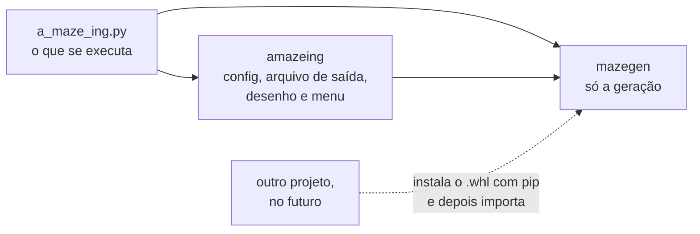

# Dois pacotes: `mazegen` e `amazeing`

O enunciado exige que o gerador de labirintos seja entregue também como um arquivo instalável
com `pip`, para outro projeto reutilizá-lo. Mas o programa tem partes que só fazem sentido aqui:
ler o `config.txt`, desenhar no terminal, o menu. Esta página mostra como o código se divide em
duas pastas para que só a parte reutilizável vá para esse arquivo.

## Pacote, importar e dependência

Três palavras que aparecem o tempo todo daqui em diante:

- Um **pacote** é uma pasta de arquivos `.py` com um arquivo chamado `__init__.py` dentro, que
  o Python importa pelo nome da pasta. A pasta `mazegen/` é o pacote `mazegen`. A
  [parte 3](../03-ambiente/07-pacotes-do-mazegen.md) mostra como criar um.
- **Importar** é trazer o código de outro arquivo para usar no arquivo atual. A linha
  `from mazegen import MazeGenerator` deixa usar a classe `MazeGenerator`, escrita em outro
  lugar.
- Quando o arquivo A importa o B, A **depende** de B: se B mudar de nome ou sumir, A quebra. Uma
  **dependência** é isso, um "eu preciso de você para funcionar".

## `mazegen`: o gerador reutilizável

Tudo o que é necessário para **gerar** um labirinto, e nada mais:

- as coordenadas `x,y` e os quatro lados de uma célula;
- a grade de paredes;
- os algoritmos que cavam o labirinto, que o transformam em tabuleiro Pac-Man e que acham o
  caminho mais curto;
- a classe `MazeGenerator`, que outro projeto usa.

Esse pacote vira o arquivo `mazegen-1.0.0-py3-none-any.whl` (um **wheel**: o formato de arquivo
que o `pip install` aceita, construído na [parte 9](../09-gerador/08-o-pacote.md)). O nome do
arquivo diz o que ele é:

| Pedaço do nome | Significado |
|---|---|
| `mazegen` | o nome do pacote |
| `1.0.0` | a versão |
| `py3` | a etiqueta diz só "Python 3"; a versão mínima, 3.10, fica registrada dentro do pacote ([parte 3](../03-ambiente/04-pyproject.md)) |
| `none` | não traz código compilado para uma versão específica do Python |
| `any` | serve em qualquer sistema: Linux, macOS ou Windows |

Quem instala esse arquivo ganha a geração, e só ela: nada de config, arquivo de saída ou
terminal. Por isso o `mazegen` segue três regras:

- só importa a **biblioteca padrão** do Python (os módulos que já vêm com ele, como `random`,
  `enum` e `dataclasses`), nada que precise ser instalado à parte;
- nunca importa nada de `amazeing` nem de `a_maze_ing.py`: o pacote instalado em outro projeto
  não leva esses arquivos junto, e o import quebraria;
- não lê nem grava arquivos, e não imprime nada: quem decide o que fazer com o labirinto é quem
  o usa.

## `amazeing`: a aplicação

Tudo o que é específico **deste programa**:

- ler e validar o `config.txt`;
- gravar o arquivo de saída;
- desenhar no terminal;
- o menu.

Esse pacote **não** vai para o wheel. Ele usa o `mazegen` do mesmo jeito que usaria uma
biblioteca instalada: só pelos imports.

## `a_maze_ing.py`: o ponto de entrada

Um arquivo pequeno na raiz do projeto: é ele que se executa, com
`python3 a_maze_ing.py config.txt`, como o enunciado manda. Ele confere se recebeu um argumento,
cria as peças dos dois pacotes, liga uma à outra e captura qualquer erro para imprimir uma
mensagem limpa, em vez do *traceback* (a listagem de erro que o Python imprime quando um erro não
é tratado).



Cada seta cheia quer dizer "importa". A seta tracejada mostra o caminho de um projeto de fora:
primeiro ele instala o arquivo do `mazegen` com `pip`, depois importa o `mazegen` como qualquer
outra biblioteca. Nenhuma seta sai do `mazegen`: ele não depende de ninguém.

## Por que os nomes diferentes

| Nome | De onde vem |
|---|---|
| `mazegen` | o enunciado exige que o arquivo do pacote se chame `mazegen-` seguido da versão, como `mazegen-1.0.0-py3-none-any.whl` |
| `amazeing` | escolha do projeto: o nome do projeto sem hífen; um nome de pacote não pode ter `-`, porque `import a-maze-ing` seria lido como a conta `a - maze - ing` |
| `a_maze_ing.py` | o nome do programa que o enunciado manda executar |

## O que o `mazegen` mostra para fora

Todo pacote tem um arquivo `__init__.py`, que o Python executa na primeira vez que alguém
importa o pacote (a [parte 3](../03-ambiente/07-pacotes-do-mazegen.md) cria esses arquivos).
Quando alguém escreve `import mazegen`, o Python executa o `mazegen/__init__.py`, e o que esse
arquivo importa fica disponível direto pelo nome do pacote. Ele importa só duas classes, com
estas duas linhas (o arquivo completo é escrito na
[parte 9](../09-gerador/05-documentacao-do-modulo.md)):

```python
from mazegen.errors import MazeError
from mazegen.generator import MazeGenerator
```

Por isso quem usa o pacote escreve só:

```python
from mazegen import MazeGenerator, MazeError
```

- `MazeGenerator`: a classe que gera o labirinto;
- `MazeError`: o tipo de erro que ela levanta (lança) quando recebe um parâmetro impossível,
  como uma largura 0. Levantar uma exceção (em inglês, *raise*) é interromper o código com um
  objeto de erro que quem chamou pode capturar com `try`/`except`.

As outras classes (`Maze`, `Cell`, `Direction`, os algoritmos) continuam dentro do pacote, mas
quem o reutiliza não precisa conhecê-las. Isso deixa livre mudar o miolo do gerador sem quebrar
os projetos que o usam.
