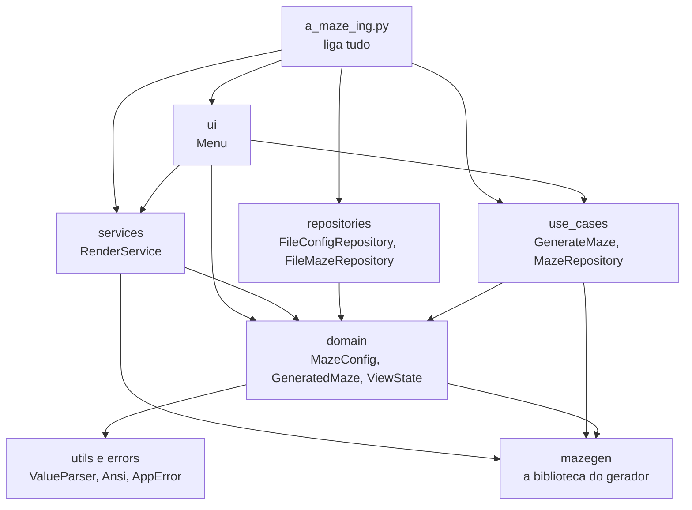
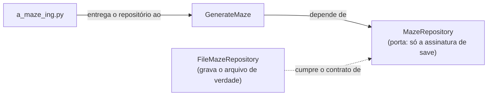

# A regra de dependência

## Quem pode importar quem

Uma camada só pode importar camadas **mais internas**, nunca as de fora. No diagrama, cada seta
quer dizer "importa":

| Módulo | Pode importar |
|---|---|
| `a_maze_ing` | tudo |
| `amazeing.ui` | `use_cases`, `services`, `domain`, `utils`, `errors` |
| `amazeing.services` | `domain`, `utils`, `errors`, `mazegen` |
| `amazeing.repositories` | `domain`, `utils`, `errors` |
| `amazeing.use_cases` | `domain`, `errors`, `mazegen` |
| `amazeing.domain` | `utils`, `errors`, `mazegen` |
| `amazeing.utils`, `amazeing.errors` | só a biblioteca padrão |
| `mazegen` | só a biblioteca padrão |

## Por que essa direção

O que está no centro muda pouco e não depende de detalhe nenhum: a regra "uma célula tem quatro
paredes" vale com ou sem terminal. O que está na borda muda mais: o formato de um arquivo, as
cores, o texto do menu.

Com as setas apontando para dentro, uma mudança na borda nunca obriga a mexer no centro.

## O caso do use case e do repositório

O use case `GenerateMaze` precisa **gravar** o arquivo, mas não pode importar o
`FileMazeRepository`, que está numa camada de fora. A solução:

1. o use case declara, numa **porta** (`ports.py`), o que precisa: "algo com um método
   `save(path, maze)`";
2. o repositório implementa esse método;
3. o `a_maze_ing.py` entrega o repositório concreto ao use case.

O use case só conhece a porta. Esse truque se chama **inversão de dependência**, e é construído
na parte 12.

## Como conferir

Basta ler os `import` do topo de cada arquivo. Um `import` que aponta para fora é um erro de
arquitetura.
