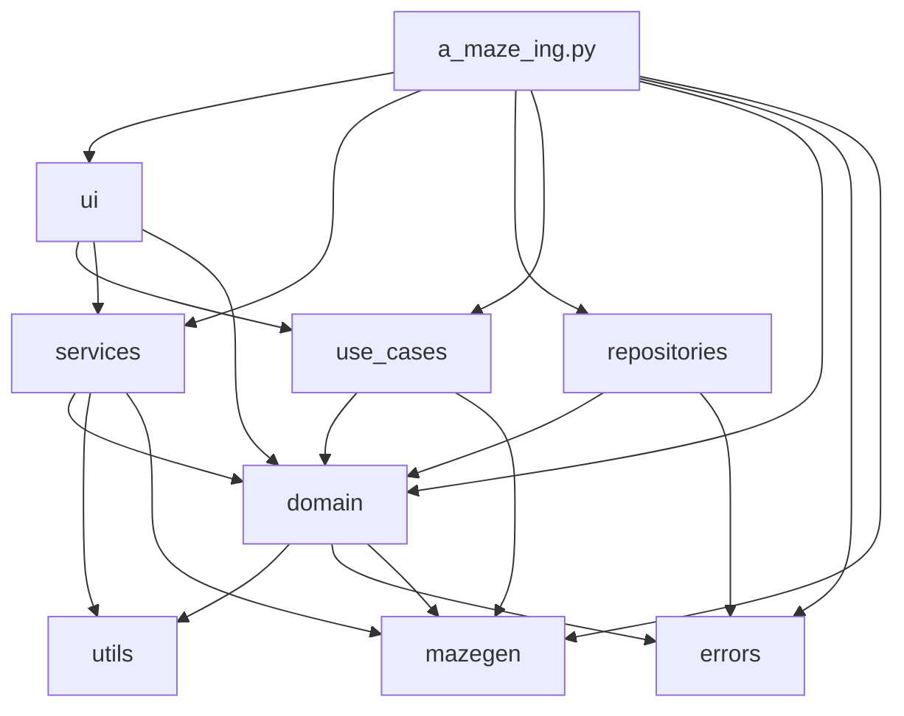

# A regra de dependência

Separar o código em camadas só ajuda se cada camada usar apenas as que estão mais para dentro:
se o gerador importasse o menu, ele voltaria a ficar preso ao programa. Esta página diz quem
pode importar quem. O único caso em que essa regra parece impossível de cumprir fica para a
[próxima página](./07-a-porta-e-a-inversao.md).

## Quem pode importar quem

Lembrando: uma **camada** é um grupo de classes com o mesmo tipo de trabalho, e cada uma mora
numa pasta. A tabela diz o que cada pasta guarda e de quais outras ela **pode** importar código;
dentro da própria camada, um arquivo sempre pode importar outro.

Três nomes da tabela só ganham página própria mais adiante; por enquanto, basta isto:

- um **use case** ("caso de uso") é uma operação completa do programa; aqui há uma só, gerar um
  labirinto e gravá-lo;
- um **repository** ("repositório") é uma classe que lê ou grava arquivos;
- uma **porta** é a descrição do que uma classe precisa de outra (os métodos e os tipos), sem
  dizer quem vai fornecer.
Os nomes das classes servem só para situar: o papel de cada uma é explicado com calma em
[Os papéis das classes](./04-papeis-das-classes.md), e cada classe é construída numa parte do tutorial.

| Pasta | O que guarda | Pode importar |
|---|---|---|
| `a_maze_ing.py` | o ponto de entrada, que cria e liga as peças | tudo |
| `amazeing/ui` | `Menu`: o menu, o único que lê o teclado; imprime o labirinto e o menu, e só ele e o `a_maze_ing.py` (que mostra a mensagem de erro final) imprimem | `use_cases`, `services`, `domain`, `utils`, `errors` |
| `amazeing/services` | `RenderService`: o desenho do labirinto em texto colorido | `domain`, `utils`, `errors`, `mazegen` |
| `amazeing/repositories` | `FileConfigRepository`, que lê o config, e `FileMazeRepository`, que grava o arquivo de saída | `domain`, `utils`, `errors` |
| `amazeing/use_cases` | `GenerateMaze`, a operação "gerar um labirinto e gravá-lo", e `MazeRepository`, a sua porta (explicada na [próxima página](./07-a-porta-e-a-inversao.md)) | `domain`, `errors`, `mazegen` |
| `amazeing/domain` | os dados do programa: `MazeConfig` (as opções lidas), `GeneratedMaze` (o labirinto pronto) e `ViewState` (o estado da tela) | `utils`, `errors`, `mazegen` |
| `amazeing/utils` | `ValueParser` (converte texto em número, booleano ou coordenada), `Ansi` (as cores do terminal) e `Box` (os caracteres de caixa que desenham as paredes) | só a biblioteca padrão |
| `amazeing/errors.py` | `AppError` e as suas variações: os tipos de erro da aplicação | só a biblioteca padrão |
| `mazegen` | o gerador reutilizável | só a biblioteca padrão (e os próprios módulos do `mazegen`) |

O diagrama mostra os imports que o código tem **de fato**. Cada seta quer dizer "importa", ou
seja, "usa código de":



Toda seta do diagrama está permitida na tabela. O contrário não vale: a tabela permite um pouco
mais do que o código usa. O `Menu`, por exemplo, poderia importar algo de `utils`, mas não
precisa. O que a tabela proíbe, nenhuma seta faz: só a seta do `a_maze_ing.py` aponta para
`ui`, nenhuma camada interna aponta para ela, e nenhuma seta sai de `mazegen`, `utils` ou
`errors`.

## A tabela e os anéis

A regra dos anéis da [primeira página desta parte](./01-por-que-camadas.md) diz que uma camada
só importa a si mesma e anéis mais para dentro. Ela é o **limite máximo**. A tabela é a regra
do projeto, mais restrita: ela também proíbe alguns imports para dentro que os anéis deixariam
passar, cada um por um motivo.

| Import que os anéis permitem e a tabela proíbe | Motivo |
|---|---|
| `ui` → `repositories` | a `ui` não abre arquivo: ela pede o labirinto ao use case `GenerateMaze`, e é ele que manda gravar |
| `ui` → `mazegen` | a `ui` não gera labirinto: recebe o labirinto pronto do use case, já como um objeto do `domain`, e o passa ao desenho |
| `services` → `use_cases` | o desenho só transforma um labirinto pronto em texto colorido; não lê, não grava e não gera |
| `repositories` → `use_cases` e `mazegen` | o repository só converte entre texto e os objetos do `domain` (as opções lidas, o labirinto pronto); ele encaixa na porta do use case sem importá-la, como mostra a [próxima página](./07-a-porta-e-a-inversao.md) |
| `use_cases` → `utils` | o use case só coordena (pede o labirinto ao gerador e manda gravar); converter texto ou escolher cor não é trabalho dele |
| `utils` e `errors` → `mazegen` | são peças de apoio da aplicação (conversão de texto, cores, caracteres de desenho, tipos de erro) que não precisam saber nada de labirinto |

Quanto menos uma camada importa, menos coisas a obrigam a mudar. Se uma dessas proibições
precisar ser quebrada, é sinal de que o código está na camada errada.

## Por que nessa direção

O que está no centro muda pouco e não depende de detalhe nenhum: a regra "uma célula tem quatro
paredes" vale com ou sem terminal. O que está na borda muda mais: o formato de um arquivo, as
cores, o texto do menu.

Com as setas sempre apontando para dentro, uma mudança na borda nunca obriga a mexer no centro.
Exemplo concreto: trocar o desenho no terminal por uma janela gráfica muda só `services` e `ui`.
O `mazegen` e o `domain` nem ficam sabendo.

## Como conferir

Basta ler os `import` do topo de cada arquivo e comparar com a tabela. Um `import` que aponta
para fora é um erro de arquitetura. Por exemplo, esta linha dentro de qualquer arquivo de
`mazegen/` estaria errada, porque o gerador passaria a depender do menu:

```python
from amazeing.ui.menu import Menu
```
