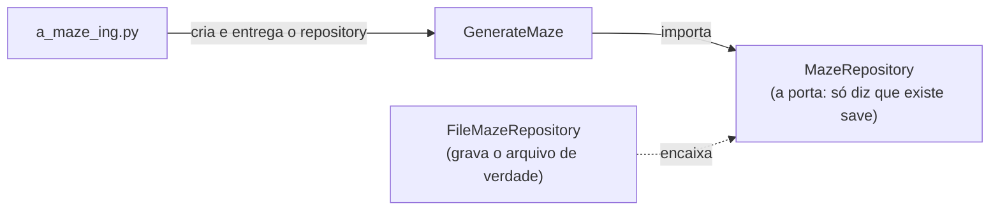

# A porta e a inversão de dependência

A [regra de dependência](./03-regra-de-dependencia.md) diz que uma camada só importa as que
estão mais para dentro. Há um caso em que isso parece impossível: uma camada de dentro precisa
usar algo que mora numa camada de fora. Esta página mostra o caso e a saída.

Duas palavras novas:

- **use case** ("caso de uso") é uma operação completa do programa, do jeito que o usuário a
  enxerga. Aqui há um só, o `GenerateMaze`: gerar um labirinto e gravá-lo no arquivo de saída.
- **repository** ("repositório") é a classe que lê ou grava arquivos. O `FileMazeRepository`
  grava o arquivo de saída.

O problema: o `GenerateMaze` precisa **gravar** o arquivo, ou seja, chamar o
`FileMazeRepository`. Mas `use_cases` fica mais para dentro que `repositories`, e importar algo
de fora quebra a regra.

A solução tem três passos:

1. O use case declara, num arquivo seu (`use_cases/ports.py`), **do que precisa**: "algo que
   tenha um método `save(path, maze)`". Essa declaração se chama **porta** (*port*). É como a
   tomada da parede: ela define o formato do encaixe, e qualquer aparelho com o plugue certo
   serve.
2. O `FileMazeRepository` tem um método `save(path, maze)` que grava o arquivo de verdade. Ele
   encaixa na porta, sem que o use case precise saber o nome dele.
3. O `a_maze_ing.py`, que pode importar tudo, cria o repository e o entrega ao use case na hora
   de criá-lo. É esta linha do `a_maze_ing.py`:

```python
        generate = GenerateMaze(generator, FileMazeRepository(), config)
```

`config` e `generator` vêm das linhas de cima do mesmo arquivo: `config` são as opções lidas do
`config.txt`, e `generator` é o `MazeGenerator` (o gerador) criado com essas opções. A linha cria
o use case entregando a ele três coisas: o gerador, um `FileMazeRepository` novo e as opções.



As setas cheias são imports. A tracejada não é: o `FileMazeRepository` não importa a porta, ele
só tem um método `save` com o mesmo nome e os mesmos parâmetros que ela descreve, e por isso
"encaixa" nela.

O `GenerateMaze` só importa a porta, que mora na mesma pasta que ele. Ao ser criado, ele guarda
o repository recebido num atributo, `self._repository` (o `_` no começo do nome quer dizer "uso
interno"). Quando ele chama `self._repository.save(...)`, quem executa é o `FileMazeRepository`,
mas o código do use case nunca escreve esse nome.

Como o Python aceita isso sem import nem herança? Na hora da chamada, o Python só confere se o
objeto tem um método `save`; ele não pergunta a classe. A conferência mais rigorosa fica com o
mypy (o verificador de tipos do projeto): antes de o programa rodar, ele compara os métodos do
`FileMazeRepository` com os da porta e acusa erro se não encaixarem.

Esse truque se chama **inversão de dependência**: em vez de o centro depender da borda, a borda
se adapta a uma descrição que o centro escreveu. A porta é construída na
[parte 12](../12-geracao-e-saida/03-a-porta-maze-repository.md).
