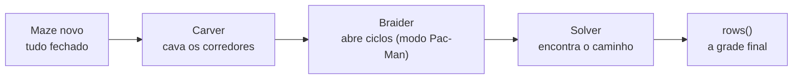

# A grade de paredes

## O que é

O `Maze`, em `mazegen/entities/maze.py`, é o labirinto **em construção**: uma grade com as
paredes de cada célula. Os algoritmos das próximas partes recebem um `Maze` e trabalham sobre
ele:



É a única **entidade** do gerador: o único objeto cujo estado muda. Por isso ele protege as
regras da grade (coerência, borda fechada, "42" fechado) por conta própria: nenhum algoritmo
consegue quebrá-las, nem por engano.

## Tudo começa fechado

```python
ALL_WALLS = 15
```

`15` é `0b1111`: as quatro paredes fechadas. Toda célula nasce assim, e gerar o labirinto é
**abrir** paredes. Começar fechado tem uma vantagem: a borda e o "42" já nascem certos, e
continuam certos simplesmente porque ninguém tem permissão de abri-los.

## O construtor

```python
    def __init__(self, width: int, height: int, pattern: Pattern42) -> None:
        self.width = width
        self.height = height
        self.pattern = pattern
        self._walls: list[list[int]] = [
            [ALL_WALLS] * width for _ in range(height)
        ]
```

- `width`, `height` e `pattern` ficam públicos: os algoritmos leem o tamanho e o padrão.
- `_walls` é a grade: uma lista por linha, cada uma com `width` inteiros. `_walls[y][x]` são as
  paredes da célula `(x, y)`, na mesma ordem do arquivo de saída (linha por linha).
- O `Maze` recebe o `Pattern42` pronto, em vez de calculá-lo. Quem cria o `Maze` (o
  `MazeGenerator`, parte 9) já calculou o padrão para validar a entrada e a saída, e o mesmo
  objeto serve aos dois.


### O `_` de `_walls`

O sublinhado diz "interno". Os algoritmos não escrevem em `_walls` diretamente: leem com
`walls(cell)` e mudam com `open_wall` e `close_wall`, os únicos métodos que alteram a grade. É
assim que a classe garante as regras: todo caminho de mudança passa por código que as confere.

### Uma lista nova por linha

A forma curta `[[ALL_WALLS] * width] * height` parece igual, mas está errada: o `* height`
repete **a mesma lista** `height` vezes. Mudar uma linha muda todas:

```python
rows = [[15] * 3] * 2
rows[0][0] = 13
print(rows)
rows = [[15] * 3 for _ in range(2)]
rows[0][0] = 13
print(rows)
```

```text
[[13, 15, 15], [13, 15, 15]]
[[13, 15, 15], [15, 15, 15]]
```

A compreensão `for _ in range(height)` cria uma lista nova a cada volta. Dentro de uma linha,
`[ALL_WALLS] * width` não tem esse problema: os elementos são inteiros, e um inteiro não muda,
só é trocado por outro.

## O que vem

| Página | Métodos |
|---|---|
| [Consultar a grade](./02-consultar-a-grade.md) | `__contains__`, `cells`, `walls` |
| [Vizinhos: a borda e o "42"](./03-vizinhos.md) | `neighbour`, `is_open` |
| [Abrir e fechar paredes](./04-abrir-e-fechar.md) | `open_wall`, `close_wall`, `_other_side` |
| [Passagens e becos](./05-passagens-e-becos.md) | `passages`, `closed_sides`, `dead_ends` |
| [Contar ciclos](./06-contar-ciclos.md) | `loop_count` |
| [Áreas abertas 3x3](./07-areas-abertas-3x3.md) | `has_open_3x3`, `_window_open` |
| [A cópia da grade](./08-a-copia-da-grade.md) | `rows` e o arquivo completo |
