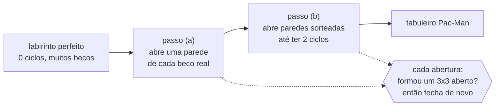

# Becos reais e becos cercados

No modo Pac-Man (`PERFECT=False`), o enunciado pede um labirinto que funcione como tabuleiro do
jogo: quem foge dos fantasmas sempre precisa ter outra rota e quase nunca pode ficar encurralado.
O labirinto perfeito que o `Carver` acabou de cavar
([parte 6](../06-carver/01-labirinto-perfeito.md)) é o oposto disso: nenhuma rota alternativa e
dezenas de becos. A classe `Braider` resolve isso abrindo paredes extras. Esta página mostra as
regras que ela precisa cumprir e quais becos dá para abrir.

O enunciado chama o modo Pac-Man de "padrão" (o que vale quando o modo perfeito não é pedido). No
arquivo de configuração, porém, a chave `PERFECT` é obrigatória e precisa estar escrita; o
"padrão" só vale ao pé da letra no `MazeGenerator`, onde `perfect=False` é o valor usado quando o
parâmetro não é passado ([parte 9](../09-gerador/10-construtor-e-atributos.md)).

## As regras do tabuleiro

O que o enunciado exige do modo Pac-Man, e que depende do `Braider`
([parte 1](../01-o-problema/05-perfeito-e-pac-man.md)):

| Regra do enunciado | Em números |
|---|---|
| pelo menos **duas rotas independentes**: dois ciclos, dois jeitos diferentes de dar a volta | pelo menos 2 ciclos |
| becos sem saída raros: "um ou dois são tolerados" | no máximo 2 becos; zero vale ponto de **bônus** (item opcional que dá nota extra) |
| nenhuma área aberta grande: nenhum bloco de 3x3 células sem parede por dentro | nenhum bloco 3x3 aberto |

O labirinto perfeito tem 0 ciclos e dezenas de becos. O trabalho do `Braider` é abrir paredes até
cumprir as duas primeiras regras, sem nunca quebrar a terceira.

## O que é um beco

Um **beco sem saída** é uma célula com exatamente **uma** passagem (um lado aberto): quem entra por
ali só consegue sair por onde entrou. Os outros três lados são paredes.

Desfazer um beco é simples: basta derrubar mais uma das paredes dele. A célula passa a ter duas
passagens e deixa de ser beco. Mas nem toda parede pode ser derrubada:

- uma parede da **borda** da grade nunca abre: o enunciado exige a volta toda do labirinto
  fechada;
- uma parede que dá para uma célula do **"42"** nunca abre: as células do "42" ficam com as quatro
  paredes fechadas ([parte 1](../01-o-problema/06-o-padrao-42.md)).

Isso separa os becos em dois tipos:

- **beco real**: pelo menos uma parede fechada dá para uma célula **livre** (dentro da grade e
  fora do "42"). Essa parede pode ser derrubada;
- **beco cercado**: todas as paredes fechadas dão para a borda ou para o "42". Nenhuma pode ser
  derrubada, e o beco fica para sempre.

As cores seguem as da [parte 5](../05-maze/05-passagens-e-becos.md): **laranja** é beco real e
**amarelo** é beco cercado. Linhas cheias são paredes fechadas; linhas tracejadas são passagens
(lados abertos). À esquerda, a célula laranja tem três paredes: a de cima e a da esquerda são da
borda, mas a de baixo (verde) dá para uma célula livre, então o beco é real. À direita, a célula
amarela tem o "42" (cinza) em três lados, com as paredes em vermelho, e a única vizinha livre é
justamente a da passagem: o beco é cercado.

Num labirinto perfeito de 9 colunas por 7 linhas (semente 1), em laranja os becos reais, em
amarelo os cercados e em cinza o "42":

## Os dois becos cercados pelo "42"

Os becos cercados em amarelo não são acaso. O desenho do "42" deixa duas células comuns dentro das
curvas do "2" (na coluna 5 do desenho, linhas 1 e 3), cada uma com o "42" em três lados
([parte 1](../01-o-problema/06-o-padrao-42.md)). Toda geração com "42", em qualquer tamanho, tem
esses dois becos cercados.

Se eles contassem, nenhum tabuleiro com "42" chegaria ao bônus de zero becos. Por isso a regra
conta só os becos **reais**. É também o que faz o `maze_analyzer.py`, o programa de conferência
que vem com o enunciado: ele não conta os becos causados pelo "42".

## Quem sabe a diferença é o `Maze`

O `Maze`, a classe que guarda as paredes da grade
([parte 5](../05-maze/05-passagens-e-becos.md)), já tem tudo o que o `Braider` precisa:

| Método do `Maze` | Devolve |
|---|---|
| `passages(cell)` | os lados abertos da célula |
| `closed_sides(cell)` | os lados fechados que dão para uma célula livre: as paredes que **podem** abrir |
| `dead_ends()` | os becos reais: células com uma passagem e `closed_sides` não vazio |
| `loop_count()` | o número de ciclos independentes ([página 3](./03-criar-ciclos.md)) |
| `has_open_3x3()` | se algum bloco 3x3 está todo aberto ([página 4](./04-a-regra-do-3x3.md)) |

`closed_sides` é o que separa os dois tipos: num beco cercado, a lista sai vazia. Por isso os becos
cercados nem aparecem em `dead_ends()`, e o `Braider` nunca tenta abri-los.

## O plano: trançar

A técnica se chama **braiding**, "trançar" em inglês: como numa trança de cabelo, os ramos
separados do labirinto perfeito passam a se cruzar e a formar voltas. São dois passos, e toda
abertura passa pela regra do 3x3:

O passo (a) está na [página 2](./02-abrir-os-becos.md), o passo (b) na
[página 3](./03-criar-ciclos.md) e a regra do 3x3 na [página 4](./04-a-regra-do-3x3.md).
