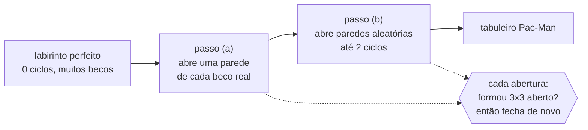

# Becos reais e becos cercados

O `Braider` transforma o labirinto perfeito do `Carver` num **tabuleiro Pac-Man**. As regras,
vistas na parte 1:

| Regra | Valor |
|---|---|
| ciclos (rotas independentes) | pelo menos 2 |
| becos sem saída reais | no máximo 2 (zero é o bônus) |
| áreas abertas | nenhum bloco 3x3 aberto |

O labirinto perfeito está longe disso: tem 0 ciclos e dezenas de becos. O trabalho do `Braider`
é abrir paredes até cumprir as duas primeiras regras, sem nunca quebrar a terceira.

## O que é um beco

Um **beco sem saída** é uma célula com exatamente **uma** passagem: entra-se nela por um lado e
só dá para voltar por onde veio.

Nem todo beco pode ser desfeito. Para eliminar um beco é preciso abrir uma das paredes fechadas
dele, e isso só é possível se do outro lado houver uma célula livre:

- **beco real**: ao menos uma parede fechada dá para uma célula dentro da grade e fora do "42".
  Dá para abrir;
- **beco cercado**: todas as paredes fechadas dão para a borda ou para o "42". Nenhuma pode ser
  aberta, porque a borda e o "42" ficam sempre fechados.

Num labirinto perfeito 9x7 (`seed=1`), em amarelo os becos reais e em laranja os cercados:

## Os dois becos do "42"

Os becos cercados em laranja não são acaso. Dentro do bloco 7x5 do "42", as células `.` da coluna
5 nas linhas 1 e 3 (a partir do canto do bloco) têm "42" em três lados. A única vizinha livre
fica do outro lado, e ela é a única passagem possível. Toda geração, em qualquer tamanho com
"42", tem esses dois becos cercados.

Se eles contassem, nenhum tabuleiro com "42" chegaria ao bônus de zero becos. Por isso a regra
conta só os becos **reais**, do mesmo jeito que o `maze_analyzer.py` entregue com o subject.

## Quem sabe a diferença é o `Maze`

A parte 5 deixou pronto o que o `Braider` precisa:

| Método do `Maze` | Devolve |
|---|---|
| `passages(cell)` | os lados abertos da célula |
| `closed_sides(cell)` | os lados fechados que dão para uma célula livre |
| `dead_ends()` | as células com uma passagem e `closed_sides` não vazio: só os becos reais |
| `loop_count()` | o número de ciclos independentes |
| `has_open_3x3()` | se alguma janela 3x3 está toda aberta |

`closed_sides` é o que separa os dois tipos: num beco cercado, a lista é vazia. Os becos cercados
nem aparecem em `dead_ends()`, então o `Braider` nunca tenta abri-los.

## O plano: trançar

O nome da técnica é **braiding** ("trançar"): pegar uma árvore e entrelaçar os ramos, abrindo
paredes. São dois passos, e toda abertura passa pela regra do 3x3:

As próximas páginas constroem cada passo.
