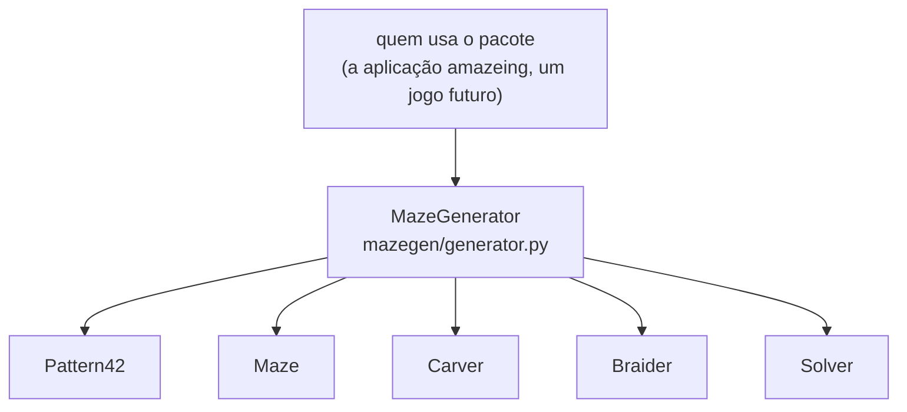

# A fachada MazeGenerator

## Uma classe para o mundo de fora

O capítulo VI do subject pede que a geração seja "uma **classe única** dentro de um **módulo
independente** que possa ser importado em um projeto futuro". Até aqui o `mazegen` tem sete
classes: `Direction`, `Cell`, `Pattern42`, `Maze`, `Carver`, `Solver` e `Braider`. Quem reutiliza
o pacote não deveria precisar conhecer nenhuma delas.

O `MazeGenerator` é uma **fachada**: a única porta de entrada. Ele recebe parâmetros simples
(inteiros, tuplas, `bool`), coordena as peças internas e devolve o resultado em tipos simples.



Do lado de fora, uma célula é sempre uma `tuple[int, int]` e as paredes são inteiros de 0 a 15.
`Cell`, `Direction` e `Maze` ficam do lado de dentro: o gerador converte na chegada (os
parâmetros `entry` e `exit`) e na saída (`grid`, `solution`, `pattern`).

## As constantes

```python
MIN_SIZE = 1
MAX_SIZE = 100
MAX_ATTEMPTS = 20
```

- `MIN_SIZE` e `MAX_SIZE`: os limites de `width` e `height`, os mesmos do arquivo de
  configuração.
- `MAX_ATTEMPTS`: quantas vezes o modo Pac-Man tenta antes de desistir ([página 3](./03-generate.md)).

## A assinatura

```python
    def __init__(self, width: int, height: int,
                 entry: tuple[int, int] = (0, 0),
                 exit: tuple[int, int] | None = None, perfect: bool = False,
                 seed: int | None = None) -> None:
```

| Parâmetro | Padrão | Significado |
|---|---|---|
| `width`, `height` | obrigatórios | colunas e linhas, de 1 a 100 |
| `entry` | `(0, 0)` | célula de entrada, `(x, y)` |
| `exit` | `None` | célula de saída; `None` é o canto de baixo à direita |
| `perfect` | `False` | `True` para labirinto perfeito, `False` para Pac-Man (o padrão do subject) |
| `seed` | `None` | seed do sorteio; `None` sorteia um labirinto diferente a cada execução |

O padrão de `exit` não pode ser uma tupla fixa: o canto de baixo à direita depende de `width` e
`height`. `None` quer dizer "calcule a partir do tamanho".

`exit` também é o nome de uma função embutida do Python. Como parâmetro, ele só esconde essa
função dentro do construtor, que não a usa; o nome acompanha o vocabulário do subject
(`ENTRY`, `EXIT`).

## Os atributos públicos

| Atributo | Antes de `generate()` | Depois |
|---|---|---|
| `grid` | `[]` | `height` listas de `width` inteiros; `grid[y][x]` são as paredes de `(x, y)` |
| `solution` | `""` | o caminho mais curto em letras `N`, `E`, `S`, `W` |
| `pattern` | as células `(x, y)` do "42" | as mesmas |

`pattern` já existe desde o construtor porque só depende do tamanho. A aplicação o usa para pintar
o "42" de cinza e para avisar quando ele não coube.

`grid` usa os mesmos bits do arquivo de saída. O subject permite outro formato ("não
necessariamente no mesmo formato do arquivo de saída"), mas com os mesmos bits a aplicação grava
o arquivo sem conversão nenhuma.
