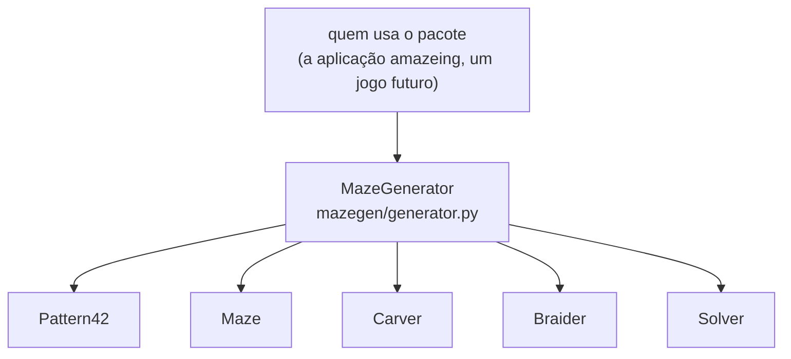

# A fachada MazeGenerator

O enunciado quer que o gerador de labirintos seja reaproveitado num projeto futuro. Para
isso, ele exige que a geração seja "uma **classe única** dentro de um **módulo independente** que
possa ser importado em um projeto futuro". Até aqui o pacote `mazegen` tem sete classes, fora a
exceção `MazeError`, e quem for reutilizá-lo não deveria precisar conhecer nenhuma delas. Esta
página apresenta a classe que resolve isso, o `MazeGenerator`, e o papel dela.

## O problema: sete classes para entender

As peças construídas até agora:

| Classe | O que faz | Onde |
|---|---|---|
| `Direction` | os quatro lados de uma célula | [parte 4](../04-value-objects/02-direction-bits.md) |
| `Cell` | a posição `x,y` de uma célula | [parte 4](../04-value-objects/04-cell.md) |
| `Pattern42` | as células do "42" | [parte 4](../04-value-objects/05-pattern42-posicao.md) |
| `Maze` | a grade de paredes | [parte 5](../05-maze/01-a-grade-de-paredes.md) |
| `Carver` | cava o labirinto perfeito | [parte 6](../06-carver/01-labirinto-perfeito.md) |
| `Solver` | acha o caminho mais curto | [parte 7](../07-solver/01-busca-em-largura.md) |
| `Braider` | transforma o perfeito em tabuleiro Pac-Man | [parte 8](../08-braider/01-becos-sem-saida.md) |

Para gerar um labirinto com elas, é preciso saber a ordem certa: criar o `Pattern42`, criar o
`Maze`, chamar o `Carver`, talvez o `Braider`, depois o `Solver`, e ainda converter `Cell` em
coordenadas comuns. Isso é detalhe interno, e quem reutiliza o pacote não deveria ter de aprender.

## A solução: uma fachada

Uma **fachada** é uma classe que fica na frente de várias outras e oferece um jeito simples de
usá-las. Funciona como a recepção de um hotel: o hóspede pede tudo à recepção, e a recepção
aciona a limpeza, a cozinha e a manutenção. O hóspede nunca precisa saber quem faz o quê.

O `MazeGenerator` é a fachada do `mazegen`: a única porta de entrada. Ele recebe parâmetros
simples (números inteiros, pares de números, `True`/`False`), aciona as peças internas na ordem
certa e devolve o resultado também em tipos simples.

Do lado de fora, uma célula é sempre uma tupla `(x, y)` de dois inteiros, e as paredes de uma
célula são um inteiro de 0 a 15, como no arquivo de saída
([parte 1](../01-o-problema/02-paredes-em-bits.md)). `Cell`, `Direction` e `Maze` ficam do lado de
dentro: o gerador converte as tuplas em `Cell` na chegada (os parâmetros `entry` e `exit`) e
converte de volta na saída (os atributos `grid`, `solution` e `pattern`).

O enunciado diz "módulo". Em Python, um **módulo** é um arquivo `.py`, e um **pacote** é uma
pasta de módulos com um `__init__.py` ([parte 3](../03-ambiente/07-pacotes-do-mazegen.md)). O
`mazegen` é um pacote, e isso cumpre a ideia do enunciado: o que se importa é uma peça só, o
`mazegen`, com o `MazeGenerator` dentro.

"Independente" quer dizer que o `mazegen` não depende de nada do resto do projeto: ele não
importa nada da aplicação `amazeing` (que lê o arquivo de configuração, grava o arquivo de saída e
desenha na tela), só a biblioteca padrão do Python ([parte 2](../02-arquitetura/02-dois-pacotes.md)).
Por isso pode ser copiado para outro projeto sozinho.

O enunciado fala em "classe única". Este projeto entende assim: uma única classe **pública** de
geração, o `MazeGenerator`, mais a exceção `MazeError` para os erros; as classes auxiliares
internas são permitidas. Pôr todo o código numa classe só também cumpriria a regra, mas a deixaria
enorme e difícil de ler; essa leitura da regra é escolha do projeto.

A [próxima página](./10-construtor-e-atributos.md) mostra o que o `MazeGenerator` recebe ao ser
criado e onde ele entrega o resultado.
