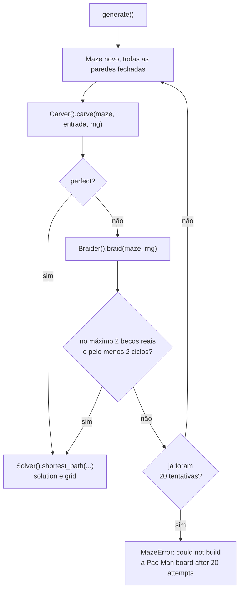

# generate() e as tentativas

Com os parâmetros conferidos pelo construtor, falta gerar o labirinto. O método `generate()`
aciona as três peças das partes anteriores na ordem certa: cava o labirinto perfeito com o
`Carver`, trança com o `Braider` (só no modo Pac-Man) e acha o caminho mais curto com o `Solver`.
Cada chamada constrói um labirinto **novo** e preenche os atributos `grid` e `solution`. Esta
página mostra o laço que faz isso e o que acontece quando o tabuleiro sai ruim.


Nos três quadros, magenta é a entrada, vermelho é a saída e cinza é o "42". No segundo, as
paredes em verde são as que o `Braider` abriu; no terceiro, a faixa ciano é o caminho mais curto.

## O laço de tentativas

O `Braider` não garante o resultado ([parte 8](../08-braider/05-o-codigo-do-braider.md)): em casos
raros, sobra beco demais ou falta ciclo. Em vez de complicar o `Braider`, o gerador confere o
tabuleiro e, se ele não serve, joga fora e começa outro, até um limite de tentativas:



```python
        for _ in range(MAX_ATTEMPTS):
            maze = Maze(self._width, self._height, self._pattern42)
            Carver().carve(maze, self._entry, self._rng)
            if self._perfect:
                break
            Braider().braid(maze, self._rng)
            if (len(maze.dead_ends()) <= MAX_DEAD_ENDS
                    and maze.loop_count() >= MIN_LOOPS):
                break
        else:
            raise MazeError("could not build a Pac-Man board after "
                            f"{MAX_ATTEMPTS} attempts")
```

- `for _ in range(MAX_ATTEMPTS)` repete até 20 vezes. O nome `_` é a convenção do Python para
  "variável que não vou usar": só importa quantas voltas o laço dá.
- Cada tentativa cria um `Maze` **novo**, com todas as paredes fechadas: a grade que falhou é
  jogada fora inteira, não remendada.
- `Carver().carve(...)` cria um `Carver` e já chama o método. Como os services não guardam nada,
  criar um novo a cada vez não custa nada e não muda o resultado.
- No modo perfeito, o `break` sai na primeira volta: uma árvore nunca falha.
- No modo Pac-Man, depois de trançar, o gerador confere as duas regras do enunciado: no máximo
  `MAX_DEAD_ENDS` (2) becos reais e pelo menos `MIN_LOOPS` (2) ciclos. Os dois números vêm do
  módulo do `Braider` ([parte 8](../08-braider/03-criar-ciclos.md)), então a regra conferida é a
  mesma que o `Braider` usa. Se as duas valem, `break`.
- Os parênteses em volta da condição deixam quebrá-la em duas linhas.

## O `else` do `for`

Em Python, um `for` pode ter um `else`. O bloco do `else` roda quando o laço termina **sem**
passar por um `break`: aqui, quando as 20 voltas acabaram e nenhuma deu um tabuleiro bom. É
exatamente o caso "todas as tentativas falharam", e ele levanta um `MazeError`.

Sem o `else`, seria preciso uma variável de controle: `ok = False` antes do laço, `ok = True`
antes de cada `break` e `if not ok:` depois do laço.

Na prática, o modo Pac-Man sai na primeira tentativa: com entrada `0,0`, em todo tamanho de 1 a 30
que comporta um tabuleiro Pac-Man e com as sementes de 0 a 19, nenhuma geração precisou de uma
segunda. O limite de 20 existe para o laço nunca rodar para sempre; o número 20 é escolha do
projeto.

## O mesmo sorteador em tudo

O `_rng` criado no construtor é o mesmo em todas as tentativas e em todas as chamadas a
`generate()`. Ele nunca é recriado. Isso tem três consequências:

- com semente, a sequência inteira se repete: a primeira chamada dá sempre o mesmo labirinto, a
  segunda sempre o mesmo segundo labirinto, e assim por diante;
- é isso que faz a opção "1. Re-generate" do menu, que gera outro labirinto
  ([parte 14](../14-menu-e-main/01-o-laco-do-menu.md)), repetir a mesma sequência de labirintos em
  duas execuções com a mesma `SEED`;
- se o gerador recriasse `random.Random(seed)` a cada chamada, a sequência recomeçaria do zero, e
  o "Re-generate" devolveria sempre o mesmo labirinto.
