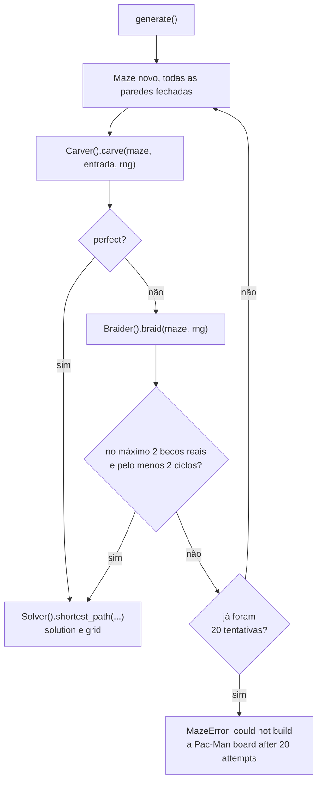

# generate() e as tentativas

`generate()` junta as três peças das partes 6, 7 e 8: escava, trança (no modo Pac-Man) e
resolve. Cada chamada constrói um labirinto novo e preenche `grid` e `solution`.


## O laço de tentativas

O `Braider` não garante o resultado (parte 8): em casos raros, sobra beco demais ou falta ciclo.
Em vez de complicar o `Braider`, o gerador confere o tabuleiro e, se não serviu, descarta e
começa outro.



```python
        for _ in range(MAX_ATTEMPTS):
            maze = Maze(self._width, self._height, self._pattern42)
            Carver().carve(maze, self._entry, self._rng)
            if self._perfect:
                break
            Braider().braid(maze, self._rng)
            if (len(maze.dead_ends()) <= MAX_DEAD_ENDS
                    and maze.loop_count() >= MIN_LOOPS):
                break
        else:
            raise MazeError("could not build a Pac-Man board after "
                            f"{MAX_ATTEMPTS} attempts")
```

- Cada tentativa cria um `Maze` **novo**: a grade que falhou é jogada fora inteira, não
  remendada.
- O modo perfeito sai na primeira volta: uma árvore nunca falha.
- `MAX_DEAD_ENDS` e `MIN_LOOPS` vêm do módulo do `Braider`: a regra é a mesma que ele usa.

## O `else` do `for`

Em Python, um `for` pode ter `else`. O bloco do `else` roda quando o laço termina **sem**
`break`, ou seja, quando as 20 voltas acabaram e nenhuma saiu pelo `break`. É exatamente o caso
"todas as tentativas falharam". Sem o `else`, seria preciso uma variável de controle:
`ok = False` antes do laço, `ok = True` antes do `break` e `if not ok:` depois.

Na prática, o modo Pac-Man sai na primeira tentativa: com entrada `(0, 0)`, todo tamanho de 1 a
30 que comporta um tabuleiro Pac-Man e seeds de 0 a 19, nenhuma geração precisou de uma
segunda. O limite de 20 existe para o laço nunca rodar para sempre.

## O mesmo `rng` em tudo

O `_rng` criado no construtor é o mesmo em todas as tentativas e em todas as chamadas a
`generate()`. Ele nunca é recriado:

- com seed, a sequência inteira se repete: a primeira chamada dá sempre o mesmo labirinto, a
  segunda sempre o mesmo segundo labirinto, e assim por diante;
- é isso que faz a opção "1. Re-generate" do menu (parte 14) repetir a mesma sequência de
  labirintos em duas execuções com a mesma `SEED`;
- recriar `random.Random(seed)` a cada chamada faria o "re-generate" devolver sempre o mesmo
  labirinto.
