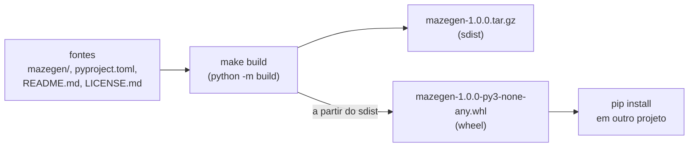

# make build: o wheel e o sdist

Para outro projeto usar o gerador, não basta copiar a pasta `mazegen/` à mão: o enunciado quer que
ele seja distribuído como um **pacote Python**, um arquivo único que se instala com o comando
`pip install`. Esta página mostra como gerar esse arquivo com `make build`, o que vai dentro dele
e como conferir que ele funciona instalado longe do código-fonte.

## O que o enunciado pede

- todo o módulo reutilizável, código e documentação, num **único arquivo** que o `pip` (o
  instalador de pacotes do Python) consiga instalar;
- o nome do arquivo começa com `mazegen-`, e ele fica na **raiz** do repositório;
- são aceitas as extensões `.whl` e `.tar.gz`, "conforme geradas pelo build padrão de um pacote
  Python";
- o repositório tem tudo o que é preciso para **reconstruir** o pacote: na avaliação, o avaliador
  cria um ambiente virtual, instala as ferramentas e refaz o pacote a partir dos fontes.

## O caminho do código até a instalação



O `make build` gera os dois arquivos: primeiro o sdist e depois, a partir dele, o wheel. O wheel
é o que se leva para o outro projeto e se instala com `pip`.

## Dois formatos

O empacotamento padrão do Python gera dois arquivos:

| Arquivo | O que é |
|---|---|
| `mazegen-1.0.0.tar.gz` | o **sdist** (*source distribution*, "distribuição dos fontes"): um arquivo compactado com os fontes e as instruções de empacotamento. O `pip` monta o pacote na hora de instalar |
| `mazegen-1.0.0-py3-none-any.whl` | o **wheel** ("roda", em inglês): um arquivo zip já pronto para instalar, sem passo de montagem. É o formato preferido do `pip` |

O nome do wheel diz onde ele funciona: `py3` (qualquer Python 3), `none` (nenhum código compilado
em C dentro), `any` (qualquer sistema operacional). O `mazegen` é Python puro e só usa a
biblioteca padrão, então funciona em qualquer lugar. O `1.0.0` é a versão, declarada no
`pyproject.toml`.

O enunciado aceita um ou outro; este projeto entrega os dois (escolha do projeto), porque o
empacotamento já gera os dois de uma vez.

## A regra `build`

O `Makefile` é o arquivo de atalhos do projeto: cada **regra** é um nome seguido dos comandos que
`make <nome>` roda. A regra `build` já está no `Makefile` desde a
[parte 3](../03-ambiente/09-makefile-empacotar.md); não a acrescente de novo (uma regra repetida
faz o `make` avisar `overriding recipe for target 'build'`). Relembrando o que ela faz:

```makefile
build:
	rm -rf dist
	$(PY) -m build
	cp dist/mazegen-*.whl dist/mazegen-*.tar.gz .
```

`$(PY)` é uma variável do `Makefile` que vale `.venv/bin/python`, o Python do ambiente virtual do
projeto ([parte 3](../03-ambiente/01-o-ambiente-virtual.md)). Os três comandos:

1. `rm -rf dist` apaga a pasta `dist/` (e tudo dentro), para o `cp` copiar só a versão recém-gerada;
2. `$(PY) -m build` roda a ferramenta padrão de empacotamento, `build`, instalada no `.venv` pelo
   `make install`. Ela lê o `pyproject.toml` e grava os dois arquivos em `dist/`;
3. `cp ... .` copia os dois arquivos para a raiz do repositório (o `.` no fim é a pasta atual). O
   `*` em `mazegen-*.whl` casa com qualquer texto, então o comando funciona com qualquer versão.

Com o `README.md` e o `LICENSE.md` no lugar ([página 8](./07-um-readme-inicial.md)):

```bash
make build
```

O começo e o fim da saída:

```text
rm -rf dist
.venv/bin/python -m build
* Creating isolated environment: venv+pip...
* Installing packages in isolated environment:
  - setuptools>=77
...
Successfully built mazegen-1.0.0.tar.gz and mazegen-1.0.0-py3-none-any.whl
cp dist/mazegen-*.whl dist/mazegen-*.tar.gz .
```

O `build` cria um ambiente isolado só para empacotar, instala nele o `setuptools` (a biblioteca
que de fato monta o pacote, pedida na seção `[build-system]` do `pyproject.toml`; por isso precisa
de internet) e gera primeiro o sdist, depois o wheel a partir dele. Nenhuma linha da saída contém
`warning`.

O pacote está pronto. A [próxima página](./09-instalar-o-pacote.md) confere o que foi para dentro
dele e o instala num ambiente novo, longe do código-fonte, para conferir que ele funciona sozinho.
