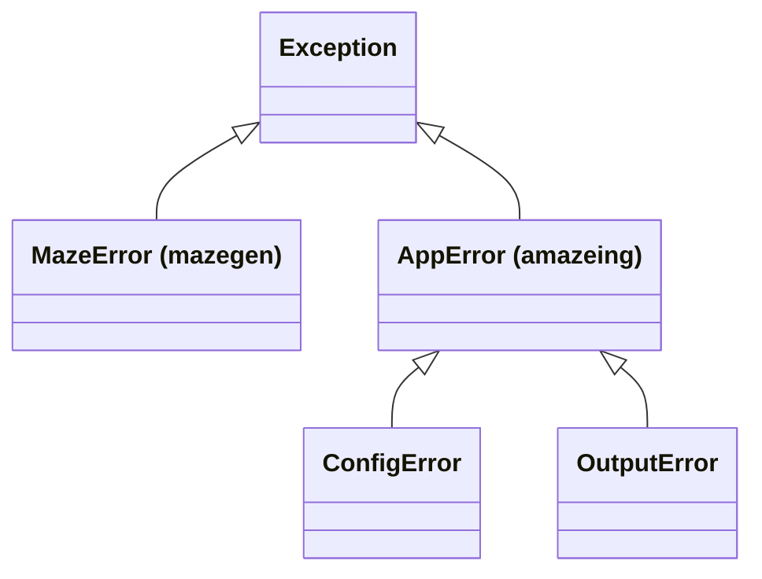

# As exceções da aplicação

A primeira peça do pacote `amazeing` é o arquivo `amazeing/errors.py`, com as três exceções que a
aplicação levanta quando algo dá errado do lado do usuário: um config ruim ou um arquivo de saída
que não pode ser gravado.

## A regra de todo erro

Todo erro do programa termina do mesmo jeito: uma linha em stderr, começando com `Error: `, e
código de saída 1. Quem imprime essa linha é o `a_maze_ing.py` (parte 14), num único lugar:

```python
except (AppError, MazeError) as error:
    print(f"Error: {error}", file=sys.stderr)
    return EXIT_ERROR
```

Para isso funcionar, a **mensagem** da exceção já tem de ser a frase final, pronta para o usuário
ler depois de `Error: `. Quem levanta o erro é quem sabe o que deu errado, então é ele quem monta a
frase:

```text
Error: config.txt: WIDTH must be an integer, got 'abc'
Error: cannot write output file 'nao_existe/maze.txt': No such file or directory
```

## Por que uma hierarquia



| Exceção | Quem levanta | Quando |
|---|---|---|
| `ConfigError` | `MazeConfig`, `FileConfigRepository` | config inexistente, ilegível ou com valor inválido |
| `OutputError` | `FileMazeRepository` | o `OUTPUT_FILE` não pode ser gravado |
| `AppError` | ninguém diretamente | é a base das duas |

O `main` não quer saber **qual** erro da aplicação aconteceu: quer só imprimir a mensagem e sair
com 1. Com uma classe base, ele captura `AppError` uma vez e pega as duas filhas. Se um dia surgir
um terceiro tipo de erro da aplicação, basta herdar de `AppError`, e o `main` continua igual.

As duas filhas existem separadas porque dizem coisas diferentes a quem lê o código:
`raise ConfigError(...)` dentro do repositório de config e `raise OutputError(...)` dentro do de
saída deixam claro, sem ler a mensagem, de que lado veio o problema.

## Por que separada do `MazeError`

O `mazegen` já tem a sua exceção, `MazeError` (parte 4). Seria tentador reaproveitá-la ou fazer
`AppError` herdar dela, mas a regra de dependência proíbe:

- o `mazegen` não pode importar nada de `amazeing`, então `MazeError` não pode herdar de
  `AppError`;
- fazer `AppError` herdar de `MazeError` diria que "arquivo de config inválido" é um erro do
  **gerador**, o que é falso: o gerador nem sabe que existe arquivo de config.

Por isso as duas famílias ficam lado a lado, e o `main` captura as duas na mesma linha:
`except (AppError, MazeError)`.

## Classes só com docstring

Nenhuma das três precisa de código: herdar de `Exception` já dá o construtor que guarda a
mensagem, e `str(error)` devolve essa mensagem. A docstring basta como corpo da classe; não é
preciso `pass`.

## Experimente

Na raiz do projeto, com o ambiente virtual da parte 3:

```bash
.venv/bin/python -c '
from amazeing.errors import AppError, ConfigError

try:
    raise ConfigError("ENTRY and EXIT must differ")
except AppError as error:
    print(f"Error: {error}")
'
```

```text
Error: ENTRY and EXIT must differ
```

## O arquivo completo

```python title="amazeing/errors.py"
"""Exceptions of the application.

The message of each one is the sentence printed after "Error: ".
"""


class AppError(Exception):
    """Base of the errors that the application reports to the user."""


class ConfigError(AppError):
    """Configuration file missing, unreadable or invalid."""


class OutputError(AppError):
    """Output file that cannot be written."""
```
