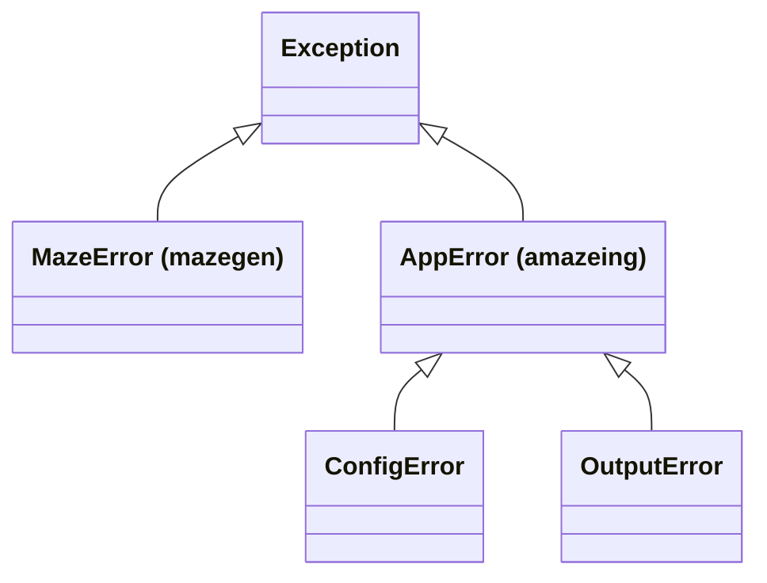

# A hierarquia AppError

O `main` imprime todo erro do usuário num único `except`, e só pode confiar na mensagem de uma
exceção que foi levantada de propósito ([página anterior](./01-excecoes-da-aplicacao.md)). O
programa tem dois tipos desses erros, o do arquivo de configuração e o do arquivo de saída, e o
`main` precisa capturar os dois de uma vez. Esta página cria as exceções da aplicação, em
`amazeing/errors.py`: uma classe-base, `AppError`, e duas filhas.

## Uma hierarquia de exceções

Em Python, uma exceção é uma classe que herda de `Exception`. **Herdar** quer dizer ser um tipo
mais específico de outra classe: `class ConfigError(AppError):` diz "um `ConfigError` é um tipo
de `AppError`". Uma **hierarquia** de exceções é uma família de classes que herdam umas das
outras:



Cada caixa é uma classe, e entre parênteses está o pacote onde ela mora. Cada seta com ponta de
triângulo vazio liga uma classe filha à mãe, com o triângulo do lado da mãe: `ConfigError` e
`OutputError` herdam de `AppError`; `AppError` e `MazeError` herdam de `Exception`, a classe-base
das exceções do Python.

Por herdar, `except AppError` captura um `AppError` **e todas as suas filhas**, mas não uma
exceção de fora da família, como um `KeyError` (o erro do Python para chave que não existe num
dicionário). O exemplo no fim da página mostra isso rodando.

| Exceção | Quem levanta | Quando |
|---|---|---|
| `ConfigError` | `MazeConfig` e `FileConfigRepository` ([parte 11](../11-configuracao/01-o-value-object-maze-config.md)) | arquivo de configuração inexistente, ilegível ou com valor inválido |
| `OutputError` | `FileMazeRepository` ([parte 12](../12-geracao-e-saida/05-gravando-o-arquivo.md)) | o arquivo de saída não pode ser gravado |
| `AppError` | ninguém diretamente | é a base das duas |

O `main` não precisa saber **qual** erro aconteceu: captura `AppError` uma vez e pega as duas
filhas. Um terceiro tipo de erro, no futuro, só precisa herdar de `AppError`.

As filhas existem separadas porque dizem, só pelo nome, de onde veio o problema: quem lê
`raise OutputError(...)` sabe que é o arquivo de saída, sem ler a mensagem.

## Por que separada do `MazeError`

O `mazegen` já tem a sua exceção, `MazeError`, levantada quando alguém pede um labirinto
impossível, como largura 0 ([parte 4](../04-value-objects/01-maze-error.md)). Ela não serve
aqui, e `AppError` não pode ser parente dela, por causa da **regra de dependência**
([parte 2](../02-arquitetura/03-regra-de-dependencia.md)): o `mazegen` não importa nada do
`amazeing`, para continuar reutilizável em outros projetos.

- `MazeError` herdar de `AppError` exigiria que o `mazegen` importasse o `amazeing`: proibido.
- `AppError` herdar de `MazeError` diria que "arquivo de configuração inválido" é um erro do
  **gerador**, que nem sabe que existe arquivo de configuração.

Por isso as duas famílias ficam lado a lado, e o `main` captura as duas na mesma linha, com a
tupla `except (AppError, MazeError)` da [página anterior](./01-excecoes-da-aplicacao.md).

## Classes só com docstring

As três classes não têm código. Herdar de `Exception` já dá tudo: o construtor guarda a
mensagem, e `str(error)` (o que o `{error}` da f-string usa) a devolve.

O corpo de uma classe precisa de pelo menos um comando, e a **docstring** (o texto entre `"""`
logo abaixo do `class`, que documenta a classe) já conta como comando. Não é preciso `pass`.

## O arquivo completo

```python title="amazeing/errors.py"
"""Exceptions of the application.

The message of each one is the sentence printed after "Error: ".
"""


class AppError(Exception):
    """Base of the errors that the application reports to the user."""


class ConfigError(AppError):
    """Configuration file missing, unreadable or invalid."""


class OutputError(AppError):
    """Output file that cannot be written."""
```

## Experimente

Primeiro, quem o `except AppError` captura. Na raiz do projeto:

```bash
.venv/bin/python - <<'EOF'
from amazeing.errors import AppError, ConfigError, OutputError

for error in [ConfigError("ENTRY and EXIT must differ"),
              OutputError("cannot write output file"),
              KeyError("WIDTH")]:
    try:
        raise error
    except AppError as caught:
        print("capturado:", type(caught).__name__, "->", caught)
    except Exception as other:
        print("NÃO é AppError:", type(other).__name__)
EOF
```

```text
capturado: ConfigError -> ENTRY and EXIT must differ
capturado: OutputError -> cannot write output file
NÃO é AppError: KeyError
```

- O laço levanta, uma por vez, três exceções já criadas, e o `try` tenta capturá-las.
- Os dois `except` são conferidos em ordem: o primeiro que aceita a exceção fica com ela. O
  `except Exception` pega o que o `except AppError` recusou.
- `type(caught)` devolve a classe da exceção capturada, e `.__name__` é o nome dessa classe como
  texto: `"ConfigError"`.
- Imprimir `caught` mostra a mensagem que a exceção guardou.

Depois, a frase final, como o `main` a imprime:

```bash
.venv/bin/python - <<'EOF'
from amazeing.errors import AppError, ConfigError

try:
    raise ConfigError("ENTRY and EXIT must differ")
except AppError as error:
    print(f"Error: {error}")
EOF
```

```text
Error: ENTRY and EXIT must differ
```
