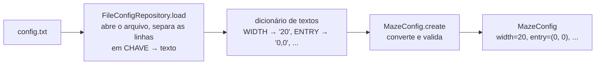

# O value object `MazeConfig`

O programa começa recebendo o caminho de um arquivo de configuração. Dali ele precisa tirar
valores **confiáveis**: uma largura que é um número entre 1 e 100, uma entrada que está dentro
da grade, e assim por diante. Se algo estiver errado, ele precisa parar com uma mensagem que
diga exatamente o quê. Esta parte constrói essa leitura; esta página mostra as duas etapas dela
e o objeto que guarda o resultado.

## Lembrando o arquivo

O arquivo de configuração ([parte 1](../01-o-problema/03-o-arquivo-de-configuracao.md)) tem uma
opção por linha, no formato `CHAVE=valor`, e linhas começando com `#` são comentários:

```text
WIDTH=20
HEIGHT=15
ENTRY=0,0
EXIT=19,14
OUTPUT_FILE=maze.txt
PERFECT=False
```

As seis chaves acima são obrigatórias pelo enunciado. `SEED`, a semente do sorteio (mesmo
número, mesmo labirinto), é opcional e foi acrescentada pelo projeto.

## Duas etapas, duas classes



- O `FileConfigRepository` (`amazeing/repositories/config_repository.py`) cuida do **arquivo**:
  abrir, ler, pular comentários, separar chave e valor. Ele devolve um dicionário de textos, como
  `{"WIDTH": "20", "ENTRY": "0,0", ...}`. É um *repository*, o papel das classes que mexem em
  arquivo; nenhuma classe fora da camada `repositories` abre arquivos
  ([parte 2](../02-arquitetura/04-papeis-das-classes.md)). A outra classe dessa camada, o
  `FileMazeRepository`, grava o arquivo de saída
  ([parte 12](../12-geracao-e-saida/05-gravando-o-arquivo.md)).
- O `MazeConfig` (`amazeing/domain/value_objects/maze_config.py`) cuida das **regras**: o que é
  um valor válido. Ele não sabe que existe arquivo; recebe o dicionário e devolve os valores já
  convertidos, ou um erro.

Separar as duas coisas deixa cada uma simples: as regras podem ser usadas e experimentadas com
um dicionário escrito à mão, sem criar arquivo nenhum. O `MazeConfig` vem primeiro nesta parte
porque o repositório o usa.

## Os campos

```python
MANDATORY_KEYS = ("WIDTH", "HEIGHT", "ENTRY", "EXIT", "OUTPUT_FILE", "PERFECT")


@dataclass(frozen=True)
class MazeConfig:
    width: int
    height: int
    entry: tuple[int, int]
    exit: tuple[int, int]
    output_file: str
    perfect: bool
    seed: int | None
```

Um campo por chave do arquivo, já no tipo certo: `entry` é a tupla `(0, 0)`, não o texto
`"0,0"`; `perfect` é o booleano `False`, não o texto `"False"`.

- `int | None` quer dizer "um inteiro **ou** `None`". `seed` é `None` quando o arquivo não tem
  `SEED`, e o gerador entende `None` como "sorteio diferente a cada execução".
- `MANDATORY_KEYS` lista as seis chaves obrigatórias na mesma ordem da tabela de opções do
  enunciado (seção 2 de [O enunciado em linguagem simples](../00-introducao/02-o-enunciado-em-linguagem-simples.md)):
  `WIDTH`, `HEIGHT`, `ENTRY`, `EXIT`, `OUTPUT_FILE`, `PERFECT`. É também a ordem em que elas
  aparecem nas mensagens de erro. `SEED` fica de fora porque é opcional.

`@dataclass` é um decorador da biblioteca padrão que escreve sozinho, a partir dos campos
anotados, o `__init__` (o construtor), o `__repr__` (o texto que o `print` mostra) e o `__eq__`
(a comparação com `==`). Ele já apareceu na `Cell` ([parte 4](../04-value-objects/04-cell.md)).
`frozen=True` ("congelado") proíbe mudar um campo depois que o objeto existe: a linha
`config.width = 0` levanta (lança) a exceção `FrozenInstanceError`. O
[Experimente da página 6](./08-o-maze-config-completo.md#experimente) mostra isso funcionando,
depois que o arquivo estiver completo.

## Por que um value object

Um **value object** é um objeto que é só um valor, como o número 20 ou o texto `"abc"`: não muda
depois de criado, e dois com o mesmo conteúdo são iguais. A configuração é um valor nesse
sentido: ela descreve **uma** execução do programa e não tem motivo para mudar no meio dela.

Ser imutável é o que torna a validação confiável. Uma vez criado e validado, um `MazeConfig`
continua válido até o fim do programa, porque nenhum código consegue trocar `width` para `0`
depois. Quem recebe um `MazeConfig` pode usar os valores sem conferir nada de novo.

## A fábrica `create`

A validação não fica no `__init__`, e sim num método separado, `create`:

```python
@classmethod
def create(cls, raw: Mapping[str, str]) -> "MazeConfig":
```

- `@classmethod` faz o método ser chamado pela **classe**, não por um objeto:
  `MazeConfig.create(...)`. O primeiro parâmetro, `cls`, recebe a própria classe `MazeConfig`.
  Um método assim, que constrói e devolve um objeto novo, se chama **fábrica**.
- `-> "MazeConfig"` anota o tipo de retorno. O nome vem entre aspas porque, no meio da
  definição da classe, o nome `MazeConfig` ainda não existe para o Python.
- `raw` é um `Mapping[str, str]`: qualquer coisa que se leia como um dicionário de textos para
  textos. O repositório passa um `dict`; o `create` só usa `raw[chave]` e `chave in raw`.
  A anotação é `Mapping`, e não `dict`, porque `Mapping` só oferece leitura: o `mypy` acusaria
  qualquer linha do `create` que tentasse alterar o dicionário recebido.

Por que não validar no `__init__`? O `__init__` que o `@dataclass` escreve recebe os valores
**já convertidos** (`width=20`). O `create` recebe **textos** (`"20"`), converte, confere todas
as regras e só no fim chama `cls(...)`, o `__init__`. Se uma regra falha, ele levanta
`ConfigError` (a exceção de configuração da
[parte 10](../10-utilitarios/05-a-hierarquia-app-error.md)) e o objeto nunca chega a existir.
O resultado: **não existe `MazeConfig` inválido**.

## O gerador também valida

O `MazeGenerator`, a classe do `mazegen` que gera o labirinto
([parte 9](../09-gerador/02-validar-os-parametros.md)), já confere várias destas regras quando
é criado. O `MazeConfig` confere de novo para a mensagem citar a **chave do arquivo**, que é o
que o usuário escreveu. A [página 5](./07-validar-duas-vezes.md) mostra a diferença com
um exemplo.

As próximas páginas constroem o `create`: converter cada texto
([página 2](./02-convertendo-um-valor.md)) e conferir as regras numa ordem fixa
([páginas 3 e 4](./03-a-ordem-das-validacoes.md)). O arquivo completo e os exemplos para rodar
estão na [página 6](./08-o-maze-config-completo.md).
