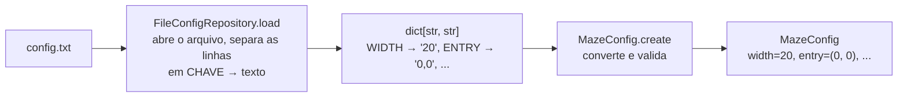

# O value object `MazeConfig`

A configuração é lida em duas etapas, por duas classes:



- O **repositório** (`amazeing/repositories/config_repository.py`) cuida do arquivo: abrir, ler,
  pular comentários, separar chave e valor. Ele é a única camada que mexe em arquivo.
- O **value object** (`amazeing/domain/value_objects/maze_config.py`) cuida das regras: o que é
  um valor válido. Ele não sabe que existe arquivo; recebe um dicionário de textos.

O `MazeConfig` é construído primeiro, porque o repositório depende dele.

## Os campos

```python
MANDATORY_KEYS = ("WIDTH", "HEIGHT", "ENTRY", "EXIT", "OUTPUT_FILE", "PERFECT")


@dataclass(frozen=True)
class MazeConfig:
    width: int
    height: int
    entry: tuple[int, int]
    exit: tuple[int, int]
    output_file: str
    perfect: bool
    seed: int | None
```

Um campo por chave do config, já no tipo certo: `entry` é a tupla `(x, y)`, não o texto `"0,0"`.
`seed` é `None` quando o config não tem `SEED`; o `MazeGenerator` entende `None` como "sorteio
novo a cada execução".

`MANDATORY_KEYS` lista as chaves obrigatórias **na ordem** em que aparecem nas mensagens. `SEED`
fica de fora porque é opcional.

## Por que um value object

`@dataclass(frozen=True)` torna o objeto imutável: depois de criado, nenhum campo muda. Uma vez
validada, a configuração continua válida até o fim do programa, porque ninguém consegue trocar
`width` para `0` no meio do caminho.

A validação mora num método de fábrica, `create`, e não no `__init__`:

```python
@classmethod
def create(cls, raw: Mapping[str, str]) -> "MazeConfig":
```

- `create` recebe **textos** (`"20"`) e devolve um objeto com **valores** (`20`). O `__init__`
  gerado pela dataclass recebe os valores já convertidos; misturar as duas coisas num lugar só
  confundiria os tipos dos campos.
- `raw` é um `Mapping[str, str]`: qualquer coisa que se lê como dicionário. O repositório passa
  um `dict`, mas o `MazeConfig` não exige nada além de `raw[chave]` e `chave in raw`.
- `create` só devolve um `MazeConfig` se **todas** as regras passarem. Caso contrário, levanta
  `ConfigError`, e o objeto nunca chega a existir.

## Por que validar aqui se o gerador também valida

O construtor do `MazeGenerator` (parte 9) já confere tamanho, coordenadas, entrada diferente da
saída, modo Pac-Man e o "42". Validar de novo parece repetição, mas as mensagens são diferentes:

```bash
.venv/bin/python -c '
from mazegen import MazeError, MazeGenerator

try:
    MazeGenerator(20, 15, entry=(6, 5))
except MazeError as error:
    print(error)
'
```

```text
entry (6, 5) lies on the "42" pattern
```

```bash
.venv/bin/python -c '
from amazeing.domain.value_objects.maze_config import MazeConfig
from amazeing.errors import ConfigError

try:
    MazeConfig.create({"WIDTH": "20", "HEIGHT": "15", "ENTRY": "6,5",
                       "EXIT": "19,14", "OUTPUT_FILE": "maze.txt",
                       "PERFECT": "True"})
except ConfigError as error:
    print(error)
'
```

```text
ENTRY=6,5 lies on the "42" pattern
```

O gerador é uma biblioteca: fala dos **parâmetros** dele, `entry`, em minúsculas. Quem escreve
o `config.txt` nunca viu esse parâmetro; viu a linha `ENTRY=6,5`. Validando antes de criar o
gerador, a mensagem cita a chave como está no arquivo, em maiúsculas, e com o valor escrito do
mesmo jeito (`6,5`, não `(6, 5)`).

A validação do gerador continua lá: ele é reutilizável, e outro programa pode chamá-lo sem passar
por config nenhum. Na aplicação, ela nunca dispara, porque o `MazeConfig` barra antes.

## Os imports

```python
from collections.abc import Callable, Mapping
from dataclasses import dataclass
from typing import TypeVar

from amazeing.errors import ConfigError
from amazeing.utils.value_parser import ValueParser
from mazegen.generator import MAX_SIZE, MIN_SIZE
from mazegen.value_objects.cell import Cell
from mazegen.value_objects.pattern42 import Pattern42
```

O domínio pode importar `utils`, `errors` e `mazegen`. `MIN_SIZE` e `MAX_SIZE` vêm do gerador:
os limites 1 e 100 são escritos num lugar só, e o config nunca diverge do gerador. `Cell` e
`Pattern42` vêm pelo caminho interno do `mazegen`, porque o `__init__` do pacote só exporta
`MazeGenerator` e `MazeError`.
