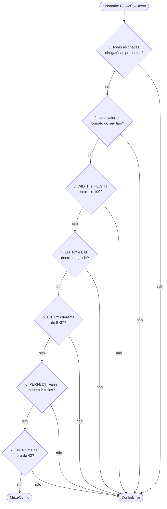

# A ordem das validações

Um arquivo de configuração pode ter vários erros ao mesmo tempo: uma chave faltando, uma largura
`abc`, uma entrada fora da grade. O programa precisa decidir qual erro contar ao usuário. Esta
página mostra a escolha do projeto: o `MazeConfig.create` confere as regras numa **ordem fixa** e
**para no primeiro erro**.

## Por que parar no primeiro erro

Cada regra só faz sentido se as anteriores passaram:

- não dá para comparar a largura com 100 se ela não é um número;
- não dá para conferir se a entrada está dentro da grade enquanto a largura é inválida: com
  `WIDTH=0`, toda entrada ficaria "fora", e a mensagem apontaria a entrada, quando o problema é
  a largura;
- não dá para saber se a entrada cai no "42" se ela nem está dentro da grade.

Juntar todos os erros de uma vez listaria consequências junto com a causa: com `WIDTH=abc`, a
regra "entrada dentro da grade" também falharia, só porque não há largura. Parar no primeiro
erro mostra a causa, e o mesmo arquivo dá sempre a mesma mensagem.

A exceção são as chaves ausentes (regra 1), listadas todas juntas, porque uma não depende da
outra.

O enunciado só exige que todo erro vire uma mensagem clara; a ordem e o "parar no primeiro" são
escolha do projeto.

## O caminho das regras



Cada `não` levanta `ConfigError` com uma mensagem e encerra o `create`. As regras 1 a 3 estão
nesta página; as regras 4 a 7, na [próxima](./04-o-42-e-o-arquivo-completo.md). É a regra 4 que
recusa uma coordenada como `-1,0`, que o conversor aceita como formato.

## 1. Chaves ausentes, todas de uma vez

```python
missing = [key for key in MANDATORY_KEYS if key not in raw]
if missing:
    raise ConfigError(
        "missing mandatory key(s): " + ", ".join(missing))
```

- A primeira linha é uma **compreensão de lista** (*list comprehension*): `[key for key in ...
  if ...]` percorre `MANDATORY_KEYS` (as seis chaves obrigatórias) e monta uma lista só com as
  que **não** estão (`not in`) no dicionário `raw`.
- Uma lista vazia conta como falso no `if`; com alguma chave faltando, o erro é levantado.
- `", ".join(missing)` junta os nomes com vírgula e espaço: `["EXIT", "PERFECT"]` vira
  `EXIT, PERFECT`.

```text
missing mandatory key(s): EXIT, PERFECT
```

Vem primeiro porque nenhuma outra regra roda sem os valores. Listar **todas** as ausentes poupa o
usuário de rodar o programa uma vez para cada chave esquecida.

## 2. Os tipos, na ordem das chaves

```python
width = _parse(raw, "WIDTH", ValueParser.to_int, "an integer")
height = _parse(raw, "HEIGHT", ValueParser.to_int, "an integer")
entry = _parse(raw, "ENTRY", ValueParser.to_coordinate,
               "'x,y' with integers")
exit = _parse(raw, "EXIT", ValueParser.to_coordinate,
              "'x,y' with integers")
output_file = raw["OUTPUT_FILE"]
if not output_file:
    raise ConfigError("OUTPUT_FILE must not be empty")
perfect = _parse(raw, "PERFECT", ValueParser.to_bool,
                 "True or False")
seed = None
if "SEED" in raw:
    seed = _parse(raw, "SEED", ValueParser.to_int, "an integer")
```

Cada `_parse` converte um texto ou levanta o erro com a chave na mensagem
([página anterior](./02-convertendo-um-valor.md)). Tudo é convertido antes de qualquer
comparação, porque as regras seguintes fazem contas com os números.

- A ordem é a das seis chaves do enunciado, na ordem da tabela dele (`WIDTH`, `HEIGHT`,
  `ENTRY`, `EXIT`, `OUTPUT_FILE`, `PERFECT`), e por último a `SEED`, que o projeto acrescentou.
  O primeiro erro acusado é o da chave mais acima.
- `OUTPUT_FILE` não é convertido: qualquer texto pode ser o nome de um arquivo. A única regra é
  não ser vazio (a linha `OUTPUT_FILE=` sem nada depois do `=`).
- `SEED` só é convertida se estiver no arquivo. Sem ela, fica `None`.

## 3. O tamanho

```python
for key, value in (("WIDTH", width), ("HEIGHT", height)):
    if not MIN_SIZE <= value <= MAX_SIZE:
        raise ConfigError(f"{key} must be between {MIN_SIZE} and "
                          f"{MAX_SIZE}, got {value}")
```

- O `for` percorre dois pares `(nome, valor)`, e a regra é escrita uma vez para as duas chaves.
- `MIN_SIZE <= value <= MAX_SIZE` é uma comparação encadeada: o mesmo que
  `MIN_SIZE <= value and value <= MAX_SIZE`.
- `MIN_SIZE` (1) e `MAX_SIZE` (100) são importados de `mazegen.generator`, o arquivo do
  `MazeGenerator` ([parte 9](../09-gerador/10-construtor-e-atributos.md)): o `MazeConfig` e o gerador usam os
  mesmos limites e nunca discordam.

O enunciado manda recusar tamanhos impossíveis, como negativos. O máximo 100 é escolha do
projeto: grades muito maiores levam segundos para gerar e podem esgotar a memória
([parte 1](../01-o-problema/03-o-arquivo-de-configuracao.md)). O tamanho vem antes das regras 4
a 7 porque todas usam a largura e a altura.

O `MazeConfig` só fica completo na [página 6](./08-o-maze-config-completo.md); o Experimente de lá
mostra estas regras e a ordem entre elas, com um arquivo que quebra duas regras de uma vez.
