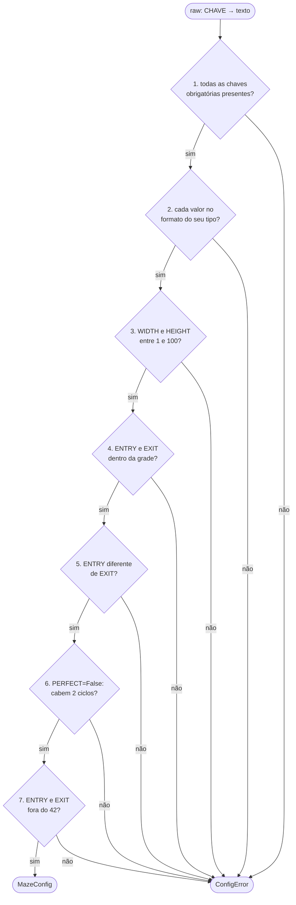

# A ordem das validações

`MazeConfig.create` confere as regras numa ordem fixa e **para no primeiro erro**. Cada regra só
faz sentido se as anteriores passaram:



## 1. Chaves ausentes, todas de uma vez

```python
missing = [key for key in MANDATORY_KEYS if key not in raw]
if missing:
    raise ConfigError(
        "missing mandatory key(s): " + ", ".join(missing))
```

Vem primeiro porque nenhuma outra regra roda sem os valores. E lista **todas** as ausentes, na
ordem de `MANDATORY_KEYS`: quem esqueceu três chaves corrige as três de uma vez, em vez de rodar
o programa três vezes para descobrir uma por uma.

```text
missing mandatory key(s): EXIT, PERFECT
```

## 2. Os tipos, na ordem das chaves

```python
width = _parse(raw, "WIDTH", ValueParser.to_int, "an integer")
height = _parse(raw, "HEIGHT", ValueParser.to_int, "an integer")
entry = _parse(raw, "ENTRY", ValueParser.to_coordinate,
               "'x,y' with integers")
exit = _parse(raw, "EXIT", ValueParser.to_coordinate,
              "'x,y' with integers")
output_file = raw["OUTPUT_FILE"]
if not output_file:
    raise ConfigError("OUTPUT_FILE must not be empty")
perfect = _parse(raw, "PERFECT", ValueParser.to_bool,
                 "True or False")
seed = None
if "SEED" in raw:
    seed = _parse(raw, "SEED", ValueParser.to_int, "an integer")
```

Converter tudo antes de comparar qualquer coisa: a regra 3 compara `width` com 100, e isso só é
possível com um `int`. A ordem `WIDTH`, `HEIGHT`, `ENTRY`, `EXIT`, `OUTPUT_FILE`, `PERFECT`,
`SEED` é a do arquivo de config, então o primeiro erro acusado é o de cima.

- `OUTPUT_FILE` não tem conversão: qualquer texto é um caminho. A única regra é não ser vazio
  (`OUTPUT_FILE=` sem nada depois).
- `SEED` só é convertida se estiver presente. Ausente, fica `None`.

## 3. O tamanho

```python
for key, value in (("WIDTH", width), ("HEIGHT", height)):
    if not MIN_SIZE <= value <= MAX_SIZE:
        raise ConfigError(f"{key} must be between {MIN_SIZE} and "
                          f"{MAX_SIZE}, got {value}")
```

As regras 4 a 7 usam a largura e a altura como limites. Com `WIDTH=0`, "dentro da grade" não tem
sentido, então o tamanho vem antes. O laço sobre pares `(chave, valor)` escreve a regra uma vez
para as duas chaves.

`MIN_SIZE <= value <= MAX_SIZE` é uma comparação encadeada do Python: equivale a
`MIN_SIZE <= value and value <= MAX_SIZE`.

## 4. Dentro da grade

```python
for key, (x, y) in (("ENTRY", entry), ("EXIT", exit)):
    if not (0 <= x < width and 0 <= y < height):
        raise ConfigError(
            f"{key}={x},{y} is outside the maze "
            f"(x in 0..{width - 1}, y in 0..{height - 1})")
```

A mensagem mostra a faixa válida, para o usuário não ter de lembrar que as coordenadas começam em
0: `ENTRY=20,0 is outside the maze (x in 0..19, y in 0..14)`. É aqui que o `-1,0`, aceito como
formato pelo `ValueParser`, é recusado.

## 5. Entrada diferente da saída

```python
if entry == exit:
    raise ConfigError("ENTRY and EXIT must differ")
```

Vem depois da regra 4: com `ENTRY=30,30` e `EXIT=30,30` numa grade 20x15, o problema mais útil de
apontar é "fora da grade", e não "iguais".

## 6. O tabuleiro Pac-Man precisa de espaço

```python
if not perfect and (width - 1) * (height - 1) < 2:
    raise ConfigError(
        "PERFECT=False needs (WIDTH - 1) x (HEIGHT - 1) >= 2 for a "
        f"Pac-Man board, got {width}x{height}")
```

A conta da parte 1: uma grade com todas as paredes internas abertas tem `(W − 1) × (H − 1)`
ciclos, e o Pac-Man exige 2. Grades 1xN, Nx1 e 2x2 não chegam lá, e o gerador nunca conseguiria
cumprir a regra. Melhor recusar logo, com a conta na mensagem.

## Experimente

Cada config abaixo quebra duas regras; só a primeira, na ordem, é acusada:

```bash
.venv/bin/python -c '
from amazeing.domain.value_objects.maze_config import MazeConfig
from amazeing.errors import ConfigError

base = {"WIDTH": "20", "HEIGHT": "15", "ENTRY": "0,0", "EXIT": "19,14",
        "OUTPUT_FILE": "maze.txt", "PERFECT": "True"}
for change in [{"WIDTH": "abc", "HEIGHT": "0"},
               {"WIDTH": "0", "ENTRY": "50,50"},
               {"ENTRY": "30,30", "EXIT": "30,30"},
               {"ENTRY": "6,5", "EXIT": "6,5"}]:
    try:
        MazeConfig.create({**base, **change})
    except ConfigError as error:
        print(error)
'
```

```text
WIDTH must be an integer, got 'abc'
WIDTH must be between 1 and 100, got 0
ENTRY=30,30 is outside the maze (x in 0..19, y in 0..14)
ENTRY and EXIT must differ
```

A última linha: `6,5` é uma célula do "42", mas a regra 5 vem antes da 7. A regra 7 é a da
[próxima página](./04-o-42-e-o-arquivo-completo.md).
