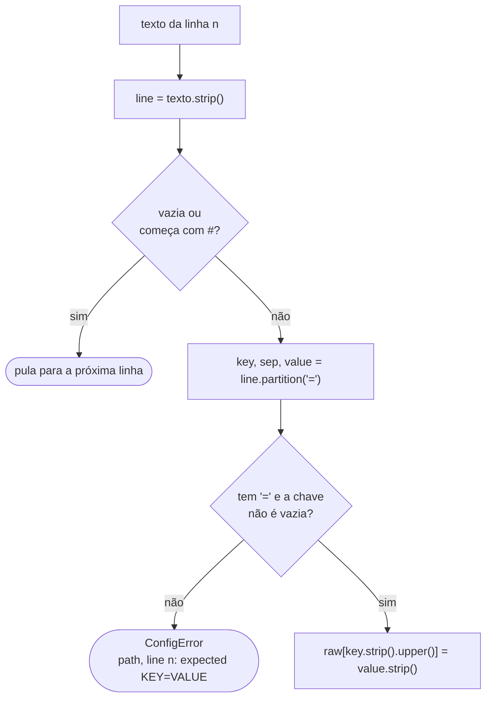

# Linha a linha

Com as linhas lidas, o `FileConfigRepository` monta o dicionário `CHAVE → valor` que o
`MazeConfig.create` espera. O arquivo é escrito por pessoas, então a leitura perdoa o que é
inofensivo (espaços, caixa, comentários) e recusa o que é ambíguo (linha sem `=`).

## O caminho de uma linha



## O laço

```python
raw: dict[str, str] = {}
for number, text in enumerate(lines, 1):
    line = text.strip()
    if not line or line.startswith("#"):
        continue
    key, sep, value = line.partition("=")
    if not sep or not key.strip():
        raise ConfigError(f"{path}, line {number}: expected "
                          f"KEY=VALUE, got '{line}'")
    raw[key.strip().upper()] = value.strip()
```

### Numerar todas as linhas

`enumerate(lines, 1)` conta a partir de 1, como um editor de texto. A contagem acontece **antes**
de pular comentários e linhas vazias: a linha 7 da mensagem é a linha 7 que o usuário vê no
editor, não a sétima linha útil.

### `strip()` primeiro

`strip()` tira espaços, tabulações e o `\n` do fim. Depois dele:

- uma linha só com espaços fica vazia e é pulada;
- `    # comentário indentado` começa com `#` e é pulada.

Comentário só existe como linha inteira. `WIDTH=20 # largura` não é cortado no `#`: o valor fica
`20 # largura`, que não é inteiro, e o erro aparece com o valor entre aspas. Cortar no `#`
quebraria um caminho legítimo como `OUTPUT_FILE=saida#1.txt`.

### Separar no primeiro `=`

`partition("=")` devolve sempre três partes: o que vem antes do primeiro `=`, o próprio `=` e o
resto.

```text
"OUTPUT_FILE=a=b.txt".partition("=")  → ('OUTPUT_FILE', '=', 'a=b.txt')
"HEIGHT 15".partition("=")            → ('HEIGHT 15', '', '')
"=15".partition("=")                  → ('', '=', '15')
```

- O `=` depois do primeiro fica no valor, então um caminho com `=` funciona.
- Sem `=`, a parte do meio (`sep`) vem vazia: é o sinal do erro de sintaxe.
- `=15` tem `=`, mas a chave é vazia: também erro.

Com `split("=")`, `a=b.txt` viraria três pedaços, e faltaria o sinal claro de "não tinha `=`".

### Chave em maiúsculas, valor sem espaços

`key.strip().upper()` faz `width`, `Width` e ` WIDTH ` virarem a mesma chave. `value.strip()`
torna `WIDTH = 20` igual a `WIDTH=20`.

### Repetida vale a última; desconhecida é ignorada

Atribuir num dicionário substitui o valor anterior: `WIDTH=20` seguido de `width=30` termina com
`30`, sem código extra. Uma chave como `COLOR=red` entra no dicionário, mas o `MazeConfig` nunca
a lê. Um arquivo com chaves a mais, de outra versão do programa, continua funcionando; e um erro
de digitação (`WIDHT=20`) não passa em silêncio: `WIDTH` continua faltando e é acusada.

## O prefixo do caminho

```python
try:
    return MazeConfig.create(raw)
except ConfigError as error:
    raise ConfigError(f"{path}: {error}") from None
```

O `MazeConfig` não sabe de arquivo nenhum, e as mensagens dele não têm o nome do arquivo. O
repositório sabe, e acrescenta o caminho na frente:

```text
WIDTH must be an integer, got 'abc'            ← do MazeConfig
config.txt: WIDTH must be an integer, got 'abc' ← o que sai do load
```

Com isso, toda mensagem de config cita o arquivo: as de leitura, as de sintaxe (com a linha) e
as de regra.

## Experimente

```bash
printf '# top\n\n  width = 20  \nHeight=15\r\nENTRY=0,0\nEXIT=19,14\nOUTPUT_FILE=a=b.txt\nperfect=false\nCOLOR=red\nWIDTH=30' > solto.txt
printf 'WIDTH=20\nHEIGHT 15\n' > sintaxe.txt
printf 'WIDTH=20\nHEIGHT=15\nENTRY=0,0\nEXIT=19,14\nOUTPUT_FILE=maze.txt\nPERFECT=yes\n' > valor.txt
printf '# caf\xe9\n' > latin1.txt
mkdir -p pasta
.venv/bin/python -c '
from amazeing.errors import ConfigError
from amazeing.repositories.config_repository import FileConfigRepository

for path in ["solto.txt", "sintaxe.txt", "valor.txt", "nao_existe.txt",
             "latin1.txt", "pasta"]:
    try:
        print(FileConfigRepository().load(path))
    except ConfigError as error:
        print(error)
'
```

```text
MazeConfig(width=30, height=15, entry=(0, 0), exit=(19, 14), output_file='a=b.txt', perfect=False, seed=None)
sintaxe.txt, line 2: expected KEY=VALUE, got 'HEIGHT 15'
valor.txt: PERFECT must be True or False, got 'yes'
configuration file not found: nao_existe.txt
configuration file is not valid UTF-8: latin1.txt
cannot read configuration file pasta: Is a directory
```

O `solto.txt` tem comentário, linha vazia, espaços em volta do `=`, chaves em minúsculas e
capitalizadas, um `\r\n`, um `=` dentro do valor, uma chave desconhecida, `WIDTH` repetida e
nenhuma quebra de linha no fim. Tudo isso é aceito, e a largura é a da última linha: 30.

## O arquivo completo

```python title="amazeing/repositories/config_repository.py"
"""Reading of the configuration file."""

from amazeing.domain.value_objects.maze_config import MazeConfig
from amazeing.errors import ConfigError


class FileConfigRepository:
    """Load a MazeConfig from a KEY=VALUE text file."""

    def load(self, path: str) -> MazeConfig:
        """Read the file, split it into keys and values and validate them.

        Args:
            path: Path of the configuration file, as typed by the user.

        Returns:
            The validated configuration.

        Raises:
            ConfigError: The file is missing, unreadable, not UTF-8, has a
                line outside KEY=VALUE or breaks a rule; the message names
                the file.
        """
        try:
            # utf-8-sig drops a leading BOM; text mode turns \r\n and \r
            # into line ends.
            with open(path, encoding="utf-8-sig") as file:
                lines = file.readlines()
        except FileNotFoundError:
            raise ConfigError(
                f"configuration file not found: {path}") from None
        except UnicodeDecodeError:
            raise ConfigError(
                f"configuration file is not valid UTF-8: {path}") from None
        except OSError as error:
            raise ConfigError(f"cannot read configuration file {path}: "
                              f"{error.strerror}") from None
        raw: dict[str, str] = {}
        for number, text in enumerate(lines, 1):
            line = text.strip()
            if not line or line.startswith("#"):
                continue
            key, sep, value = line.partition("=")
            if not sep or not key.strip():
                raise ConfigError(f"{path}, line {number}: expected "
                                  f"KEY=VALUE, got '{line}'")
            raw[key.strip().upper()] = value.strip()
        try:
            return MazeConfig.create(raw)
        except ConfigError as error:
            raise ConfigError(f"{path}: {error}") from None
```

O `load` não acrescenta o `Error: ` da frente: isso é trabalho do `main` (parte 14), o único que
imprime.
