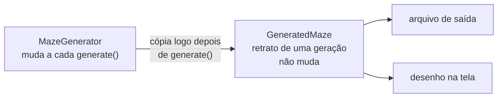

# O retrato `GeneratedMaze`

Depois de gerar um labirinto, o programa faz duas coisas com ele: **grava** no arquivo de saída
e **desenha** na tela. As duas precisam mostrar exatamente o mesmo labirinto, com as mesmas
paredes e o mesmo caminho; senão o usuário veria na tela um labirinto e encontraria outro no
arquivo. Esta página cria o objeto que garante isso: uma cópia do labirinto que ninguém consegue
mudar.

## O que o gerador entrega

O `MazeGenerator` é a classe do `mazegen` que gera os labirintos
([parte 9](../09-gerador/01-a-fachada.md)). Cada chamada a `generate()` cria um labirinto novo e
o deixa em três atributos:

| Atributo | Tipo | Conteúdo |
|---|---|---|
| `grid` | lista de listas de inteiros | `grid[y][x]` é o número de 0 a 15 que diz quais paredes da célula `x,y` estão fechadas ([parte 1](../01-o-problema/02-paredes-em-bits.md)) |
| `solution` | texto | o caminho mais curto da entrada à saída, uma letra `N`, `E`, `S` ou `W` por passo |
| `pattern` | conjunto de pares `(x, y)` | as células do "42"; vazio quando ele não coube |

## Por que não ler direto do gerador

O arquivo e a tela poderiam ler esses atributos direto do gerador. Três problemas:

- `grid` é uma lista, e listas podem ser alteradas: qualquer código que receba a grade pode
  mudar uma parede por engano (`grid[0][0] = 0`), e a tela deixaria de bater com o arquivo.
- Cada `generate()` **troca** `grid` e `solution`. Quem guardasse o gerador para desenhar depois
  veria o labirinto atual, que talvez não seja o que foi gravado.
- O gerador não oferece a entrada e a saída como atributos, e o arquivo e a tela precisam delas.

## A ideia do retrato

A solução é tirar um **retrato** do resultado logo depois de cada geração, como uma foto: a cena
pode mudar depois, a foto não. O `GeneratedMaze` (`amazeing/domain/value_objects/generated_maze.py`)
guarda a grade, o caminho, o "42", a entrada e a saída de **uma** geração, num objeto que não
pode ser alterado.



O arquivo e a tela partem do mesmo retrato, então não têm como discordar. Como não muda depois
de criado, o retrato é um **value object**, como o `MazeConfig` da
[parte 11](../11-configuracao/01-o-value-object-maze-config.md).

## Os campos

```python
@dataclass(frozen=True)
class GeneratedMaze:
    grid: tuple[tuple[int, ...], ...]
    entry: tuple[int, int]
    exit: tuple[int, int]
    solution: str
    pattern: frozenset[tuple[int, int]]
```

Cada tipo é a versão **imutável** do que o gerador usa:

| Gerador | Retrato | O que muda |
|---|---|---|
| `list` (lista) | `tuple` (tupla) | uma tupla não aceita trocar, acrescentar nem remover itens |
| `set` (conjunto) | `frozenset` ("conjunto congelado") | um `frozenset` não aceita acrescentar nem remover itens |

`tuple[int, ...]`, com reticências, quer dizer "tupla de inteiros de qualquer tamanho": o número
de colunas depende da configuração. `tuple[tuple[int, ...], ...]` é uma tupla de linhas, cada
linha uma tupla de inteiros.

Daqui em diante, nos exemplos e no código, a variável `maze` guarda um `GeneratedMaze`, o
retrato, e não um `Maze`, a grade de paredes que o gerador usa por dentro enquanto cava
([parte 5](../05-maze/01-a-grade-de-paredes.md)). O nome é o mesmo porque, para o resto do
programa, o retrato **é** o labirinto.

São necessárias **duas** proteções:

- `frozen=True` impede trocar um campo inteiro: `maze.grid = ...` levanta (lança) a exceção
  `FrozenInstanceError`;
- os tipos imutáveis impedem mexer **dentro** do campo: `maze.grid[0][0] = 15` levanta
  `TypeError`. Com uma lista dentro de um objeto `frozen`, essa segunda alteração passaria.

## `from_generator`: tirar o retrato

```python
@classmethod
def from_generator(cls, generator: MazeGenerator, entry: tuple[int, int],
                   exit: tuple[int, int]) -> "GeneratedMaze":
    return cls(tuple(tuple(row) for row in generator.grid), entry, exit,
               generator.solution, frozenset(generator.pattern))
```

- `@classmethod` faz o método ser chamado pela classe (`GeneratedMaze.from_generator(...)`) e
  receber a classe em `cls`. Ele constrói e devolve um objeto novo: é uma **fábrica**, como o
  `MazeConfig.create`.
- `tuple(tuple(row) for row in generator.grid)` copia a grade linha por linha: cada linha
  (`row`) vira uma tupla, e as linhas juntas viram a tupla de fora. Só `tuple(generator.grid)`
  não bastaria: a tupla de fora seria nova, mas as linhas dentro dela continuariam sendo as
  listas do gerador.
- `frozenset(generator.pattern)` copia o conjunto do "42" num conjunto congelado.
- `solution` é texto, e texto já não pode ser alterado em Python; entra como está.
- `entry` e `exit` vêm de fora, da configuração, porque o gerador não os oferece.

O arquivo completo do `GeneratedMaze` está no fim da [próxima página](./02-o-caminho-em-celulas.md),
seguido de um Experimente que mostra o retrato sem mudar quando o gerador gera de novo.
