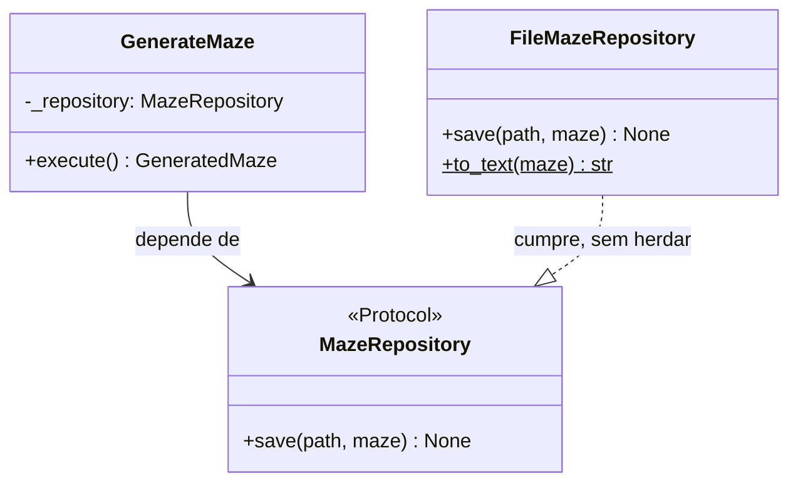

# A porta `MazeRepository`

O use case `GenerateMaze` (última página desta parte) precisa **gravar** o labirinto. Quem grava
de verdade é o `FileMazeRepository`, da camada `repositories`. Mas a regra de dependência (parte
2) proíbe o use case de importar um repositório: `repositories` é uma camada mais de fora.

A saída é inverter a dependência: o use case declara **o que** precisa, e o repositório cumpre.

## O contrato: `typing.Protocol`

```python
class MazeRepository(Protocol):
    """Storage of a generated maze."""

    def save(self, path: str, maze: GeneratedMaze) -> None:
        """Store a maze, replacing what the path held before."""
```

Um `Protocol` descreve uma **forma**: "qualquer objeto que tenha um método
`save(path: str, maze: GeneratedMaze) -> None`". Não tem implementação; o corpo do método é só a
docstring, que já é um comando válido em Python, e dispensa `pass` ou `...`.

A diferença para uma classe base comum está em como uma classe passa a "ser" um
`MazeRepository`:

| Classe base (`ABC`) | `Protocol` |
|---|---|
| a classe concreta precisa **herdar**: `class FileMazeRepository(MazeRepository)` | basta **ter** o método com a assinatura certa, sem herdar nada |
| o repositório importaria o módulo do use case | o repositório não importa nada do use case |

Isso se chama tipagem **estrutural**: o que vale é a estrutura do objeto, não a árvore de herança.
Em Python é a ideia do "se anda como pato e grasna como pato, é um pato", agora conferida pelo
`mypy`.

## Quem depende de quem



- `GenerateMaze` importa só `MazeRepository`, da sua própria camada (`use_cases/ports.py`).
- `FileMazeRepository` não importa `ports.py`: ele só tem um `save` com a mesma assinatura. A
  camada `repositories` continua sem conhecer `use_cases`.
- Quem junta os dois é o `a_maze_ing.py` (parte 14), que pode importar tudo:
  `GenerateMaze(generator, FileMazeRepository(), config)`.

### Quem confere

Nada acontece em tempo de execução: o Python não testa se o objeto cumpre o `Protocol`. Quem
confere é o `mypy`, na linha do `a_maze_ing.py` que passa um `FileMazeRepository()` onde se
espera um `MazeRepository`. Se a assinatura do `save` divergir (outro nome de parâmetro, outro
tipo), o `mypy --strict` acusa ali.

## O que se ganha

- **A regra de dependência é respeitada**: o use case não sabe que existe arquivo.
- **Trocar o armazenamento** não mexe no use case: um repositório que grave em outro formato só
  precisa de um `save` com a mesma assinatura.
- **Experimentar sem disco**: qualquer objeto com `save` serve, como o `Memory` da última página
  desta parte.

## Por que `ports.py` fica em `use_cases`

A porta é o que o **use case** precisa, escrito do ponto de vista dele. Por isso mora na pasta
dele, e não na dos repositórios: quem define o contrato é quem usa, não quem implementa.

## O arquivo completo

```python title="amazeing/use_cases/ports.py"
"""Ports that the use cases depend on."""

from typing import Protocol

from amazeing.domain.value_objects.generated_maze import GeneratedMaze


class MazeRepository(Protocol):
    """Storage of a generated maze."""

    def save(self, path: str, maze: GeneratedMaze) -> None:
        """Store a maze, replacing what the path held before.

        Args:
            path: Destination of the maze.
            maze: Maze to store.
        """
```
