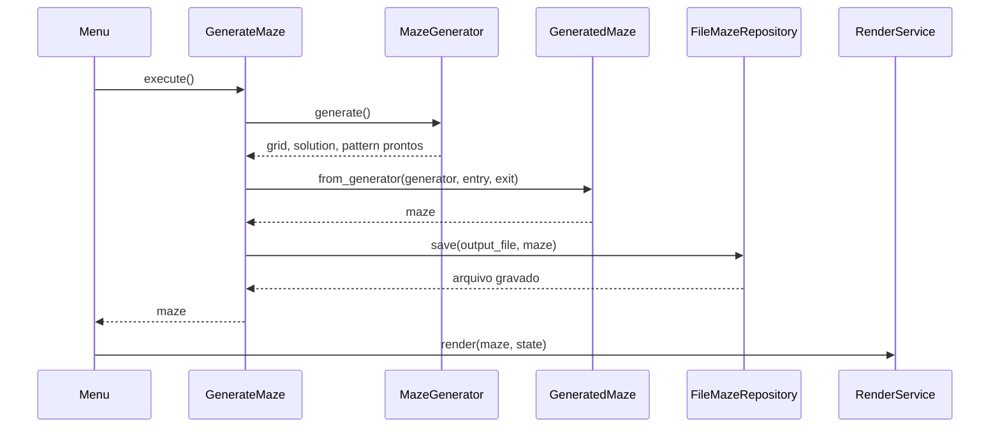

# O caso de uso `GenerateMaze`

O `GenerateMaze` (`amazeing/use_cases/generate_maze.py`) junta as peças desta parte numa operação
só: gerar um labirinto, tirar o retrato, gravar o arquivo e devolver o retrato. O menu (parte 14)
o chama na primeira geração e a cada opção `1`, "Re-generate a new maze".

## Os colaboradores

```python
def __init__(self, generator: MazeGenerator, repository: MazeRepository,
             config: MazeConfig) -> None:
    self._generator = generator
    self._repository = repository
    self._config = config
```

| Colaborador | Para quê |
|---|---|
| `generator` | gera o labirinto; criado uma vez, com os valores do config |
| `repository` | grava; qualquer objeto que cumpra a porta `MazeRepository` |
| `config` | dá a entrada, a saída e o `OUTPUT_FILE` |

O use case não cria nenhum deles: recebe prontos. Quem cria é o `a_maze_ing.py` (parte 14). Assim
o use case não sabe qual repositório concreto está usando, nem de onde veio o config.

O **mesmo** gerador é usado em todas as chamadas. Ele guarda um único `random.Random`, então, com
`SEED`, a sequência inteira de labirintos se repete de uma execução para outra: o primeiro, o da
primeira regeneração, o da segunda...

## `execute`

```python
def execute(self) -> GeneratedMaze:
    self._generator.generate()
    maze = GeneratedMaze.from_generator(
        self._generator, self._config.entry, self._config.exit)
    self._repository.save(self._config.output_file, maze)
    return maze
```



Um método, quatro linhas, uma ordem que não muda.

## Por que gravar antes de desenhar

O desenho só acontece **depois** que `execute` devolve o retrato. Se a gravação falha, o `save`
levanta `OutputError`, o `execute` não chega ao `return`, e a exceção sobe até o `main`, que
imprime o erro e termina com código 1:

```text
Error: cannot write output file 'nao_existe/maze.txt': No such file or directory
```

O usuário nunca vê na tela um labirinto que não está no arquivo. Na ordem inversa, desenhar e
depois gravar, uma falha deixaria na tela um labirinto que o arquivo não tem, e o arquivo com o
labirinto anterior, ou com nada.

Vale também na regeneração: se o disco encher entre uma geração e outra, a opção `1` termina com
a mesma mensagem e o mesmo código 1 da primeira geração.

## Por que uma geração por `execute`

Tela e arquivo vêm do **mesmo** retrato, criado uma vez por chamada. Não há como o menu desenhar
um labirinto e o arquivo guardar outro: o objeto que o `save` gravou é o mesmo que o `execute`
devolve para desenhar.

E a primeira geração e as regenerações passam pelo mesmo caminho. Se a regeneração fosse um
código à parte no menu, bastaria esquecer o `save` ali para o arquivo ficar com o labirinto
antigo.

## As exceções

`execute` não captura nada: as duas falhas possíveis já chegam com a mensagem pronta para o
usuário.

| Exceção | De onde | Quando |
|---|---|---|
| `MazeError` | `generate()` | o gerador não conseguiu montar um tabuleiro Pac-Man em 20 tentativas |
| `OutputError` | `save()` | o `OUTPUT_FILE` não pode ser gravado |

O `main` captura as duas na mesma linha, `except (AppError, MazeError)`.

## Experimente

Qualquer objeto com um `save` serve de repositório. Este guarda numa lista o que receberia:

```bash
.venv/bin/python -c '
from amazeing.domain.value_objects.maze_config import MazeConfig
from amazeing.use_cases.generate_maze import GenerateMaze
from mazegen import MazeGenerator


class Memory:
    def __init__(self):
        self.saved = []

    def save(self, path, maze):
        self.saved.append((path, maze.solution))


config = MazeConfig.create({"WIDTH": "6", "HEIGHT": "4", "ENTRY": "0,0",
                            "EXIT": "5,3", "OUTPUT_FILE": "maze.txt",
                            "PERFECT": "False", "SEED": "1"})
generator = MazeGenerator(config.width, config.height, config.entry,
                          config.exit, config.perfect, config.seed)
memory = Memory()
use_case = GenerateMaze(generator, memory, config)
first = use_case.execute()
second = use_case.execute()
print(memory.saved)
print(first.solution, second.solution)
'
```

```text
[('maze.txt', 'EESEEESS'), ('maze.txt', 'EEEEESSS')]
EESEEESS EEEEESSS
```

Duas chamadas, dois labirintos, duas gravações no mesmo caminho, cada uma com o retrato que
`execute` devolveu. O `Memory` não herda de nada e não importa nada: é a porta `MazeRepository`
funcionando. Com `FileMazeRepository()` no lugar de `memory`, o `maze.txt` fica com o segundo
labirinto, o último devolvido.

## O arquivo completo

```python title="amazeing/use_cases/generate_maze.py"
"""Use case that generates, stores and returns one maze."""

from amazeing.domain.value_objects.generated_maze import GeneratedMaze
from amazeing.domain.value_objects.maze_config import MazeConfig
from amazeing.use_cases.ports import MazeRepository
from mazegen import MazeGenerator


class GenerateMaze:
    """One generation: generate, snapshot, store, return.

    The first maze and every regeneration go through execute, so the file
    always holds the maze that the screen shows next.
    """

    def __init__(self, generator: MazeGenerator, repository: MazeRepository,
                 config: MazeConfig) -> None:
        """Keep the collaborators of the use case.

        Args:
            generator: Generator built from the configuration.
            repository: Storage of the output file.
            config: Validated configuration.
        """
        self._generator = generator
        self._repository = repository
        self._config = config

    def execute(self) -> GeneratedMaze:
        """Generate a new maze and store it before anyone draws it.

        Returns:
            The stored maze.

        Raises:
            MazeError: The generator could not build the maze.
            OutputError: The output file cannot be written.
        """
        self._generator.generate()
        maze = GeneratedMaze.from_generator(
            self._generator, self._config.entry, self._config.exit)
        self._repository.save(self._config.output_file, maze)
        return maze
```
