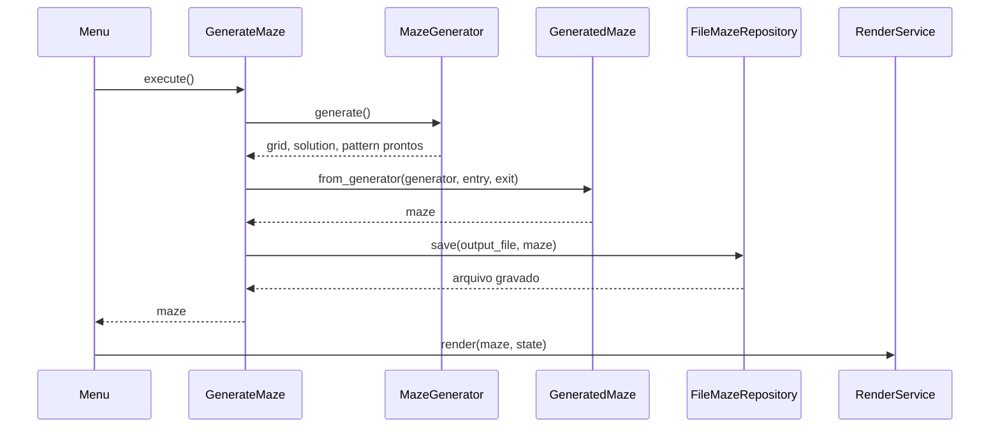

# O caso de uso `GenerateMaze`

Gerar um labirinto acontece mais de uma vez: logo que o programa abre e a cada vez que o usuário
escolhe a opção `1` do menu, "Re-generate a new maze". Toda vez, os mesmos passos, na mesma
ordem: gerar, tirar o retrato, gravar o arquivo e só então desenhar. Esta página junta esses
passos numa única operação, o `GenerateMaze` (`amazeing/use_cases/generate_maze.py`).

## O que é um use case

Um **use case** (caso de uso) é uma operação completa da aplicação, do ponto de vista de quem a
usa: "gerar um labirinto novo". Ele não faz o trabalho pesado sozinho; ele **coordena** as peças
que fazem, como uma receita que diz em que ordem usar cada utensílio
([parte 2](../02-arquitetura/04-papeis-das-classes.md)). Neste projeto, cada use case tem um
único método público, `execute`, que roda a operação inteira.

As peças que o `GenerateMaze` coordena:

| Peça | O que faz | Onde foi construída |
|---|---|---|
| `MazeGenerator` | gera o labirinto | [parte 9](../09-gerador/03-generate.md) |
| `GeneratedMaze` | o retrato imutável de uma geração | [página 1](./01-o-retrato-generated-maze.md) |
| `MazeRepository` | a porta "algo com `save`"; na prática, o `FileMazeRepository` | [página 3](./03-a-porta-maze-repository.md) |
| `MazeConfig` | a configuração validada: entrada, saída e `OUTPUT_FILE` | [parte 11](../11-configuracao/01-o-value-object-maze-config.md) |

## Receber as peças prontas

```python
def __init__(self, generator: MazeGenerator, repository: MazeRepository,
             config: MazeConfig) -> None:
    self._generator = generator
    self._repository = repository
    self._config = config
```

O use case não cria nenhuma peça: recebe todas prontas e as guarda. O `_` no começo dos nomes é
a convenção do Python para "interno ao objeto, não use de fora".

Quem cria as peças é o `a_maze_ing.py` ([parte 14](../14-menu-e-main/04-o-composition-root.md)):

```python
generate = GenerateMaze(generator, FileMazeRepository(), config)
```

Receber em vez de criar é o que deixa o use case sem saber qual repositório está usando nem de
onde veio a configuração. Basta passar outro objeto com `save` para ele gravar em outro lugar,
como mostra o Experimente da [próxima página](./07-gravar-antes-de-desenhar.md#experimente).

O arquivo do use case importa o `MazeGenerator`, uma classe concreta, mas não o
`FileMazeRepository`. A diferença vem da tabela de imports permitidos da
[parte 2](../02-arquitetura/03-regra-de-dependencia.md): `use_cases` pode importar o `mazegen`,
que fica mais para dentro, mas não `repositories`, que fica mais para fora. Para o repositório,
o use case usa a porta `MazeRepository` da [página 3](./03-a-porta-maze-repository.md).

### Um gerador para todas as gerações

O **mesmo** gerador é usado em todas as chamadas. Ele guarda um único sorteador
(`random.Random`), criado com a semente da configuração
([parte 6](../06-carver/04-a-seed.md)). Com `SEED` no arquivo, a **sequência** inteira de
labirintos se repete de uma execução para outra: o primeiro, o da primeira regeneração, o da
segunda... Criar um gerador novo a cada vez, com a mesma semente, faria toda regeneração
devolver o mesmo labirinto.

## `execute`

```python
def execute(self) -> GeneratedMaze:
    self._generator.generate()
    maze = GeneratedMaze.from_generator(
        self._generator, self._config.entry, self._config.exit)
    self._repository.save(self._config.output_file, maze)
    return maze
```

1. `generate()` cria um labirinto novo dentro do gerador.
2. `from_generator` tira o retrato, juntando a entrada e a saída da configuração.
3. `save` grava o retrato no `OUTPUT_FILE`.
4. O retrato volta para quem chamou (o menu), que o desenha.



O diagrama mostra as chamadas de cima para baixo, na ordem em que acontecem: a seta cheia é
uma chamada, a tracejada é a resposta. As duas últimas peças ainda não existem: o
`RenderService`, que desenha, é construído na [parte 13](../13-tela/02-a-grade-de-posicoes.md),
e o `state` que ele recebe é o estado da tela (caminho visível ou não, cor das paredes), o
`ViewState` da [parte 13](../13-tela/01-o-estado-da-tela.md). Gravar antes de devolver o
retrato ao menu é uma decisão com motivo, explicada na
[próxima página](./07-gravar-antes-de-desenhar.md).
