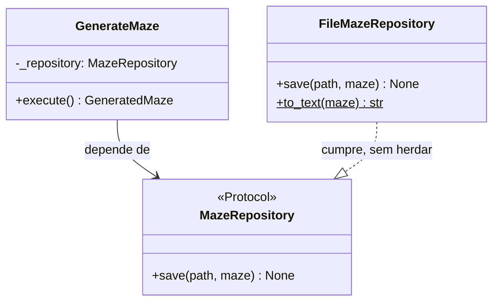

# A porta completa

A porta `MazeRepository` ([página anterior](./03-a-porta-maze-repository.md)) só descreve uma
forma: "algo com um método `save(path, maze)`". Falta ver como o use case, a porta e o
repositório se ligam, e quem confere que o repositório tem mesmo essa forma. Esta página mostra
as duas coisas e o arquivo `amazeing/use_cases/ports.py`.

## Quem depende de quem



Como ler o diagrama: cada caixa é uma classe, com os atributos e os métodos dentro. `-` marca um
membro interno (o `_` do Python) e `+` um público; `$` marca um método estático, chamado pela
classe. `<<Protocol>>` diz que a caixa é uma porta, só com assinaturas. A seta cheia (`-->`)
quer dizer "usa"; a tracejada com ponta vazada (`..|>`) quer dizer "cumpre a forma de".

- O `GenerateMaze` importa só o `MazeRepository`, da própria camada.
- O `FileMazeRepository` não importa `ports.py`: só tem um `save` com a mesma assinatura.
- Quem junta os dois é o `a_maze_ing.py`, que pode importar tudo:
  `GenerateMaze(generator, FileMazeRepository(), config)`.

## O que se ganha

- **A regra das camadas é respeitada**: o use case não sabe que existe arquivo.
- **Trocar a forma de gravar** não mexe no use case: outro repositório só precisa de um `save`
  com a mesma assinatura.
- **Experimentar sem disco**: qualquer objeto com `save` serve, como o `Memory` do Experimente
  da [página 8](./07-gravar-antes-de-desenhar.md).

## O arquivo completo

```python title="amazeing/use_cases/ports.py"
"""Ports that the use cases depend on."""

from typing import Protocol

from amazeing.domain.value_objects.generated_maze import GeneratedMaze


class MazeRepository(Protocol):
    """Storage of a generated maze."""

    def save(self, path: str, maze: GeneratedMaze) -> None:
        """Store a maze, replacing what the path held before.

        Args:
            path: Destination of the maze.
            maze: Maze to store.
        """
```

## Experimente: quem confere a forma

Enquanto o programa roda, o Python não confere se o objeto cumpre o `Protocol`. Quem confere é o
**mypy**, a ferramenta que lê as anotações de tipo e acusa incoerências **antes** de o programa
rodar.

Na raiz do projeto, os comandos abaixo criam um arquivo `troca_porta.py` com uma classe certa e
uma com o `save` errado (falta o `path`), passam o arquivo pelo mypy e o apagam:

```bash
cat > troca_porta.py <<'EOF'
from amazeing.domain.value_objects.generated_maze import GeneratedMaze
from amazeing.use_cases.ports import MazeRepository


class Screen:
    def save(self, path: str, maze: GeneratedMaze) -> None:
        print(path, maze.solution)


class Wrong:
    def save(self, maze: GeneratedMaze) -> None:
        print(maze.solution)


good: MazeRepository = Screen()
bad: MazeRepository = Wrong()
EOF
.venv/bin/python -m mypy --strict troca_porta.py
rm troca_porta.py
```

```text
troca_porta.py:16: error: Incompatible types in assignment (expression has type "Wrong", variable has type "MazeRepository")  [assignment]
troca_porta.py:16: note: Following member(s) of "Wrong" have conflicts:
troca_porta.py:16: note:     Expected:
troca_porta.py:16: note:         def save(self, path: str, maze: GeneratedMaze) -> None
troca_porta.py:16: note:     Got:
troca_porta.py:16: note:         def save(self, maze: GeneratedMaze) -> None
Found 1 error in 1 file (checked 1 source file)
```

`cat > troca_porta.py <<'EOF'` grava no arquivo tudo o que vem até a linha `EOF`. `--strict`
liga todas as conferências do mypy, como o `make lint-strict` do projeto. `Screen` passa sem
herdar nada; `Wrong` é acusada na linha 16, com a assinatura esperada e a encontrada.
