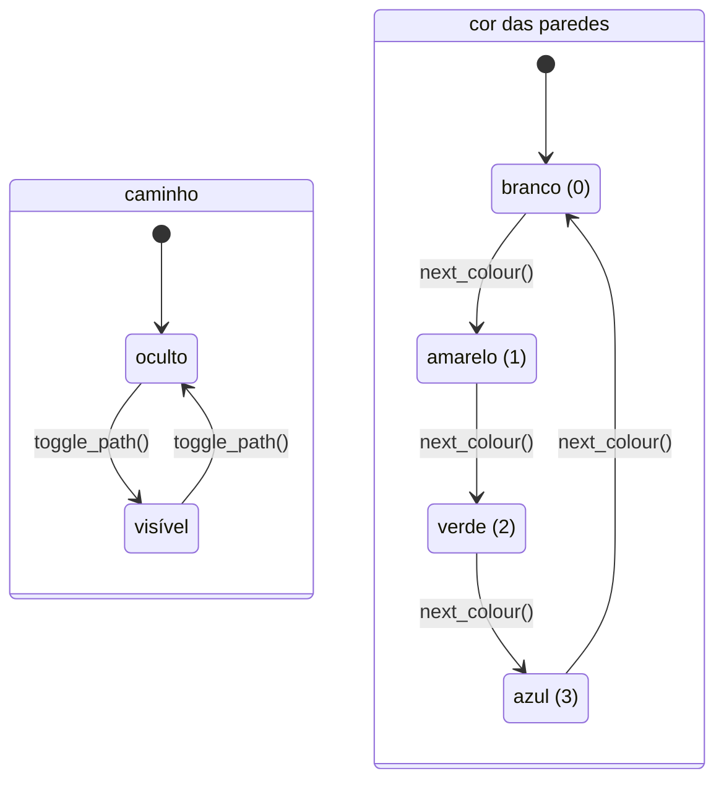

# O estado da tela

`ViewState` guarda as duas escolhas do usuário que mudam o desenho sem mudar o labirinto: se o
caminho mais curto aparece e qual é a cor das paredes. O `Menu` altera esse estado nas opções `2`
e `3`; o `RenderService` só o lê para decidir as cores.

## Por que uma entidade

O estado **muda** durante a sessão e precisa **sobreviver** às regenerações. Quem mostrou o
caminho e trocou a cor para verde e depois pede um labirinto novo continua vendo o caminho, em
paredes verdes. Por isso ele não pode morar no `GeneratedMaze`, que é refeito a cada opção `1`,
nem no `MazeConfig`, que vem do arquivo e nunca muda.

Um objeto que muda de estado e protege as próprias regras é uma **entidade**. As regras aqui são
pequenas, mas existem: o índice da cor nunca sai da paleta, e o caminho só alterna entre dois
valores. Quem usa o `ViewState` chama `toggle_path()` e `next_colour()`; ninguém escreve
`colour_index = 7` e quebra o desenho.

O `ViewState` mora em `amazeing/domain/entities/`, e não no `mazegen`: mostrar caminho e cor de
parede são assuntos da tela, e o pacote reutilizável não sabe que existe uma tela.

## A paleta

```python
from amazeing.utils.ansi import Ansi

PALETTE = (Ansi.WHITE, Ansi.YELLOW, Ansi.GREEN, Ansi.BLUE)
```

A paleta é uma tupla de códigos SGR de fundo (`47`, `43`, `42` e `44`), vindos do `Ansi` da
parte 10. Tupla, e não lista, porque ela nunca muda. Nenhuma das quatro cores coincide com as
cores fixas do desenho (cinza do "42", magenta da entrada, vermelho da saída, ciano do caminho):
em qualquer posição do rodízio, paredes e marcações continuam distinguíveis.

## O estado inicial

```python
    def __init__(self) -> None:
        """Start with the path hidden and white walls."""
        self.show_path = False
        self.colour_index = 0
```

O construtor não recebe nada. O subject não diz como começar, e o programa sempre abre com o
caminho oculto e as paredes brancas: o primeiro desenho mostra o labirinto limpo, e o usuário
pede o caminho se quiser.

## Alternar o caminho

```python
    def toggle_path(self) -> None:
        """Show the path when hidden and hide it when shown."""
        self.show_path = not self.show_path
```

A opção `2` do menu é "Show / Hide": uma única tecla que inverte. Não há `show()` e `hide()`
separados porque o menu nunca precisa de um dos dois sozinho.

## O rodízio das cores

```python
    def next_colour(self) -> None:
        """Move to the next wall colour, back to white after blue."""
        self.colour_index = (self.colour_index + 1) % len(PALETTE)
```

O resto da divisão por `len(PALETTE)` faz o índice voltar a `0` depois do `3`: branco, amarelo,
verde, azul, branco de novo. Usar `len(PALETTE)` em vez de `4` mantém o rodízio certo se alguém
acrescentar uma cor.

## A cor atual

```python
    @property
    def wall_colour(self) -> int:
        """SGR background code of the walls.

        Returns:
            The current colour of PALETTE.
        """
        return PALETTE[self.colour_index]
```

O `RenderService` precisa do código SGR, não do índice. A propriedade esconde a tradução: quem
desenha pergunta `state.wall_colour` e recebe `47`, `43`, `42` ou `44`.



As duas partes do estado são independentes: alternar o caminho não mexe na cor, e trocar a cor
não mexe no caminho.

## Experimente

```bash
.venv/bin/python -c '
from amazeing.domain.entities.view_state import ViewState
state = ViewState()
print(state.show_path, state.colour_index, state.wall_colour)
state.toggle_path()
for _ in range(5):
    state.next_colour()
    print(state.colour_index, state.wall_colour)
print(state.show_path)
'
```

```text
False 0 47
1 43
2 42
3 44
0 47
1 43
True
```

## O arquivo completo

```python title="amazeing/domain/entities/view_state.py"
"""State of the display that survives regenerations."""

from amazeing.utils.ansi import Ansi

PALETTE = (Ansi.WHITE, Ansi.YELLOW, Ansi.GREEN, Ansi.BLUE)


class ViewState:
    """Whether the shortest path shows and which colour the walls have.

    Attributes:
        show_path: True when the shortest path is drawn.
        colour_index: Position of the wall colour in PALETTE.
    """

    def __init__(self) -> None:
        """Start with the path hidden and white walls."""
        self.show_path = False
        self.colour_index = 0

    def toggle_path(self) -> None:
        """Show the path when hidden and hide it when shown."""
        self.show_path = not self.show_path

    def next_colour(self) -> None:
        """Move to the next wall colour, back to white after blue."""
        self.colour_index = (self.colour_index + 1) % len(PALETTE)

    @property
    def wall_colour(self) -> int:
        """SGR background code of the walls.

        Returns:
            The current colour of PALETTE.
        """
        return PALETTE[self.colour_index]
```
