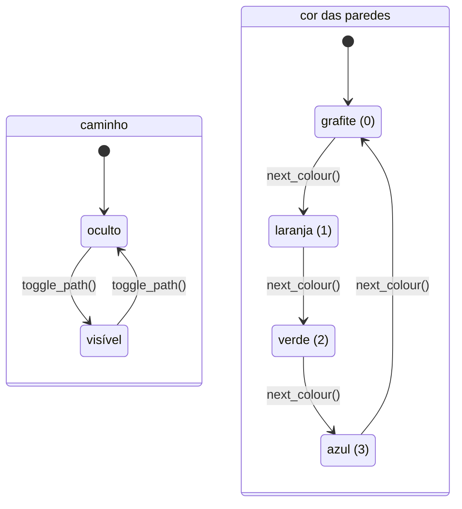

# Os métodos do `ViewState`

O `ViewState` ([página anterior](./01-o-estado-da-tela.md)) guarda duas escolhas do usuário: se
o caminho aparece e qual cor as paredes têm. O menu precisa mudar cada uma com uma tecla, e o
desenho precisa ler a cor atual. Esta página escreve os quatro pedaços da classe: o estado
inicial, os dois métodos que mudam o estado e a propriedade que dá a cor.

## O estado inicial

```python
    def __init__(self) -> None:
        """Start with the path hidden and charcoal walls."""
        self.show_path = False
        self.colour_index = 0
```

O `__init__` roda quando o objeto é criado, com `ViewState()`. O `-> None` é a anotação de tipo
do retorno: o método não devolve nada.

O enunciado não diz como a tela começa. O projeto escolheu o caminho escondido (`False`) e as
paredes grafite (índice `0`, o primeiro da paleta): o primeiro desenho mostra o labirinto limpo,
e o usuário pede o caminho se quiser.

## Alternar o caminho

```python
    def toggle_path(self) -> None:
        """Show the path when hidden and hide it when shown."""
        self.show_path = not self.show_path
```

*Toggle* é "alternar". O `not` inverte o valor: `not False` é `True`, `not True` é `False`. A
opção `2` do menu é "Show / Hide" ("mostrar / esconder"): uma tecla só, que inverte. Por isso
não há um `show()` e um `hide()` separados; o menu nunca precisa de um dos dois sozinho.

## O rodízio das cores

```python
    def next_colour(self) -> None:
        """Move to the next wall colour, back to charcoal after blue."""
        self.colour_index = (self.colour_index + 1) % len(PALETTE)
```

O `%` dá o **resto da divisão**. Com 4 cores, `len(PALETTE)` é 4:

| Índice antes | `+ 1` | `% 4` | Cor depois |
|---|---|---|---|
| 0 | 1 | 1 | laranja |
| 1 | 2 | 2 | verde |
| 2 | 3 | 3 | azul |
| 3 | 4 | 0 | grafite de novo |

O resto nunca chega a 4, então o índice nunca sai da paleta. Usar `len(PALETTE)` em vez de
escrever `4` mantém o rodízio certo se alguém acrescentar uma cor à tupla.

## A cor atual

```python
    @property
    def wall_colour(self) -> Rgb:
        """Colour of the walls.

        Returns:
            The current colour of PALETTE.
        """
        return PALETTE[self.colour_index]
```

O `@property` faz o método ser lido como se fosse um atributo, **sem parênteses**: quem desenha
escreve `state.wall_colour`, e não `state.wall_colour()`. O `RenderService` precisa da cor em si,
a tupla RGB, não da posição dela na paleta; a propriedade faz a tradução, e ninguém fora do
`ViewState` precisa saber que a paleta existe. A anotação `-> Rgb` diz que o valor devolvido é
uma tupla de três inteiros ([parte 10](../10-utilitarios/04-cores-ansi.md#o-tipo-rgb)).

As duas metades do estado, e o que muda cada uma:



As duas metades são independentes: alternar o caminho não mexe na cor, e trocar a cor não mexe
no caminho.

## O arquivo completo

```python title="amazeing/domain/entities/view_state.py"
"""State of the display that survives regenerations."""

from amazeing.utils.ansi import Ansi, Rgb

PALETTE = (Ansi.CHARCOAL, Ansi.ORANGE, Ansi.GREEN, Ansi.BLUE)


class ViewState:
    """Whether the shortest path shows and which colour the walls have.

    Attributes:
        show_path: True when the shortest path is drawn.
        colour_index: Position of the wall colour in PALETTE.
    """

    def __init__(self) -> None:
        """Start with the path hidden and charcoal walls."""
        self.show_path = False
        self.colour_index = 0

    def toggle_path(self) -> None:
        """Show the path when hidden and hide it when shown."""
        self.show_path = not self.show_path

    def next_colour(self) -> None:
        """Move to the next wall colour, back to charcoal after blue."""
        self.colour_index = (self.colour_index + 1) % len(PALETTE)

    @property
    def wall_colour(self) -> Rgb:
        """Colour of the walls.

        Returns:
            The current colour of PALETTE.
        """
        return PALETTE[self.colour_index]
```

## Experimente

Na raiz do projeto:

```bash
.venv/bin/python -c '
from amazeing.domain.entities.view_state import ViewState
state = ViewState()
print(state.show_path, state.colour_index, state.wall_colour)
state.toggle_path()
for _ in range(5):
    state.next_colour()
    print(state.colour_index, state.wall_colour)
print(state.show_path)
'
```

```text
False 0 (31, 41, 55)
1 (194, 65, 12)
2 (21, 128, 61)
3 (29, 78, 216)
0 (31, 41, 55)
1 (194, 65, 12)
True
```

A primeira linha é o estado inicial: caminho oculto e paredes grafite. Depois de cinco trocas
de cor, o índice deu a volta (`3` → `0`) e parou no `1`, o laranja; o caminho, alternado uma
vez, ficou `True`.
