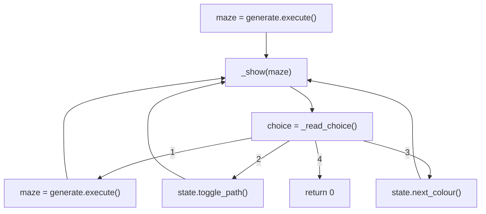

# O laço do menu

`Menu` é a interface do programa: desenha o labirinto, mostra as opções, lê a escolha e reage,
até o usuário sair. Junto com o `main`, é o único lugar do projeto que usa `print` e `input`.

## Os textos do menu

```python
MENU = ("=== A-Maze-ing ===", "1. Re-generate a new maze",
        "2. Show / Hide the shortest path", "3. Rotate the wall colours",
        "4. Quit")
PROMPT = "Choice? (1-4): "
PATTERN_MISSING = 'Error: maze too small for the "42" pattern'
CHOICES = ("1", "2", "3", "4")
```

Os textos ficam em constantes no topo do módulo, não espalhados pelos métodos: são o contrato
visível do programa, e mudar um deles é mudar uma linha só. O subject pede, no mínimo,
regenerar, mostrar e ocultar o caminho e trocar a cor das paredes; a opção `4` sai.

`PROMPT` termina com um espaço e sem quebra de linha: o cursor fica na mesma linha, logo depois
dos dois-pontos, esperando a tecla.

## Por que `input()`

O menu lê uma linha inteira com `input()`, e o usuário confirma com Enter. A alternativa seria
pôr o terminal em modo *raw* e reagir a cada tecla, sem Enter. O modo raw depende do terminal
(no Linux e no macOS é um módulo, no Windows é outro), quebra quando a entrada vem de um pipe e
deixa o terminal desconfigurado se o programa morrer sem restaurá-lo. `input()` funciona igual
num terminal, num pipe (`printf '2\n4\n' | python3 a_maze_ing.py config.txt`) e no avaliador.

## Os colaboradores

```python
    def __init__(self, generate: GenerateMaze, renderer: RenderService,
                 state: ViewState) -> None:
        """Keep the collaborators of the menu.

        Args:
            generate: Use case that builds and stores a maze.
            renderer: Service that draws a maze.
            state: Path visibility and wall colour of the session.
        """
        self._generate = generate
        self._renderer = renderer
        self._state = state
```

O `Menu` não cria nada: recebe prontos o use case que gera e grava, o service que desenha e o
estado da tela. Quem cria e liga as peças é o `main` (página
[O composition root](./04-o-composition-root.md)). O menu não sabe que existe um arquivo de
configuração, nem qual arquivo de saída é gravado: ele só pede "gere outro" ao `GenerateMaze`.

## O laço

```python
    def run(self) -> int:
        """Generate the first maze and loop over the menu.

        Exceptions are left to the caller: a failed regeneration, the end
        of the input and Ctrl+C all reach main.

        Returns:
            0 when the user picks option 4.
        """
        maze = self._generate.execute()
        while True:
            self._show(maze)
            choice = self._read_choice()
            if choice == "1":
                maze = self._generate.execute()
            elif choice == "2":
                self._state.toggle_path()
            elif choice == "3":
                self._state.next_colour()
            else:
                return 0
```

- A primeira geração acontece aqui, pelo mesmo `execute` das regenerações. Primeiro labirinto
  e regenerações seguem o mesmo caminho: gerar, gravar o arquivo, devolver o retrato.
- Cada volta do laço desenha e lê **uma escolha válida**. `_read_choice` só devolve `"1"` a
  `"4"`, então o `else` é sempre a opção `4`.
- As opções `1`, `2` e `3` só mudam o estado (o labirinto ou o `ViewState`) e voltam ao topo,
  onde o `_show` desenha de novo com o estado novo. Ninguém chama `_show` em mais de um lugar.
- A opção `1` troca só o `maze`. O `ViewState` é o mesmo objeto, então o caminho continua
  visível ou oculto, e a cor continua a escolhida.
- O `return 0` devolve o código de saída ao `main`, que o passa para `sys.exit`.



## Exceções sobem

O `Menu` não tem nenhum `try`. Três coisas podem interromper o laço:

- a regeneração falha ao gravar o arquivo (`OutputError`, vindo do repositório);
- a entrada acaba (`EOFError`, levantado pelo `input` com Ctrl+D ou no fim de um pipe);
- o usuário aperta Ctrl+C (`KeyboardInterrupt`).

Todas sobem até o `main`, que tem um único lugar para transformar cada uma em mensagem e código
de saída. Tratar parte delas aqui espalharia a mesma decisão por dois arquivos.
