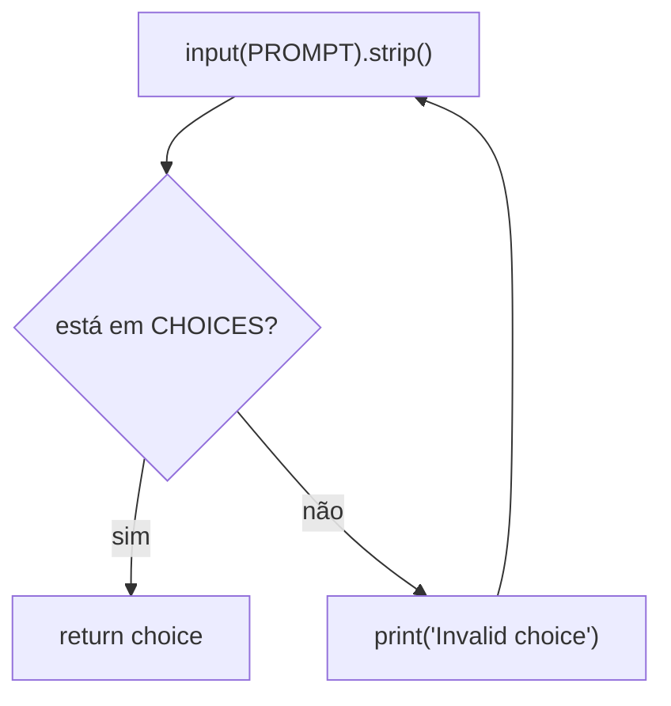

# Ler a escolha

`_read_choice` pergunta até vir uma das quatro opções e devolve a escolha como texto.

```python
    def _read_choice(self) -> str:
        """Ask until the user types one of the menu options.

        An invalid choice is answered on the prompt line without redrawing
        the maze.

        Returns:
            "1", "2", "3" or "4".
        """
        while True:
            choice = input(PROMPT).strip()
            if choice in CHOICES:
                return choice
            print("Invalid choice")
```

## `input(PROMPT).strip()`

`input` escreve o prompt sem quebra de linha, espera o Enter e devolve a linha sem o `\n`. O
`strip()` tira espaços e tabulações das pontas: ` 2 ` e `2` são a mesma escolha. Sem ele, um
espaço digitado por engano viraria `Invalid choice`, e o usuário não veria o motivo, porque o
espaço é invisível.

A escolha fica como texto. Converter com `int()` levantaria `ValueError` para `abc` e aceitaria
`02` e `+2`; comparar com `CHOICES` aceita exatamente as quatro strings e recusa todo o resto,
sem `try`.

## Escolha inválida não redesenha

Qualquer outra coisa (`9`, `abc`, `-1`, linha vazia) imprime `Invalid choice` e pergunta de
novo, **sem** desenhar o labirinto outra vez. O laço de leitura é separado do laço do `run`
justamente para isso: o `run` só volta a desenhar depois de uma escolha válida.

Redesenhar a cada erro imprimiria de novo as 31 linhas do labirinto 20x15 por causa de uma
tecla errada, e o aviso `Invalid choice` subiria para fora da tela junto com o desenho antigo.



## Num terminal e num pipe

Num terminal, o Enter que o usuário digita é ecoado, então `Invalid choice` sai na linha de
baixo:

```text
Choice? (1-4): 9
Invalid choice
Choice? (1-4):
```

Com a entrada vinda de um pipe, ninguém ecoa nada: o `9` não aparece e não há quebra de linha
depois do prompt. `Invalid choice` sai colado nele, e o próximo prompt vem na linha seguinte.
Saída real de `printf '9\n4\n' | python3 a_maze_ing.py config.txt`, sem as cores, a partir do
menu (o `$` marca o fim de cada linha):

```text
=== A-Maze-ing ===$
1. Re-generate a new maze$
2. Show / Hide the shortest path$
3. Rotate the wall colours$
4. Quit$
Choice? (1-4): Invalid choice$
Choice? (1-4): 
```

A última linha termina no espaço depois dos dois-pontos, sem quebra: a opção `4` sai sem
imprimir nada.

## O fim da entrada

Quando a entrada acaba (Ctrl+D no terminal, ou o fim do pipe), `input` levanta `EOFError`. O
`_read_choice` não o trata: ele sobe pelo `run` até o `main`, que encerra o programa com código
0 (página [A barreira de erros](./05-a-barreira-de-erros.md)). Sem esse cuidado, um pipe sem a
opção `4` deixaria o programa num traceback.
