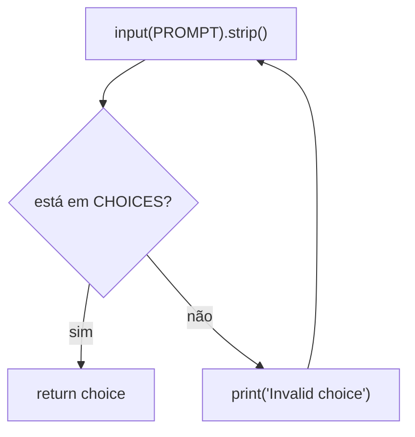

# Ler a escolha

O usuário pode digitar qualquer coisa na pergunta do menu: `2`, ` 2 ` com espaços, `abc`, `9`,
ou só apertar Enter. O menu precisa aceitar exatamente as quatro opções e, para todo o resto,
avisar e perguntar de novo. O método `_read_choice` faz isso.

```python
    def _read_choice(self) -> str:
        """Ask until the user types one of the menu options.

        An invalid choice is answered on the prompt line without redrawing
        the maze.

        Returns:
            "1", "2", "3" or "4".
        """
        while True:
            choice = input(PROMPT).strip()
            if choice in CHOICES:
                return choice
            print("Invalid choice")
```

Linha por linha:

- `while True:` repete até um `return`.
- `input(PROMPT)` mostra `Choice? (1-4): `, espera o Enter e devolve a linha digitada, sem o
  Enter.
- `.strip()` tira os espaços, as tabulações e as quebras de linha das **pontas** do texto:
  `" 2 ".strip()` dá `"2"`.
- `if choice in CHOICES:` confere se o texto é igual a um dos quatro de `CHOICES` (`"1"`, `"2"`,
  `"3"`, `"4"`). Se for, `return choice` devolve a escolha ao laço do `run`.
- Senão, `print("Invalid choice")` avisa, e o `while` pergunta de novo.

## Por que o `strip()`

Sem ele, um espaço digitado por engano antes ou depois do número viraria `Invalid choice`. O
usuário não entenderia o motivo, porque o espaço não aparece na tela.

## Por que comparar texto, e não converter para número

Converter com `int()` parece natural, mas aceitaria mais do que deve e quebraria com o resto:

- `int("02")`, `int("+2")` e `int(" 2 ")` dão todos `2`: respostas estranhas passariam como
  válidas;
- `int("abc")` levanta `ValueError`, e seria preciso um `try` para tratar.

Comparar com `CHOICES` aceita exatamente as quatro strings e recusa todo o resto, sem `try`.

## Escolha inválida não redesenha

Qualquer outra resposta (`9`, `abc`, `-1`, linha vazia) imprime `Invalid choice` e pergunta de
novo, **sem** desenhar o labirinto outra vez. É por isso que a leitura tem o seu próprio laço,
separado do laço do `run` ([página anterior](./07-o-laco-do-run.md)): o `run` só volta a
desenhar depois de uma escolha válida.

Redesenhar a cada erro imprimiria de novo todas as linhas do labirinto (31, num labirinto de 15
linhas de células) por causa de uma tecla errada, e o aviso `Invalid choice` sumiria para cima,
junto com o desenho antigo.



## Num terminal e num pipe

Num terminal, o que o usuário digita aparece na tela: o terminal **ecoa** as teclas, inclusive o
Enter, que pula de linha. Por isso `Invalid choice` sai na linha de baixo:

```text
Choice? (1-4): 9
Invalid choice
Choice? (1-4):
```

Com a entrada vinda de um **pipe** (o `|`, que entrega o texto de um comando como se fosse
digitado; [página 1](./01-o-laco-do-menu.md)), ninguém digita, e nada é ecoado: o `9` não
aparece e não há quebra de linha depois do prompt. `Invalid choice` sai colado nele, e o próximo
prompt vem na linha seguinte.

Com o programa pronto, `printf '9\n4\n' | .venv/bin/python a_maze_ing.py config.txt` termina
assim (só as últimas linhas, depois do desenho; a [página 10](./09-o-programa-rodando.md) roda o
comando de verdade). O `$` marca onde cada linha termina; ele não é impresso pelo programa:

```text
=== A-Maze-ing ===$
1. Re-generate a new maze$
2. Show / Hide the shortest path$
3. Rotate the wall colours$
4. Quit$
Choice? (1-4): Invalid choice$
Choice? (1-4): 
```

A última linha termina no espaço depois dos dois-pontos, sem quebra: a resposta `4` sai do
programa sem imprimir nada.

Por que a opção `4` não imprime uma quebra de linha antes de sair, como o Ctrl+D faz
([página 9](./06-saidas-e-erros-inesperados.md))? Num terminal, o usuário digita `4` e Enter, e o
terminal ecoa o Enter: o cursor já está numa linha nova, e o prompt do terminal aparece no lugar
certo. No Ctrl+D, nada é ecoado, e a quebra de linha precisa vir do programa. Com um pipe, a
saída termina colada no prompt, como acima; é o único caso em que isso acontece, e só quem roda
o programa sem ninguém no teclado o vê.

## O fim da entrada

Quando não há mais nada para ler, o `input` levanta `EOFError` (*End Of File*, "fim do
arquivo"). Isso acontece quando o usuário aperta Ctrl+D num terminal de Linux ou macOS, ou
quando o texto de um pipe acaba antes de uma resposta `4`.

O `_read_choice` não trata o `EOFError`: ele sobe pelo `run` até o `main`, que encerra o programa
com código 0, sem mensagem de erro ([página 9](./06-saidas-e-erros-inesperados.md)). Sem esse cuidado,
um pipe sem a resposta `4` terminaria o programa com um *traceback*, a listagem de erro do
Python.
