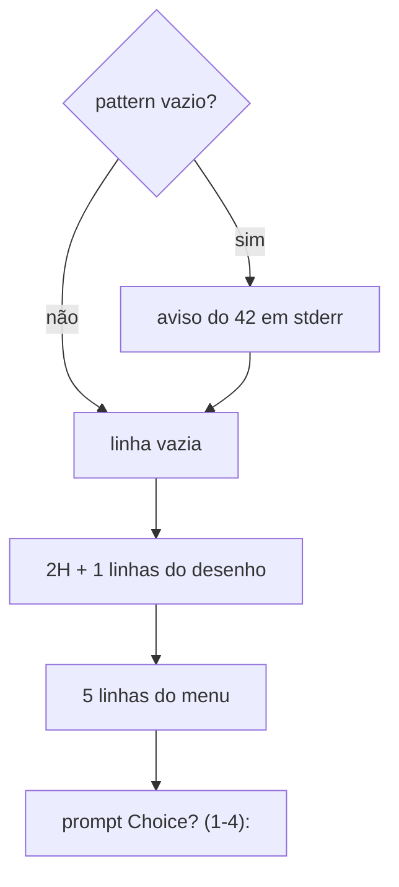

# Mostrar o labirinto

`_show` imprime um desenho completo: o aviso do "42", quando for o caso, uma linha vazia, o
labirinto e o menu.

```python
    def _show(self, maze: GeneratedMaze) -> None:
        """Print the "42" warning, a blank line, the drawing and the menu.

        With piped input nobody echoes the Enter; the blank line ends the
        previous prompt line before the drawing starts.

        Args:
            maze: Maze to draw.
        """
        if not maze.pattern:
            print(PATTERN_MISSING, file=sys.stderr)
        print()
        for line in self._renderer.render(maze, self._state):
            print(line)
        for line in MENU:
            print(line)
```

## O aviso do "42" ausente

Com `WIDTH < 9` ou `HEIGHT < 7`, o "42" não cabe, e o gerador cria o labirinto sem ele, com
`pattern` vazio. O subject manda avisar com uma mensagem de erro, mas não manda parar: o
labirinto é válido e o programa segue.

- O aviso vai para `sys.stderr`, como todo `Error:` do programa. Quem redireciona o desenho para
  um arquivo continua vendo o aviso no terminal.
- Ele sai **antes de cada desenho** desse labirinto, não só no primeiro. Depois de várias
  regenerações e trocas de cor, o aviso continua perto do desenho a que se refere.
- O código de saída não muda: a opção `4` ainda termina com 0.

`if not maze.pattern` usa a verdade do `frozenset`: vazio é falso.

```bash
printf '2\n4\n' | python3 a_maze_ing.py small.txt > /dev/null
```

Com um `small.txt` de 5x5, stderr recebe o aviso duas vezes, um por desenho (o inicial e o
redesenho depois do `2`):

```text
Error: maze too small for the "42" pattern
Error: maze too small for the "42" pattern
```

## A linha vazia antes do desenho

`print()` sem argumento imprime só a quebra de linha. Ela existe por causa do pipe.

Num terminal, o usuário digita `2` e Enter, e o terminal ecoa a quebra: o desenho começa numa
linha nova. Com a entrada vinda de um pipe, nada é ecoado. O cursor continua depois de
`Choice? (1-4): `, e sem a linha vazia a primeira linha do desenho sairia grudada no prompt,
desalinhando a borda Norte.

A linha vazia encerra a linha do prompt nos dois casos. No terminal ela aparece como uma linha
em branco entre o prompt e o desenho, o que também separa um desenho do anterior. O primeiro
desenho também começa com ela, então todo desenho tem o mesmo formato.

O desenho seguinte sai abaixo do anterior, sem limpar a tela. Limpar exigiria mais uma
sequência de terminal, e o histórico na tela deixa o usuário comparar o labirinto novo com o
anterior.

## O desenho e o menu

As linhas do `RenderService` já terminam com o reset das cores, então o `print` de cada uma só
acrescenta a quebra de linha. O menu vem logo abaixo, e o prompt é impresso pelo `input` do
`_read_choice`, na volta ao `run`.

Uma sessão num terminal com um config 9x7 (`PERFECT=False`, `SEED=4`): o primeiro desenho, uma
escolha inválida e o pedido do caminho; a linha vazia no fim é a que `_show` imprime antes do
desenho seguinte.


O desenho seguinte, depois do `2`: o mesmo labirinto, agora com o caminho em ciano, e o menu de
novo.


A sequência completa de um desenho:



## O arquivo completo

```python title="amazeing/ui/menu.py"
"""Interactive terminal menu."""

import sys

from amazeing.domain.entities.view_state import ViewState
from amazeing.domain.value_objects.generated_maze import GeneratedMaze
from amazeing.services.render_service import RenderService
from amazeing.use_cases.generate_maze import GenerateMaze

MENU = ("=== A-Maze-ing ===", "1. Re-generate a new maze",
        "2. Show / Hide the shortest path", "3. Rotate the wall colours",
        "4. Quit")
PROMPT = "Choice? (1-4): "
PATTERN_MISSING = 'Error: maze too small for the "42" pattern'
CHOICES = ("1", "2", "3", "4")


class Menu:
    """Draw the maze and answer the menu until the user quits."""

    def __init__(self, generate: GenerateMaze, renderer: RenderService,
                 state: ViewState) -> None:
        """Keep the collaborators of the menu.

        Args:
            generate: Use case that builds and stores a maze.
            renderer: Service that draws a maze.
            state: Path visibility and wall colour of the session.
        """
        self._generate = generate
        self._renderer = renderer
        self._state = state

    def run(self) -> int:
        """Generate the first maze and loop over the menu.

        Exceptions are left to the caller: a failed regeneration, the end
        of the input and Ctrl+C all reach main.

        Returns:
            0 when the user picks option 4.
        """
        maze = self._generate.execute()
        while True:
            self._show(maze)
            choice = self._read_choice()
            if choice == "1":
                maze = self._generate.execute()
            elif choice == "2":
                self._state.toggle_path()
            elif choice == "3":
                self._state.next_colour()
            else:
                return 0

    def _read_choice(self) -> str:
        """Ask until the user types one of the menu options.

        An invalid choice is answered on the prompt line without redrawing
        the maze.

        Returns:
            "1", "2", "3" or "4".
        """
        while True:
            choice = input(PROMPT).strip()
            if choice in CHOICES:
                return choice
            print("Invalid choice")

    def _show(self, maze: GeneratedMaze) -> None:
        """Print the "42" warning, a blank line, the drawing and the menu.

        With piped input nobody echoes the Enter; the blank line ends the
        previous prompt line before the drawing starts.

        Args:
            maze: Maze to draw.
        """
        if not maze.pattern:
            print(PATTERN_MISSING, file=sys.stderr)
        print()
        for line in self._renderer.render(maze, self._state):
            print(line)
        for line in MENU:
            print(line)
```
