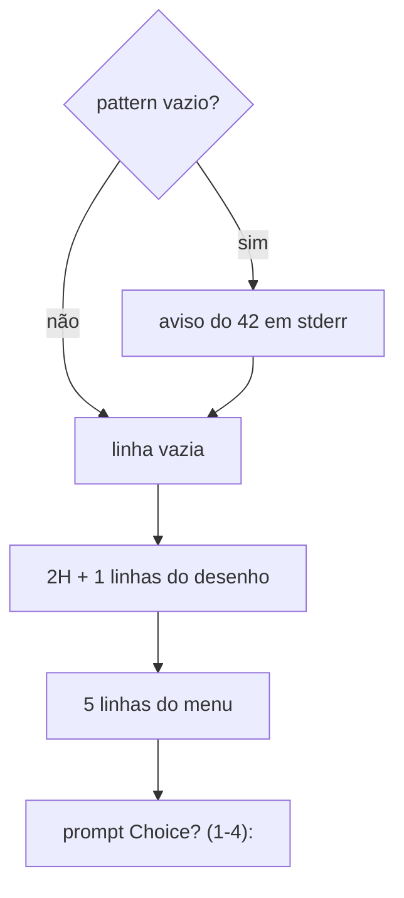

# Mostrar o labirinto

A cada volta do laço do menu, o programa precisa pôr na tela o desenho do labirinto e, logo
abaixo, o menu. Quando o labirinto é pequeno demais para o "42", precisa também avisar. O método
`_show` faz as três coisas.

```python
    def _show(self, maze: GeneratedMaze) -> None:
        """Print the "42" warning, a blank line, the drawing and the menu.

        With piped input nobody echoes the Enter; the blank line ends the
        previous prompt line before the drawing starts.

        Args:
            maze: Maze to draw.
        """
        if not maze.pattern:
            print(PATTERN_MISSING, file=sys.stderr)
        print()
        for line in self._renderer.render(maze, self._state):
            print(line)
        for line in MENU:
            print(line)
```

Na ordem: o aviso do "42", se for o caso; uma linha vazia; as linhas do desenho; as linhas do
menu.

## O aviso do "42" ausente

O "42" ocupa um bloco de 7 por 5 células e precisa de corredor em volta, então só cabe num
labirinto de pelo menos 9 colunas por 7 linhas ([parte 1](../01-o-problema/06-o-padrao-42.md)).
Num labirinto menor, o gerador cria o labirinto sem ele, e o conjunto `pattern` (as células do
"42") fica vazio.

O enunciado diz: o "42" pode ser omitido quando o labirinto é pequeno demais, e nesse caso o
programa imprime uma mensagem de erro no console. Ele não manda parar: o labirinto continua
válido, e o programa segue.

`if not maze.pattern` usa a regra de verdade do Python para coleções: um conjunto vazio conta
como falso, e um com itens conta como verdadeiro. Então `not maze.pattern` é verdadeiro quando o
"42" não coube.

### A saída de erros

Um programa tem duas saídas de texto, e as duas aparecem no terminal:

- a **saída padrão** (*stdout*), onde o `print` escreve normalmente;
- a **saída de erros** (*stderr*), reservada para avisos e erros.

`print(texto, file=sys.stderr)` escreve na saída de erros. A diferença aparece quando a saída
padrão é redirecionada: `> arquivo` manda só a stdout para o arquivo, e o que vai para a stderr
continua aparecendo no terminal.

Um exemplo, com um arquivo de configuração `pequeno.txt` de um labirinto 5x5, pequeno demais
para o "42" (`WIDTH=5`, `HEIGHT=5`, `ENTRY=0,0`, `EXIT=4,4`, `OUTPUT_FILE=pequeno_maze.txt`,
`PERFECT=False`). Com o programa pronto (o exemplo roda na
[página 10](./09-o-programa-rodando.md)), o comando

```bash
printf '2\n4\n' | .venv/bin/python a_maze_ing.py pequeno.txt > /dev/null
```

responde `2` e depois `4` ao menu e manda a stdout para o `/dev/null`, um "arquivo" especial que
descarta tudo o que recebe. O desenho e o menu somem, e sobra no terminal só a stderr: o aviso,
duas vezes, um para cada desenho (o inicial e o redesenho depois do `2`):

```text
Error: maze too small for the "42" pattern
Error: maze too small for the "42" pattern
```

As escolhas do projeto sobre esse aviso:

- vai para a stderr, como toda mensagem `Error:` do programa;
- sai **antes de cada desenho** daquele labirinto, não só no primeiro: depois de várias trocas de
  cor, o aviso continua perto do desenho a que se refere;
- não muda o código de saída: a opção `4` ainda termina com 0 ("terminou bem").

## A linha vazia antes do desenho

`print()` sem nada imprime só uma quebra de linha. Ela existe por causa do pipe.

Num terminal, o usuário digita `2` e Enter, e o terminal ecoa o Enter: o cursor vai para uma
linha nova, e o desenho começa ali. Com a entrada vinda de um pipe, nada é ecoado
([página anterior](./02-ler-a-escolha.md)). O cursor continua parado depois de
`Choice? (1-4): `, e sem a linha vazia a primeira linha do desenho sairia grudada no prompt,
desalinhando a borda de cima.

A linha vazia termina a linha do prompt nos dois casos. No terminal, ela aparece como uma linha
em branco entre o prompt e o desenho, o que também separa um desenho do anterior. O primeiro
desenho também começa com ela, então todo desenho tem o mesmo formato.

O desenho seguinte sai **abaixo** do anterior, sem limpar a tela; é uma escolha do projeto.
Limpar exigiria mais uma sequência especial de terminal, e o histórico na tela deixa o usuário
comparar o labirinto novo com o anterior.

## O desenho e o menu

As linhas do `RenderService` já terminam com a sequência que volta as cores ao normal
([parte 13](../13-tela/06-as-linhas-de-texto.md)), então o `print` de cada uma só acrescenta a
quebra de linha. O menu vem logo abaixo. A pergunta `Choice? (1-4): ` não é impressa aqui: quem
a mostra é o `input` do `_read_choice`, na volta ao laço do `run`.

Uma sessão num terminal, com um arquivo de configuração `nove.txt` de um labirinto 9x7
(`WIDTH=9`, `HEIGHT=7`, `ENTRY=0,0`, `EXIT=8,6`, `OUTPUT_FILE=nove_maze.txt`, `PERFECT=False`,
`SEED=4`): o comando, o primeiro desenho, uma resposta inválida e o pedido do caminho.


O desenho tem fundo branco, paredes grafite, o "42" em cinza, a entrada em magenta e a saída em
vermelho; o texto do comando e do menu sai nas cores normais do terminal, porque cada linha do
desenho termina com o reset.

O desenho seguinte, depois do `2`: o mesmo labirinto, agora com o caminho em ciano, e o menu de
novo.


A sequência completa de um desenho, para um labirinto de `H` linhas de células:



## O arquivo completo

```python title="amazeing/ui/menu.py"
"""Interactive terminal menu."""

import sys

from amazeing.domain.entities.view_state import ViewState
from amazeing.domain.value_objects.generated_maze import GeneratedMaze
from amazeing.services.render_service import RenderService
from amazeing.use_cases.generate_maze import GenerateMaze

MENU = ("=== A-Maze-ing ===", "1. Re-generate a new maze",
        "2. Show / Hide the shortest path", "3. Rotate the wall colours",
        "4. Quit")
PROMPT = "Choice? (1-4): "
PATTERN_MISSING = 'Error: maze too small for the "42" pattern'
CHOICES = ("1", "2", "3", "4")


class Menu:
    """Draw the maze and answer the menu until the user quits."""

    def __init__(self, generate: GenerateMaze, renderer: RenderService,
                 state: ViewState) -> None:
        """Keep the collaborators of the menu.

        Args:
            generate: Use case that builds and stores a maze.
            renderer: Service that draws a maze.
            state: Path visibility and wall colour of the session.
        """
        self._generate = generate
        self._renderer = renderer
        self._state = state

    def run(self) -> int:
        """Generate the first maze and loop over the menu.

        Exceptions are left to the caller: a failed regeneration, the end
        of the input and Ctrl+C all reach main.

        Returns:
            0 when the user picks option 4.
        """
        maze = self._generate.execute()
        while True:
            self._show(maze)
            choice = self._read_choice()
            if choice == "1":
                maze = self._generate.execute()
            elif choice == "2":
                self._state.toggle_path()
            elif choice == "3":
                self._state.next_colour()
            else:
                return 0

    def _read_choice(self) -> str:
        """Ask until the user types one of the menu options.

        An invalid choice is answered on the prompt line without redrawing
        the maze.

        Returns:
            "1", "2", "3" or "4".
        """
        while True:
            choice = input(PROMPT).strip()
            if choice in CHOICES:
                return choice
            print("Invalid choice")

    def _show(self, maze: GeneratedMaze) -> None:
        """Print the "42" warning, a blank line, the drawing and the menu.

        With piped input nobody echoes the Enter; the blank line ends the
        previous prompt line before the drawing starts.

        Args:
            maze: Maze to draw.
        """
        if not maze.pattern:
            print(PATTERN_MISSING, file=sys.stderr)
        print()
        for line in self._renderer.render(maze, self._state):
            print(line)
        for line in MENU:
            print(line)
```
