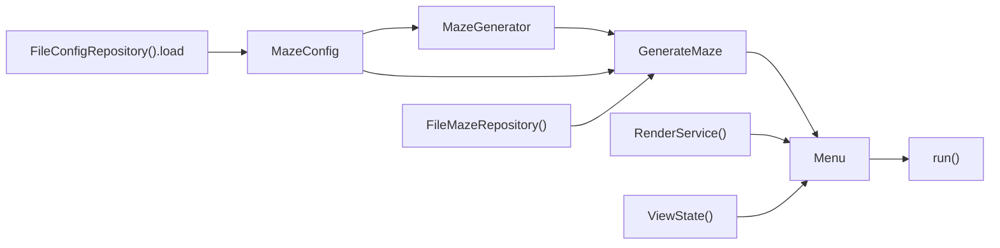

# O composition root

`a_maze_ing.py` é o script que o subject manda executar: `python3 a_maze_ing.py config.txt`.
Ele não tem regra de negócio. Faz duas coisas: **monta** as peças das camadas e **trata** todo
erro que chegar até ele.

O lugar que cria as classes concretas e as liga é o *composition root*. Todas as outras classes
recebem os colaboradores prontos no construtor; só aqui aparecem os nomes
`FileConfigRepository`, `FileMazeRepository` e `RenderService` juntos.

## Os imports

```python
import sys

from amazeing.domain.entities.view_state import ViewState
from amazeing.errors import AppError
from amazeing.repositories.config_repository import FileConfigRepository
from amazeing.repositories.maze_repository import FileMazeRepository
from amazeing.services.render_service import RenderService
from amazeing.ui.menu import Menu
from amazeing.use_cases.generate_maze import GenerateMaze
from mazegen import MazeError, MazeGenerator
```

O script importa de todas as camadas. Ele é o único que pode: está fora delas, no topo, e
depende de tudo para que nada dependa dele. Do `mazegen` vêm só os dois nomes públicos do
pacote, `MazeGenerator` e `MazeError`.

## As constantes

```python
USAGE = "Usage: python3 a_maze_ing.py <config_file>"
EXIT_OK = 0
EXIT_ERROR = 1
```

`EXIT_OK` e `EXIT_ERROR` dão nome aos códigos de saída: `return EXIT_ERROR` diz o que
significa, `return 1` obriga o leitor a saber a convenção.

## A linha de comando

```python
def main(argv: list[str]) -> int:
    """Read the configuration, generate the maze and run the menu.

    Args:
        argv: Command-line arguments without the script name.

    Returns:
        0 on Quit, end of input or Ctrl+C; 1 on any error.
    """
    if len(argv) != 1:
        print(USAGE, file=sys.stderr)
        return EXIT_ERROR
```

- `main` recebe os argumentos **sem** o nome do script e **devolve** o código de saída, em vez
  de ler `sys.argv` e chamar `sys.exit` por dentro. Assim ele pode ser chamado de outro código
  Python com qualquer lista, e quem chama decide o que fazer com o código.
- O subject define o uso com exatamente um argumento. Zero ou dois ou mais imprimem a linha de
  uso em stderr e terminam com 1, antes de tentar abrir qualquer arquivo.
- `<config_file>` diz o que falta, e a linha mostra o comando inteiro, pronto para copiar.

```bash
python3 a_maze_ing.py
python3 a_maze_ing.py config.txt outro.txt
```

```text
Usage: python3 a_maze_ing.py <config_file>
Usage: python3 a_maze_ing.py <config_file>
```

Os dois terminam com código 1.

## Montar as peças

```python
        config = FileConfigRepository().load(argv[0])
        generator = MazeGenerator(config.width, config.height, config.entry,
                                  config.exit, config.perfect, config.seed)
        generate = GenerateMaze(generator, FileMazeRepository(), config)
        return Menu(generate, RenderService(), ViewState()).run()
```

Essas quatro linhas ficam dentro do `try` da [próxima página](./05-a-barreira-de-erros.md).



A ordem não é arbitrária:

- **O config antes do gerador.** O `MazeGenerator` também valida os parâmetros, mas a mensagem
  dele cita os nomes do construtor (`width`, `entry`). Validando o arquivo antes, o usuário vê a
  chave que escreveu (`WIDTH`, `ENTRY`) e o nome do arquivo.
- **O gerador é criado uma vez.** Ele guarda o `random.Random` da seed. Cada `generate()` tira
  números da mesma sequência, então, com seed, a sessão inteira (o primeiro labirinto e cada
  regeneração) se repete igual.
- **O `GenerateMaze` recebe o `FileMazeRepository` concreto**, mas declara depender só da porta
  `MazeRepository`. A troca do repositório (por um que grava em memória, por exemplo) acontece
  aqui e em nenhum outro lugar.
- **O `ViewState` nasce uma vez por sessão**, fora do laço. Se o `Menu` o criasse a cada
  regeneração, o caminho e a cor voltariam ao início.

A última linha devolve o resultado de `run()`: o código 0 da opção `4`.

## O fim do script

```python
if __name__ == "__main__":
    sys.exit(main(sys.argv[1:]))
```

`sys.argv[1:]` tira o nome do script. `sys.exit` transforma o inteiro devolvido em código de
saída do processo. O `if __name__ == "__main__"` faz o `main` rodar só quando o arquivo é
executado, não quando é importado.
