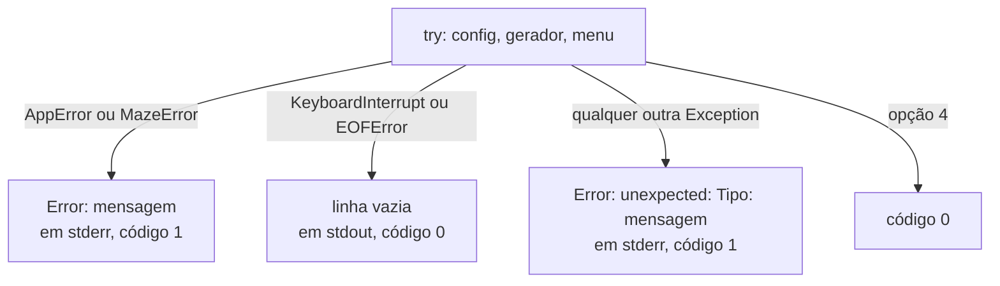

# A barreira de erros

O subject exige que o programa trate todos os erros com elegância, nunca trave inesperadamente
e sempre dê uma mensagem clara; um programa que cai com exceção não tratada na avaliação é
considerado não funcional. O `main` cumpre isso com **um único `try`** em volta da leitura do
config, da criação do gerador e do menu. Toda exceção, de qualquer camada, termina aqui.

```python
    try:
        config = FileConfigRepository().load(argv[0])
        generator = MazeGenerator(config.width, config.height, config.entry,
                                  config.exit, config.perfect, config.seed)
        generate = GenerateMaze(generator, FileMazeRepository(), config)
        return Menu(generate, RenderService(), ViewState()).run()
    except (AppError, MazeError) as error:
        print(f"Error: {error}", file=sys.stderr)
        return EXIT_ERROR
    except (KeyboardInterrupt, EOFError):
        # Keeps the shell prompt off the "Choice? (1-4): " line.
        print()
        return EXIT_OK
    except Exception as error:
        print(f"Error: unexpected: {type(error).__name__}: {error}",
              file=sys.stderr)
        return EXIT_ERROR
```



## Erros conhecidos: `AppError` e `MazeError`

`AppError` é a base dos erros da aplicação (`ConfigError` do config, `OutputError` da gravação),
e `MazeError` é o erro do gerador. As camadas que os levantam já escrevem a mensagem completa,
com o arquivo, a linha ou a chave. O `main` só acrescenta `Error: ` na frente:

```text
Error: configuration file not found: nao_existe.txt
Error: cannot read configuration file pasta: Is a directory
Error: ruim.txt: WIDTH must be between 1 and 100, got 0
```

Todos terminam com código 1. A mensagem vai para stderr, separada do desenho: quem redireciona
stdout para um arquivo continua vendo o erro.

O `try` cobre também o menu, então uma regeneração que falha ao gravar o arquivo (disco cheio,
arquivo sem permissão) sai do mesmo jeito, no meio da sessão:

```text
Error: cannot write output file 'locked.txt': Permission denied
```

## Saída do usuário: Ctrl+C e Ctrl+D

Ctrl+C levanta `KeyboardInterrupt`; o fim da entrada (Ctrl+D no terminal, ou o fim de um pipe)
faz o `input` levantar `EOFError`. Nenhum dos dois é erro: o usuário quis sair. O programa
termina com código 0, sem nada em stderr.

O `print()` imprime só uma quebra de linha. O usuário estava parado em `Choice? (1-4): `, sem
quebra no fim; sem o `print()`, o prompt do shell apareceria colado nele.

```bash
python3 a_maze_ing.py config.txt < /dev/null
```

A saída termina em `Choice? (1-4): ` seguido da quebra de linha do `print()`, e o código de
saída é 0.

## A rede de segurança: `Exception`

Qualquer outra exceção é um bug: algo que nenhuma camada previu. Ela também vira uma linha só,
com o tipo e a mensagem, e código 1:

```text
Error: unexpected: KeyError: 'x'
```

`type(error).__name__` dá o nome da classe (`KeyError`), que é a pista mais útil para quem vai
consertar. O `unexpected:` avisa que não é um erro de uso: o arquivo de configuração não tem
culpa.

## A ordem dos `except` importa

Python testa os `except` de cima para baixo e usa o primeiro que casar.

- `EOFError` é subclasse de `Exception`. Se `except Exception` viesse antes, o Ctrl+D virava
  `Error: unexpected: EOFError` com código 1.
- `AppError` e `MazeError` também são subclasses de `Exception`. Pelo mesmo motivo, ficam acima
  dele, ou todo erro de config sairia como `unexpected`.
- `KeyboardInterrupt` não é subclasse de `Exception`: herda direto de `BaseException`. Um
  `except Exception` nunca o pegaria; ele precisa estar listado pelo nome.

Por isso a ordem é: erros conhecidos, saídas do usuário e, por último, o genérico.

## O que fica fora do `try`

A checagem dos argumentos fica antes do `try` porque não levanta nada: é um `if` que imprime
o uso e devolve 1.

Os `import` do topo também ficam fora. Se a pasta `amazeing/` não estiver ao lado do script,
o Python falha com `ModuleNotFoundError` antes de o `main` existir. Isso só acontece com a
instalação incompleta (a parte 15 mostra por que `amazeing/` precisa ir junto com o script).

## Experimente

Um erro inesperado, simulado trocando o `load` por uma função que levanta `KeyError`:

```bash
.venv/bin/python -c 'import sys, a_maze_ing
from amazeing.repositories.config_repository import FileConfigRepository
def boom(self, path): raise KeyError("x")
FileConfigRepository.load = boom
sys.exit(a_maze_ing.main(["config.txt"]))'; echo "exit=$?"
```

```text
Error: unexpected: KeyError: 'x'
exit=1
```

## O arquivo completo

```python title="a_maze_ing.py"
"""Entry point of A-Maze-ing: wire the layers and report every error."""

import sys

from amazeing.domain.entities.view_state import ViewState
from amazeing.errors import AppError
from amazeing.repositories.config_repository import FileConfigRepository
from amazeing.repositories.maze_repository import FileMazeRepository
from amazeing.services.render_service import RenderService
from amazeing.ui.menu import Menu
from amazeing.use_cases.generate_maze import GenerateMaze
from mazegen import MazeError, MazeGenerator

USAGE = "Usage: python3 a_maze_ing.py <config_file>"
EXIT_OK = 0
EXIT_ERROR = 1


def main(argv: list[str]) -> int:
    """Read the configuration, generate the maze and run the menu.

    Args:
        argv: Command-line arguments without the script name.

    Returns:
        0 on Quit, end of input or Ctrl+C; 1 on any error.
    """
    if len(argv) != 1:
        print(USAGE, file=sys.stderr)
        return EXIT_ERROR
    try:
        config = FileConfigRepository().load(argv[0])
        generator = MazeGenerator(config.width, config.height, config.entry,
                                  config.exit, config.perfect, config.seed)
        generate = GenerateMaze(generator, FileMazeRepository(), config)
        return Menu(generate, RenderService(), ViewState()).run()
    except (AppError, MazeError) as error:
        print(f"Error: {error}", file=sys.stderr)
        return EXIT_ERROR
    except (KeyboardInterrupt, EOFError):
        # Keeps the shell prompt off the "Choice? (1-4): " line.
        print()
        return EXIT_OK
    except Exception as error:
        print(f"Error: unexpected: {type(error).__name__}: {error}",
              file=sys.stderr)
        return EXIT_ERROR


if __name__ == "__main__":
    sys.exit(main(sys.argv[1:]))
```
