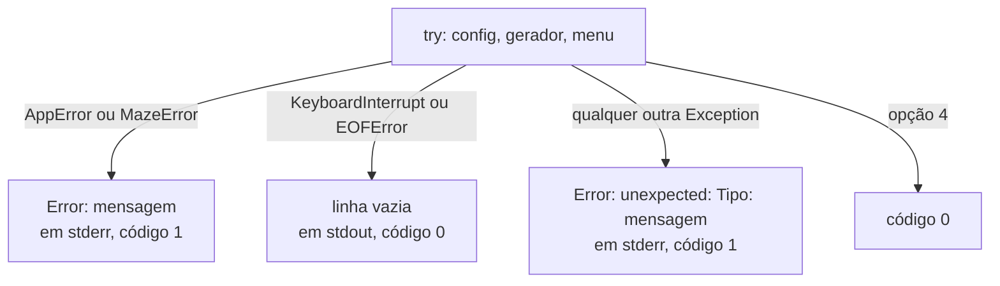

# A barreira de erros

Quando algo dá errado (o arquivo de configuração não existe, um valor é inválido, o arquivo de
saída não pode ser gravado), o Python levanta (lança) uma **exceção**. Se ninguém a trata, o
programa para na hora e imprime um *traceback*.

O enunciado proíbe isso. O programa precisa tratar todos os erros: configuração inválida,
arquivo não encontrado, sintaxe errada, parâmetros impossíveis. Ele **nunca** pode travar
inesperadamente e precisa **sempre** dar uma mensagem de erro clara. Na avaliação, um programa
que trava com uma exceção não tratada é considerado não funcional.

O `main` cumpre isso com um único `try`, a "barreira" por onde toda exceção do programa passa
antes de chegar ao usuário.

## O que é um traceback

É a listagem que o Python imprime quando uma exceção chega ao topo do programa sem ser tratada.
Na raiz do projeto, os comandos abaixo criam um script de cinco linhas, `sem_barreira.py`, que lê
um arquivo de configuração que não existe **sem** barreira; depois rodam o script e o apagam:

```bash
cat > sem_barreira.py <<'EOF'
import sys

from amazeing.repositories.config_repository import FileConfigRepository

FileConfigRepository().load(sys.argv[1])
EOF
.venv/bin/python sem_barreira.py nao_existe.txt
rm sem_barreira.py
```

A saída, com o começo de cada caminho (a pasta do projeto) encurtado para `.../`:

```text
Traceback (most recent call last):
  File ".../sem_barreira.py", line 5, in <module>
    FileConfigRepository().load(sys.argv[1])
    ~~~~~~~~~~~~~~~~~~~~~~~~~~~^^^^^^^^^^^^^
  File ".../amazeing/repositories/config_repository.py", line 30, in load
    raise ConfigError(
        f"configuration file not found: {path}") from None
amazeing.errors.ConfigError: configuration file not found: nao_existe.txt
```

O traceback lista as chamadas de função que levaram ao erro, da mais externa para a mais
interna, com o arquivo e a linha de cada uma, e termina com o tipo da exceção e a mensagem. É
útil para quem programa e está procurando um defeito. Para o usuário, é ruído: a única
informação que importa está na última linha, misturada com nomes internos. E, na avaliação, um
traceback quer dizer que o programa travou.

Com a barreira, o mesmo erro sai assim, e o programa termina com código 1 (a
[página 10](./09-o-programa-rodando.md) roda o programa pronto com esse arquivo):

```text
Error: configuration file not found: nao_existe.txt
```

## O `try` do `main`

```python
    try:
        config = FileConfigRepository().load(argv[0])
        generator = MazeGenerator(config.width, config.height, config.entry,
                                  config.exit, config.perfect, config.seed)
        generate = GenerateMaze(generator, FileMazeRepository(), config)
        return Menu(generate, RenderService(), ViewState()).run()
    except (AppError, MazeError) as error:
        print(f"Error: {error}", file=sys.stderr)
        return EXIT_ERROR
    except (KeyboardInterrupt, EOFError):
        # Keeps the shell prompt off the "Choice? (1-4): " line.
        print()
        return EXIT_OK
    except Exception as error:
        print(f"Error: unexpected: {type(error).__name__}: {error}",
              file=sys.stderr)
        return EXIT_ERROR
```

Como o `try` funciona:

- o Python roda o bloco do `try`; se nada for levantado, os `except` são ignorados;
- se uma exceção for levantada em qualquer ponto do bloco, **inclusive dentro** das funções que
  ele chama (a leitura do config, o gerador, o laço inteiro do menu), o Python interrompe o bloco
  e procura o primeiro `except` cujo tipo combina com a exceção;
- `except (A, B)` pega uma exceção do tipo `A` **ou** do tipo `B` (ou de uma subclasse delas);
- `as error` guarda a exceção na variável `error`, e `{error}` numa f-string mostra a mensagem
  dela.



Por que essa decisão fica só no `main`, e quais erros ele já conhece, estão na
[próxima página](./10-so-o-main-trata.md).
