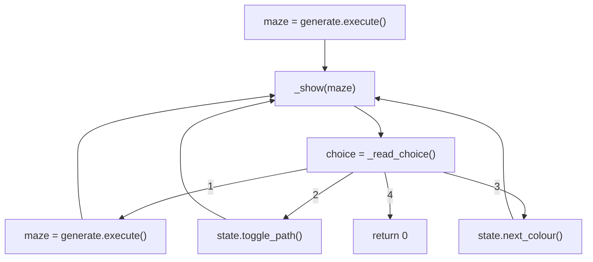

# O laço do menu

O menu ([página anterior](./01-o-laco-do-menu.md)) precisa repetir o mesmo ciclo até o usuário
pedir para sair: desenhar, perguntar, reagir. Esta página escreve o método `run`, que gera o
primeiro labirinto e faz esse ciclo, e mostra o que pode interrompê-lo.

## O método `run`

```python
    def run(self) -> int:
        """Generate the first maze and loop over the menu.

        Exceptions are left to the caller: a failed regeneration, the end
        of the input and Ctrl+C all reach main.

        Returns:
            0 when the user picks option 4.
        """
        maze = self._generate.execute()
        while True:
            self._show(maze)
            choice = self._read_choice()
            if choice == "1":
                maze = self._generate.execute()
            elif choice == "2":
                self._state.toggle_path()
            elif choice == "3":
                self._state.next_colour()
            else:
                return 0
```

Passo a passo:

1. `maze = self._generate.execute()` gera o **primeiro** labirinto, grava o arquivo de saída e
   guarda o retrato em `maze`.
2. `while True:` repete o bloco de baixo para sempre. A única saída é o `return`.
3. `self._show(maze)` imprime o desenho e o menu ([página 4](./03-mostrar-o-labirinto.md)).
4. `self._read_choice()` pergunta até vir uma resposta válida e devolve `"1"`, `"2"`, `"3"` ou
   `"4"` ([próxima página](./02-ler-a-escolha.md)).
5. Conforme a resposta:
   - `"1"`: gera outro labirinto (e regrava o arquivo); `maze` passa a ser o novo;
   - `"2"`: liga ou desliga o caminho no `ViewState`;
   - `"3"`: passa as paredes para a próxima cor;
   - qualquer outra: só pode ser `"4"`, porque `_read_choice` nunca devolve outra coisa. O
     `return 0` sai do laço e do método.
6. Nas opções `1`, `2` e `3`, o laço volta ao passo 3 e desenha de novo, já com a mudança.

Uma sessão em que o usuário digita `2`, depois `3`, depois `1` e por fim `4`:

| Resposta | O que muda | Desenho seguinte |
|---|---|---|
| (início) | gera e grava o primeiro labirinto | labirinto 1, sem caminho, paredes grafite |
| `2` | `show_path` vira `True` | labirinto 1, com caminho, paredes grafite |
| `3` | a cor passa para laranja | labirinto 1, com caminho, paredes laranja |
| `1` | gera e grava o labirinto 2 | labirinto 2, com caminho, paredes laranja |
| `4` | `return 0` | nenhum: o programa termina |

A opção `1` troca só o `maze`. O `ViewState` é o mesmo objeto do começo ao fim, então o caminho
continua visível e a cor continua a escolhida.

O desenho acontece num lugar só, no topo do laço. As opções não desenham nada: só mudam o estado
e deixam o laço voltar ao `_show`.



O `0` devolvido é o **código de saída** do programa: o número que um programa entrega ao sistema
quando termina. Por convenção, 0 quer dizer "terminou bem", e qualquer outro número quer dizer
"deu erro". Scripts e outras ferramentas leem esse número para saber se o programa funcionou; no
terminal, `echo $?` logo depois de um comando mostra o código dele (o `$?` guarda o código do
último comando). O `run` devolve o 0 ao `main`, que o passa ao sistema
([página 6](./08-montar-as-pecas.md)).

## As exceções sobem

O `Menu` não tem nenhum `try`. Quando uma função levanta uma exceção e não a trata, o Python sai
dessa função e entrega a exceção a quem a chamou; se esta também não trata, sai dela, e assim por
diante. Diz-se que a exceção **sobe**.

Quatro coisas podem interromper o laço:

- a gravação do arquivo falha numa regeneração: o `GenerateMaze` levanta (lança) `OutputError`, o
  erro da aplicação para "não consegui gravar o arquivo de saída"
  ([parte 10](../10-utilitarios/05-a-hierarquia-app-error.md));
- a geração falha: no modo Pac-Man, o `generate()` do gerador levanta `MazeError` quando 20
  tentativas seguidas não montam um tabuleiro válido
  ([parte 9](../09-gerador/03-generate.md));
- a entrada acaba: o `input` levanta `EOFError` (*End Of File*, "fim do arquivo") quando não há
  mais nada para ler, por exemplo quando o usuário aperta Ctrl+D ou quando o texto de um pipe
  termina;
- o usuário aperta Ctrl+C: o Python levanta `KeyboardInterrupt` ("interrupção pelo teclado").

As quatro sobem até o `main`, que tem um único lugar para transformar cada uma numa mensagem e
num código de saída (páginas [7](./05-a-barreira-de-erros.md) a
[9](./06-saidas-e-erros-inesperados.md)). Tratar parte delas aqui espalharia a mesma decisão por
dois arquivos.
