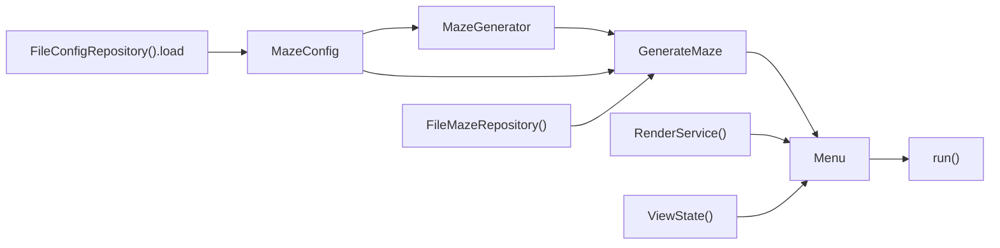

# Montar as peças

Com os argumentos conferidos ([página anterior](./04-o-composition-root.md)), o `main` precisa
criar cada objeto do programa e entregar a cada um as peças de que ele precisa, na ordem certa.
Esta página mostra essas quatro linhas, por que a ordem delas não é arbitrária e como o
arquivo termina.

## Montar as peças

```python
        config = FileConfigRepository().load(argv[0])
        generator = MazeGenerator(config.width, config.height, config.entry,
                                  config.exit, config.perfect, config.seed)
        generate = GenerateMaze(generator, FileMazeRepository(), config)
        return Menu(generate, RenderService(), ViewState()).run()
```

Essas quatro linhas ficam dentro do `try` da [próxima página](./05-a-barreira-de-erros.md),
que trata os erros.

1. `FileConfigRepository().load(argv[0])` lê o arquivo de configuração e devolve um `MazeConfig`
   já validado, com `width`, `height`, `entry`, `exit`, `output_file`, `perfect` e `seed`.
2. `MazeGenerator(...)` cria o gerador com os valores do config, na ordem dos parâmetros do
   construtor: largura, altura, entrada, saída, modo e semente.
3. `GenerateMaze(...)` recebe o gerador, um `FileMazeRepository` novo (quem grava) e o config
   (de onde vêm a entrada, a saída e o nome do arquivo de saída).
4. `Menu(...)` recebe o `GenerateMaze`, um `RenderService` e um `ViewState` novos, e `.run()`
   começa o laço. Quando o usuário escolhe `4`, o `run` devolve 0, e o `main` devolve esse 0.



A ordem não é arbitrária:

- **O config antes do gerador.** O `MazeGenerator` também confere os parâmetros, mas a mensagem
  dele cita os nomes do construtor (`width`, `entry`). Conferindo o arquivo antes, o usuário vê
  na mensagem a chave que escreveu (`WIDTH`, `ENTRY`) e o nome do arquivo.
- **O gerador é criado uma vez só.** Ele guarda o sorteador de números (`random.Random`) criado
  com a semente (*seed*): mesmo número, mesma sequência de sorteios
  ([parte 6](../06-carver/04-a-seed.md)). Cada labirinto novo tira números da mesma sequência,
  então, com `SEED`, a sessão inteira se repete igual: o primeiro labirinto e cada um gerado pela
  opção `1`.
- **O `GenerateMaze` recebe o `FileMazeRepository`**, mas só declara precisar de "algo com um
  método `save`": a **porta** `MazeRepository`, a descrição do que ele precisa sem dizer quem
  fornece ([parte 12](../12-geracao-e-saida/03-a-porta-maze-repository.md)). É aqui, e só aqui,
  que se escolhe o repositório concreto.
- **O `ViewState` nasce uma vez por execução**, fora do laço do menu. Se o `Menu` o criasse a
  cada labirinto novo, o caminho e a cor voltariam ao começo.

## O fim do script

```python
if __name__ == "__main__":
    sys.exit(main(sys.argv[1:]))
```

- `sys.argv` é a lista da linha de comando inteira, com o nome do script na frente:
  `["a_maze_ing.py", "config.txt"]`. O `[1:]` tira o primeiro item e deixa `["config.txt"]`.
- `sys.exit(codigo)` encerra o programa entregando ao sistema o código devolvido pelo `main`.
- `__name__` é uma variável que o Python preenche em todo arquivo. No arquivo executado
  diretamente (`python3 a_maze_ing.py`), ela vale `"__main__"`; num arquivo importado por outro
  (`import a_maze_ing`), vale o nome do módulo, `"a_maze_ing"`. Com o `if`, o `main` só roda
  quando o arquivo é executado, e não quando é importado.
