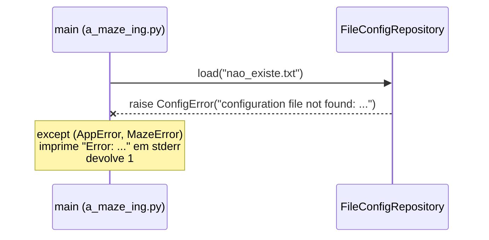

# Só o `main` trata

A barreira de erros ([página anterior](./05-a-barreira-de-erros.md)) é um `try` que fica no
`main`, no topo do programa. Nenhuma outra classe trata os erros que levanta: o `FileConfigRepository`,
o `GenerateMaze` e o gerador só os deixam subir. Esta página explica por que a decisão fica num
lugar só e mostra os erros que o `main` já conhece.

## Por que só o `main` trata

Uma exceção levantada lá no fundo **sobe** de função em função até alguém tratá-la. Um arquivo
de configuração inexistente percorre este caminho:



No diagrama de sequência, o tempo corre de cima para baixo. A seta cheia (`->>`) é uma chamada:
o `main` chama o `load`. A seta tracejada com um `x` na ponta (`--x`) é a exceção voltando: o
`load` não devolve nada, levanta o erro, e quem o recebe é o `main`.

Cada camada levanta o seu erro com a mensagem completa (ela sabe o que deu errado: qual arquivo,
qual linha, qual chave) e **não** o trata. Só o `main` decide o que mostrar e com qual código
sair. Os motivos:

- **Uma decisão, um lugar.** "Imprimir `Error: ` e a mensagem em stderr, e sair com 1" fica
  escrito uma vez. Se cada camada tratasse os próprios erros, a mesma decisão se repetiria em
  vários arquivos, e um dia eles divergiriam. (O aviso do "42" também começa com `Error:`, mas
  não encerra o programa; por isso o `Menu` o imprime direto, sem passar pelo `main`;
  [página 1](./01-o-laco-do-menu.md).)
- **Só a borda sabe que é um programa de terminal.** O `main` e o `Menu` são as únicas peças
  que conversam com o terminal. O `mazegen` é usado por outros projetos,
  que podem querer tratar um `MazeError` de outro jeito (mostrar numa janela, tentar outro
  tamanho). Se o gerador imprimisse e encerrasse o programa sozinho, ninguém poderia reutilizá-lo.
- **Só o topo pode pegar tudo.** O `except Exception` pega qualquer erro, inclusive defeitos do
  próprio código. Numa camada de baixo, ele esconderia o defeito e deixaria o programa seguir
  num estado errado. No `main`, a última parada antes do usuário, ele só troca o traceback por
  uma linha clara e encerra.

## Erros conhecidos: `AppError` e `MazeError`

`AppError` é a base dos erros da aplicação: `ConfigError` (arquivo de configuração ruim) e
`OutputError` (arquivo de saída que não grava) herdam dela
([parte 10](../10-utilitarios/05-a-hierarquia-app-error.md)). `MazeError` é o erro do gerador
([parte 4](../04-value-objects/01-maze-error.md)). Quem os levanta já escreve a mensagem
completa; o `main` só acrescenta `Error: ` na frente:

```text
Error: configuration file not found: nao_existe.txt
Error: cannot read configuration file pasta_config: Is a directory
Error: largura_zero.txt: WIDTH must be between 1 and 100, got 0
```

Todos terminam com **código de saída** 1, o número que diz ao sistema "deu erro"
([página 2](./07-o-laco-do-run.md)).

O formato `Error: <causa>`, na stderr e com código 1, é escolha do projeto; o enunciado só exige
uma mensagem clara. A mensagem vai para a **stderr**, a saída de erros, e não para a stdout, a
saída normal ([página 4](./03-mostrar-o-labirinto.md)): quem redireciona a stdout para um
arquivo continua vendo o erro na tela.

O `try` cobre também o laço do menu. Uma regeneração (a opção `1`) que falha ao gravar o arquivo
de saída (a pasta sem permissão de escrita, o disco cheio) termina o programa do mesmo jeito, no
meio da sessão, com código 1. A mensagem é a mesma de uma falha na primeira geração, como esta,
com o `OUTPUT_FILE` dentro da pasta `trancado/`, sem permissão de escrita (o exemplo da
[parte 12](../12-geracao-e-saida/05-gravando-o-arquivo.md), que a
[página 10](./09-o-programa-rodando.md) roda com o programa pronto):

```text
Error: cannot write output file 'trancado/maze.txt': Permission denied
```

## O resto do `try`

Os outros dois `except`, o de Ctrl+C e fim da entrada e o de qualquer outro erro, e a ordem
em que os `except` aparecem estão na [próxima página](./06-saidas-e-erros-inesperados.md),
junto com o arquivo completo.
