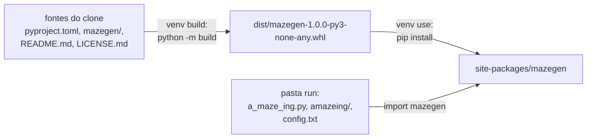

# Reconstruir o pacote

Os dois arquivos do pacote na raiz, `mazegen-1.0.0-py3-none-any.whl` e
`mazegen-1.0.0.tar.gz`, precisam ser gerados **depois** do README final.

## Por que de novo

O `pyproject.toml` declara `readme = "README.md"`: o build copia o README inteiro para os
metadados do pacote (o arquivo `METADATA` do wheel e o `PKG-INFO` do sdist). Um wheel gerado
antes do README final carrega o README antigo. O mesmo vale para qualquer mudança no `mazegen/`
depois do último build: o wheel na raiz precisa ser exatamente o código entregue.

## `make build`

Na raiz do projeto:

```bash
make build
```

A regra apaga `dist/`, roda `python -m build` (que gera o sdist e o wheel num ambiente isolado,
baixando o `setuptools`) e copia os dois arquivos para a raiz. O fim da saída:

```text
adding 'mazegen-1.0.0.dist-info/licenses/LICENSE.md'
adding 'mazegen-1.0.0.dist-info/METADATA'
adding 'mazegen-1.0.0.dist-info/WHEEL'
adding 'mazegen-1.0.0.dist-info/top_level.txt'
adding 'mazegen-1.0.0.dist-info/RECORD'
removing build/bdist.macosx-26.0-arm64/wheel
Successfully built mazegen-1.0.0.tar.gz and mazegen-1.0.0-py3-none-any.whl
cp dist/mazegen-*.whl dist/mazegen-*.tar.gz .
```

O nome da pasta temporária `build/bdist...` muda com o sistema; o resto é igual. A saída não
pode ter nenhuma linha de `warning`.

## Conferir o wheel

O wheel é um zip. A lista de arquivos mostra que só o `mazegen` entrou:

```bash
unzip -l mazegen-1.0.0-py3-none-any.whl
```

```text
mazegen/__init__.py
mazegen/errors.py
mazegen/generator.py
mazegen/py.typed
mazegen/entities/__init__.py
mazegen/entities/maze.py
mazegen/services/__init__.py
mazegen/services/braider.py
mazegen/services/carver.py
mazegen/services/solver.py
mazegen/value_objects/__init__.py
mazegen/value_objects/cell.py
mazegen/value_objects/direction.py
mazegen/value_objects/pattern42.py
mazegen-1.0.0.dist-info/licenses/LICENSE.md
mazegen-1.0.0.dist-info/METADATA
mazegen-1.0.0.dist-info/WHEEL
mazegen-1.0.0.dist-info/top_level.txt
mazegen-1.0.0.dist-info/RECORD
```

(A saída do `unzip` tem também tamanhos e datas; aqui ficaram só os nomes.) Nada de
`amazeing/`, `a_maze_ing.py` ou `config.txt`: a aplicação não faz parte do módulo reutilizável.

O README novo está nos metadados:

```bash
unzip -p mazegen-1.0.0-py3-none-any.whl mazegen-1.0.0.dist-info/METADATA | sed -n '12,14p'
```

```text
*This project has been created as part of the 42 curriculum by macoelho.*

# A-Maze-ing
```

## O roteiro da avaliação

O subject avisa que, na avaliação, o pacote será reconstruído a partir dos fontes, num
virtualenv. O roteiro completo, de um clone limpo, usa um venv para construir e **outro** para
usar, e roda o programa numa pasta sem o código-fonte do `mazegen`:

```bash
T=$(mktemp -d)
python3 -m venv "$T/build"
"$T/build/bin/python" -m pip install build
"$T/build/bin/python" -m build
python3 -m venv "$T/use"
"$T/use/bin/python" -m pip install dist/mazegen-1.0.0-py3-none-any.whl
mkdir "$T/run"
cp -R a_maze_ing.py amazeing config.txt "$T/run/"
cd "$T/run"
"$T/use/bin/python" a_maze_ing.py config.txt
"$T/use/bin/python" -c 'import mazegen; print(mazegen.__file__)'
```



- `python3` precisa ser 3.10 ou posterior. Com um Python mais antigo, o `pip install` recusa o
  wheel (`requires a different Python`), porque o `pyproject.toml` declara
  `requires-python = ">=3.10"`.
- A pasta `$T/run` não tem `mazegen/`. O `import mazegen` do programa só funciona porque o
  wheel foi instalado no venv `use`, e a última linha imprime um caminho dentro de
  `site-packages`.
- `amazeing/` vai junto com o script, porque a aplicação não está no pacote. Sem ela, o
  programa termina com `ModuleNotFoundError: No module named 'amazeing'`, antes mesmo de o
  `main` começar.
- O mesmo roteiro funciona com `dist/mazegen-1.0.0.tar.gz` no lugar do wheel: o `pip` constrói
  o wheel a partir do sdist e instala.

O labirinto aparece, a opção `4` sai com código 0, e o `maze.txt` gravado em `$T/run` passa no
`maze_analyzer.py` do subject.

## Limpar

O build deixa `dist/` e `mazegen.egg-info/` na raiz. Os dois estão no `.gitignore` e
`make clean` os apaga; o que fica versionado são só os dois arquivos copiados para a raiz.
