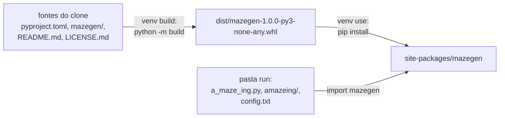

# O roteiro da avaliação

Na avaliação, o pacote `mazegen` não é aceito só porque está na raiz do repositório: ele é
reconstruído a partir dos fontes e instalado num ambiente separado, onde o programa precisa
rodar com ele. Esta página mostra esse roteiro, para você fazer o mesmo antes da entrega.

## O teste

O enunciado avisa que, na avaliação, o pacote será reconstruído: "em um virtualenv ou
equivalente, instalar as ferramentas necessárias e reconstruir o pacote a partir dos seus
fontes". A **folha de avaliação** (a lista de perguntas que o avaliador segue durante a defesa
do projeto) detalha o teste: o aluno reconstrói o pacote num ambiente
virtual; depois, num **outro** ambiente virtual, instala o pacote recém-criado e roda o
`a_maze_ing.py` com o seu arquivo de configuração.

Um **ambiente virtual** (*virtualenv*, ou *venv*) é uma pasta com um Python e as bibliotecas de
um projeto só, separados do resto do computador
([parte 3](../03-ambiente/01-o-ambiente-virtual.md)). Usar dois, um para construir e outro para
usar, prova que o pacote funciona sozinho: o segundo ambiente nunca viu os fontes do `mazegen`.

O roteiro roda numa cópia limpa do repositório: o clone `entrega` feito na
[página anterior](./09-enviar-e-conferir.md), com `git clone`. Dentro da pasta `entrega`:

```bash
A="$PWD/../maze_analyzer.py"
T=$(mktemp -d)
python3 -m venv "$T/build"
"$T/build/bin/python" -m pip install build
"$T/build/bin/python" -m build
python3 -m venv "$T/use"
"$T/use/bin/python" -m pip install dist/mazegen-1.0.0-py3-none-any.whl
mkdir "$T/run"
cp -R a_maze_ing.py amazeing config.txt "$T/run/"
cd "$T/run"
printf '4\n' | "$T/use/bin/python" a_maze_ing.py config.txt
"$T/use/bin/python" "$A" maze.txt | tail -n 1
"$T/use/bin/python" -c 'import mazegen; print(mazegen.__file__)'
cd -
rm -rf "$T"
```

Linha por linha:

1. Guarda na variável `A` o caminho do `maze_analyzer.py`, o verificador que vem com o enunciado.
   Ele fica na pasta acima do projeto ([parte 16](../16-bonus/03-conferir-com-o-analyzer.md)),
   que é também a pasta acima do clone `entrega`. O `$PWD` é a pasta atual, escrita por
   extenso: guardar o caminho agora deixa usá-lo depois do `cd`.
2. `mktemp -d` cria uma pasta temporária vazia e imprime o caminho dela; `T=$(...)` guarda esse
   caminho na variável `T`. Daqui em diante, `"$T"` é essa pasta.
3. `python3 -m venv "$T/build"` cria o primeiro ambiente virtual, `build`.
4. Instala nele a ferramenta `build`. O `"$T/build/bin/python"` é o Python desse ambiente:
   chamá-lo pelo caminho dispensa "ativar" o ambiente.
5. `python -m build` lê o `pyproject.toml` da pasta atual (o clone) e gera o wheel e o sdist em
   `dist/`.
6. Cria o segundo ambiente, `use`.
7. Instala nele o wheel recém-gerado, com `pip install`.
8. Cria a pasta `run`, onde o programa vai rodar.
9. Copia para ela o programa (`a_maze_ing.py`), a pasta da aplicação (`amazeing/`) e o
   `config.txt`; o `-R` do `cp` copia pastas com tudo o que há dentro. A pasta `mazegen/`
   **não** vai.
10. Entra na pasta `run`.
11. Roda o programa com o Python do ambiente `use`. O `printf '4\n' |` entrega ao menu a resposta
    `4`, como se alguém a digitasse: o labirinto aparece, e a opção `4` sai.
12. Roda o verificador sobre o `maze.txt` que o programa acabou de gravar; o `tail -n 1` mostra
    só a última linha, o veredito.
13. Mostra de onde o `import mazegen` veio.
14. `cd -` volta para a pasta anterior (o clone `entrega`) e imprime o caminho dela.
15. `rm -rf "$T"` apaga a pasta temporária com os dois ambientes.

A linha 13 imprime um caminho dentro do ambiente `use` (no terminal, o `$T` aparece trocado pelo
caminho real da pasta temporária); o `cd -` da linha 14 também imprime um caminho, o do clone:

```text
$T/use/lib/python3.15/site-packages/mazegen/__init__.py
```

O `site-packages` é a pasta do ambiente virtual onde o `pip` instala os pacotes; o `python3.15`
muda conforme a versão do Python. Como a pasta `run` não tem `mazegen/`, o programa só funciona
porque o wheel foi instalado no ambiente `use`.



O que pode dar errado:

- **Python antigo.** O `python3` precisa ser 3.10 ou mais novo. Com um Python anterior, o
  `pip install` recusa o wheel com `requires a different Python`, porque o `pyproject.toml`
  declara `requires-python = ">=3.10"`.
- **Faltou a aplicação.** A pasta `amazeing/` precisa ir junto com o script, porque a aplicação
  não está no pacote. Sem ela, o programa termina com
  `ModuleNotFoundError: No module named 'amazeing'` antes mesmo de o `main` começar.

O mesmo roteiro funciona com `dist/mazegen-1.0.0.tar.gz` no lugar do wheel: o `pip` monta o
wheel a partir do sdist e o instala.

A linha 12 mostra o veredito do verificador sobre o `maze.txt` gravado em `$T/run`; ele começa
com `Verdict: Pac-Man-USABLE`, porque o `config.txt` pede `PERFECT=False`. No terminal, ele sai
na mesma linha do prompt `Choice? (1-4): `: a resposta `4` veio pelo `printf`, e ninguém a
digitou para o terminal mostrar a quebra de linha
([parte 16](../16-bonus/03-conferir-com-o-analyzer.md) explica o relatório).

## Limpar

O build deixa as pastas `dist/` e `mazegen.egg-info/` dentro do clone `entrega`, não no seu
projeto. A pasta temporária `$T` já foi apagada no fim do bloco. Terminado o roteiro, apague o
clone inteiro, a partir da pasta onde ele foi criado:

```bash
rm -rf entrega
```
