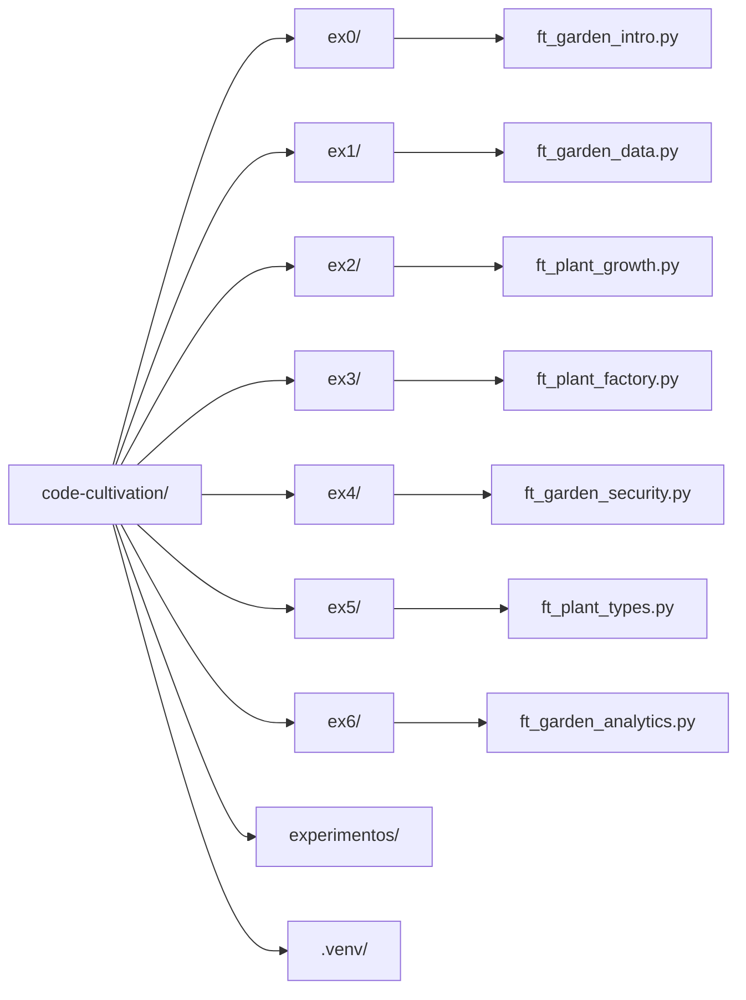

# A pasta do projeto

Cada exercício é um arquivo próprio, dentro de uma pasta com o número do exercício: `ex0/`, `ex1/`,
até `ex6/`. Crie uma pasta para o projeto, entre nela e crie as sete pastas:

```bash
mkdir code-cultivation
cd code-cultivation
mkdir ex0 ex1 ex2 ex3 ex4 ex5 ex6
```

O nome `code-cultivation` é só uma sugestão; o que o enunciado fixa são as pastas `ex0` a `ex6`
e os nomes dos arquivos. **Todos os comandos são rodados a partir desta pasta**, a
`code-cultivation`.

Crie também uma pasta `experimentos`, para os programas pequenos que mostram cada ideia nova
antes de ela entrar num exercício. Eles não fazem parte da entrega:

```bash
mkdir experimentos
```

Ao fim do projeto, a pasta fica assim:



A pasta `.venv/` é criada em [O ambiente virtual](./03-o-ambiente-virtual.md). Só os sete arquivos
`.py` das pastas `ex0` a `ex6` são entregues.

## Cada exercício é um arquivo completo

Os exercícios evoluem a mesma classe `Plant`: o exercício 2 parte da classe do 1, o 3 parte da
do 2, e assim por diante. Mesmo assim, **cada arquivo é independente**: ele traz a sua própria
cópia da classe, do jeito que ela está naquele exercício, e roda sozinho.

Isso é escolha do projeto, com duas bases no enunciado: cada exercício "deve conter as definições
solicitadas e todo o código exigido", e *imports* ficam para um projeto futuro. Outra opção seria
importar a classe do exercício anterior; aí um arquivo deixaria de rodar sozinho, e uma mudança
no exercício 1 mudaria todos os seguintes.
