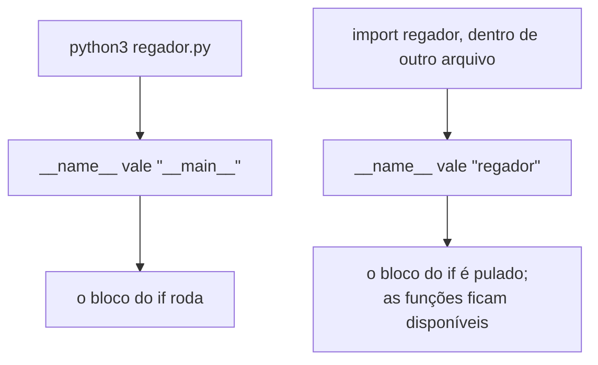

# O ponto de partida

Um arquivo `.py` tem dois usos. Ele pode ser rodado diretamente, com `python3 arquivo.py`: nesse
uso ele é um **script**, o programa principal. Ou ele pode ser **importado** por outro arquivo,
para que o outro use as funções e classes dele: nesse uso ele é um **módulo**. O mesmo arquivo
serve aos dois usos, e o bloco `if __name__ == "__main__":` (o **bloco main**) separa o código
que só deve rodar no primeiro.

## A variável `__name__`

Ao carregar um arquivo, o Python cria nele uma variável chamada `__name__` (com dois `_` de cada
lado). O valor dela diz como o arquivo foi carregado:

- no arquivo rodado diretamente, `__name__` vale o texto `"__main__"`;
- num arquivo importado, `__name__` vale o nome usado no `import`: para `import regador`,
  `"regador"`, o nome do arquivo sem o `.py`.

## Um experimento com dois arquivos

Crie `experimentos/regador.py`, um módulo com uma função e um bloco main:

```python title="experimentos/regador.py"
def water() -> None:
    print("Watering the garden")


print(f"regador.py: __name__ = {__name__}")

if __name__ == "__main__":
    print("regador.py é o programa principal")
    water()
```

E `experimentos/jardineiro.py`, que importa o primeiro:

```python title="experimentos/jardineiro.py"
import regador

print(f"jardineiro.py: __name__ = {__name__}")
regador.water()
```

- `import regador` carrega o arquivo `regador.py` da mesma pasta, rodando o que estiver nele;
- `regador.water()` chama a função `water` que está dentro de `regador`.

Rodando o `regador.py` diretamente:

```bash
python3 experimentos/regador.py
```

```text
regador.py: __name__ = __main__
regador.py é o programa principal
Watering the garden
```

O `__name__` vale `__main__`, então o bloco do `if` roda. Rodando o `jardineiro.py`:

```bash
python3 experimentos/jardineiro.py
```

```text
regador.py: __name__ = regador
jardineiro.py: __name__ = __main__
Watering the garden
```

O `import` rodou o `regador.py`, mas lá o `__name__` vale `regador`, e o bloco do `if` **não**
rodou: a frase "é o programa principal" não aparece. A função `water` continuou disponível, e o
`jardineiro.py` a chamou.



O `import` também cria uma pasta `experimentos/__pycache__`, onde o Python guarda uma versão
pré-processada do módulo importado para carregá-lo mais rápido da próxima vez. Ela pode ser
apagada à vontade.

## Por que isso importa

O enunciado pede que você saiba explicar por que esse bloco é importante. Sem o `if`, todo o
código de demonstração de um arquivo rodaria também quando outro arquivo o importasse só para
usar uma função ou uma classe. Com o `if`, o arquivo pode ser as duas coisas: um programa que se
demonstra quando rodado, e um módulo que só oferece o seu código quando importado.

O exercício 0 exige o bloco. Nos exercícios seguintes, o enunciado só o permite, e usá-lo em
todos é escolha do projeto: a demonstração fica separada das classes, e o
[exercício 4](../06-ex4/08-rodar-e-conferir.md) importa a classe sem rodar a demonstração. Os
próximos projetos do curso usam *imports* de verdade.
