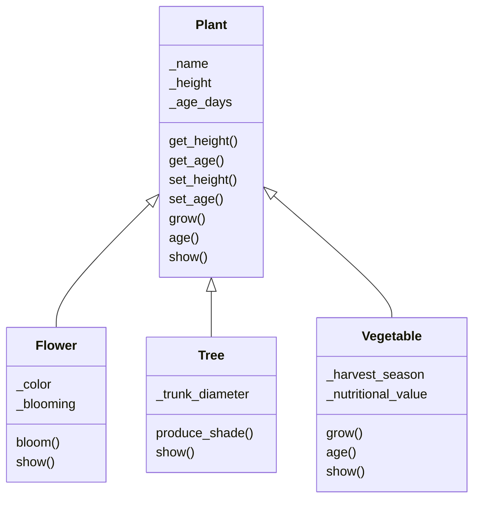

# Herança

**Herança** é criar uma classe a partir de outra: a classe nova recebe tudo o que a outra tem,
atributos e métodos, e acrescenta ou troca o que quiser. A classe de onde se herda é a **classe
pai** (ou classe base); a nova é a **classe filha**. A relação se lê como "é um": uma flor **é
uma** planta, com algo a mais.

A herança se escreve com o nome da classe pai entre parênteses, depois do nome da filha:

```python
class Flower(Plant):
    pass
```

O corpo, por enquanto, é só o `pass` do [exercício 1](../03-ex1/02-classe-e-objeto.md): mesmo
sem nenhuma linha própria, `Flower` já tem tudo de `Plant`.

## Um experimento

```python title="experimentos/heranca.py"
class Plant:
    def __init__(self, name: str) -> None:
        self._name = name

    def show(self) -> None:
        print(f"Plant: {self._name}")

    def water(self) -> None:
        print(f"Watering {self._name}")


class Flower(Plant):
    def show(self) -> None:
        print(f"Flower: {self._name}")


rose = Flower("Rose")
rose.water()
rose.show()
oak = Plant("Oak")
oak.show()
```

```bash
python3 experimentos/heranca.py
```

```text
Watering Rose
Flower: Rose
Plant: Oak
```

- `Flower` não escreveu `__init__` nem `water`, e mesmo assim `Flower("Rose")` funcionou e
  `rose.water()` regou a rosa: os dois vieram de `Plant`;
- `Flower` escreveu o seu próprio `show`, e `rose.show()` usou o da flor. Escrever na filha um
  método com o mesmo nome de um método da classe pai se chama **sobrescrever** (*override*): para
  os objetos da filha, vale o método da filha;
- a classe pai não muda: `oak`, uma `Plant`, continua com o `show` de planta;
- a filha usa `self._name`, o atributo protegido da classe pai. Era isso que a convenção
  protected do [exercício 4](../06-ex4/02-encapsulamento.md) prometia: interno à classe **e às
  filhas**.

Ao procurar um nome num objeto (`rose.show`), o Python olha primeiro o próprio objeto, depois a
classe dele e, se não achar, sobe para a classe pai.

## A família do jardim



As setas apontam da classe filha para a classe pai. Cada filha lista só o que acrescenta ou
sobrescreve; o resto vem de `Plant`.
