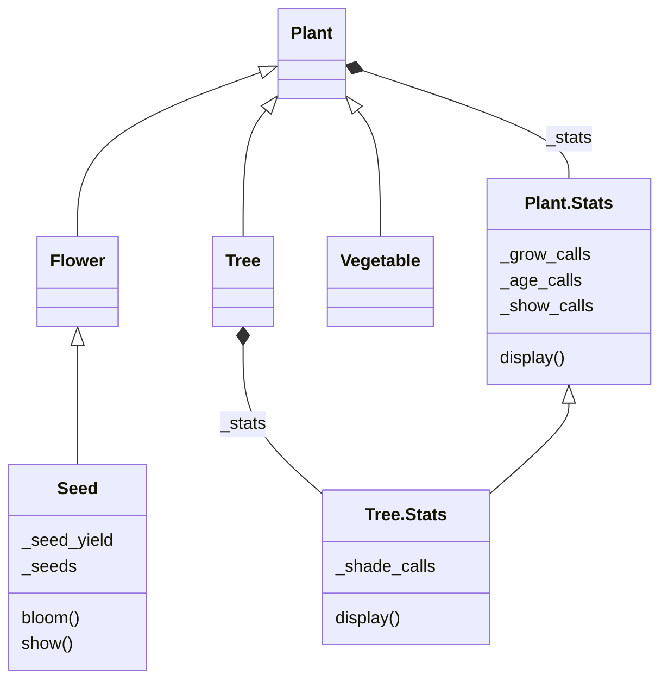

# Seed

Uma `Seed` é uma flor que, depois de florescer, dá sementes. Ela herda de `Flower`, que por sua
vez herda de `Plant`: uma **cadeia de herança**. Uma `Seed` é uma flor, e
uma flor é uma planta, então uma `Seed` tem tudo de `Flower` e tudo de `Plant`.



As setas vazadas são herança; as setas com losango ligam cada planta ao objeto de estatísticas
que ela guarda no atributo `_stats`.

## A classe

```python
class Seed(Flower):
    def __init__(
        self, name: str, height: float, age_days: int, color: str,
        seed_yield: int
    ) -> None:
        super().__init__(name, height, age_days, color)
        self._seed_yield = seed_yield
        self._seeds = 0

    def bloom(self) -> None:
        super().bloom()
        self._seeds = self._seed_yield

    def show(self) -> None:
        super().show()
        print(f" Seeds: {self._seeds}")
```

- `super().__init__` aqui é o construtor de `Flower`, que por sua vez chama o de `Plant`: cada
  classe da cadeia cuida dos seus dados;
- `_seed_yield` ("rendimento") é quantas sementes a flor vai dar; `_seeds` é quantas ela tem
  agora, e começa em 0;
- `bloom()` faz a flor florescer, pelo `bloom()` de `Flower`, e só então guarda as sementes.
  Antes de florescer, a flor não tem semente nenhuma;
- `show()` imprime tudo o que uma flor imprime e acrescenta a linha das sementes.

## Quantas sementes

Esta é uma escolha do projeto. O enunciado pede que a `Seed` guarde o número de sementes depois
de florescer, e a saída mostra `0` antes e `42` depois. O número vem no construtor
(`Seed("Sunflower", 80.0, 45, "yellow", 42)`), e cada girassol pode render quantas sementes o
programa disser.

Outras opções seriam um número fixo dentro de `bloom()`, igual para todas as sementes, ou um
parâmetro obrigatório em `bloom()`. A segunda mudaria a assinatura do método herdado de
`Flower`, e o mypy recusaria a troca: quem chama `bloom()` numa flor qualquer não passa argumento
nenhum.

## Uma contagem só, com três show()

`Seed.show()` chama `Flower.show()`, que chama `Plant.show()`. Só `Plant.show()` conta a chamada,
então um `show()` num girassol conta **um**, e não três: a saída mostra `2 show` depois de dois
`show()`.

## No programa

```python
    print("=== Seed")
    sunflower = Seed("Sunflower", 80.0, 45, "yellow", 42)
    sunflower.show()
    print("[make sunflower grow, age and bloom]")
    sunflower.grow(30.0)
    sunflower.age(20)
    sunflower.bloom()
    sunflower.show()
    display_stats(sunflower)
```

`display_stats` é a [função de estatísticas](./07-a-funcao-de-estatisticas.md).
