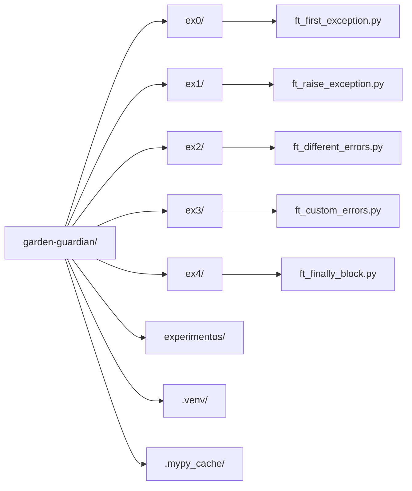

# A pasta do projeto

O enunciado pede cada exercício num arquivo próprio, dentro de uma pasta com o número do
exercício: `ex0/`, `ex1/`, até `ex4/`. Crie uma pasta para o projeto, entre nela e crie as cinco
pastas:

```bash
mkdir garden-guardian
cd garden-guardian
mkdir ex0 ex1 ex2 ex3 ex4
```

O nome `garden-guardian` é só uma sugestão; o que o enunciado fixa são as pastas `ex0` a `ex4` e
os nomes dos arquivos. **Todos os comandos do tutorial são rodados a partir desta pasta**, a
`garden-guardian`.

Crie também uma pasta `experimentos`, para os programas pequenos que a parte
[O que é uma exceção](../02-excecoes/01-o-programa-que-trava.md) usa para mostrar cada ideia.
Eles não fazem parte da entrega:

```bash
mkdir experimentos
```

Ao fim do projeto, a pasta fica assim:



A pasta `.venv/` é criada na [próxima página](./03-o-ambiente-virtual.md), e a `.mypy_cache/`
aparece sozinha na primeira vez que o mypy roda: é onde ele guarda resultados para ir mais rápido
na conferência seguinte. Só os cinco arquivos
`.py` das pastas `ex0` a `ex4` são entregues.
