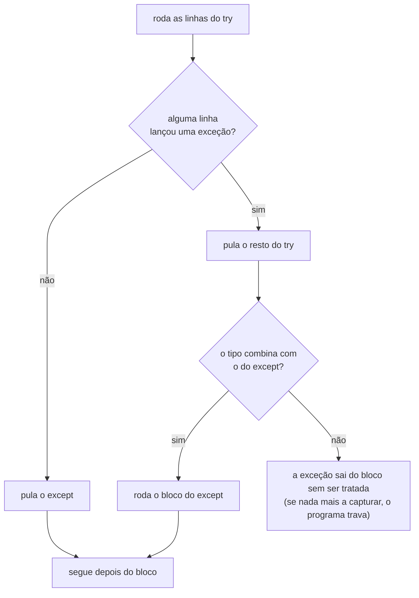

# try e except

Para o programa não travar, o código que pode falhar vai dentro de um bloco `try` ("tente"), e o
que fazer em caso de erro vai num bloco `except` ("exceto se"). Crie
`experimentos/captura.py`:

```python
print("Before the error")
try:
    temperature = int("abc")
    print("This line is skipped")
except ValueError as error:
    print(f"Caught: {error}")
print("After the error")
```

```bash
python3 experimentos/captura.py
echo $?
```

```text
Before the error
Caught: invalid literal for int() with base 10: 'abc'
After the error
0
```

Agora o programa chega ao fim e termina com código `0`. Linha por linha:

1. `try:` abre o bloco protegido. As linhas recuadas abaixo dele rodam normalmente.
2. `int("abc")` lança um `ValueError`. Nesse instante, o resto do bloco `try` é **pulado**: o
   `print("This line is skipped")` nunca roda.
3. O Python procura um `except` que aceite aquele tipo de erro. `except ValueError` aceita, então
   o bloco dele roda. (O `as error` e o `{error}` mostram a mensagem do erro; a
   [próxima página](./04-a-mensagem-do-erro.md) os explica.)
4. Depois do `except`, o programa segue na linha seguinte ao bloco inteiro, o
   `print("After the error")`.

Se nada der errado dentro do `try`, o bloco `except` é simplesmente ignorado.



## O tipo no except importa

`except ValueError` só captura erros do tipo `ValueError` (e dos tipos que são casos
particulares dele, os seus "filhos"; a página [Os tipos embutidos](./06-os-tipos-embutidos.md)
mostra essa família de tipos). Uma divisão por zero dentro
desse `try` lançaria outro tipo de erro, que esse `except` não aceitaria, e o programa travaria
do mesmo jeito.

Esse cuidado é proposital: capturar só o erro que você **espera** deixa os erros inesperados
aparecerem, em vez de escondê-los.
