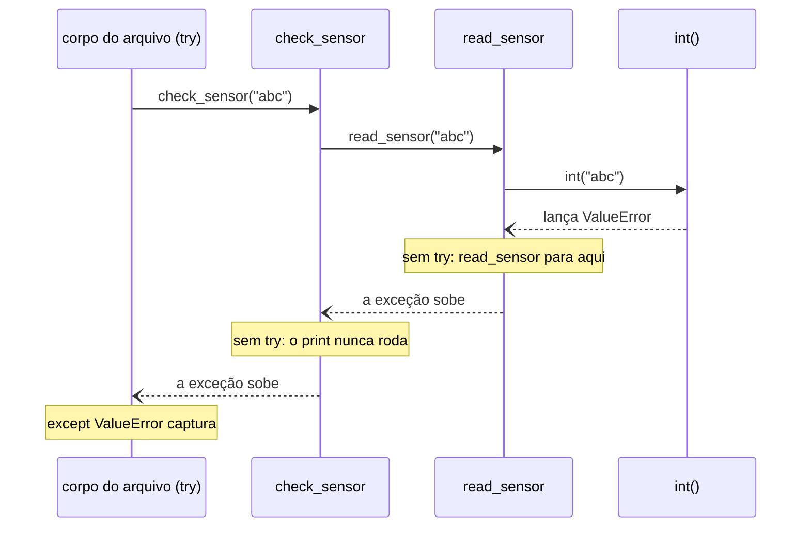

# A exceção sobe

Nos exercícios, o erro acontece **dentro de uma função** (por exemplo, o `int()` dentro de
`input_temperature`) e é capturado **em outra** (a `test_temperature`, que a chamou). Isso
funciona porque uma exceção não tratada sobe de função em função até achar um `except`.

Crie `experimentos/sobe.py`, com uma função chamando outra e nenhum `try`:

```python
def read_sensor(text: str) -> int:
    return int(text)


def check_sensor(text: str) -> None:
    value = read_sensor(text)
    print(f"Sensor value: {value}")


check_sensor("abc")
```

```bash
python3 experimentos/sobe.py
```

```text
Traceback (most recent call last):
  File "/…/garden-guardian/experimentos/sobe.py", line 10, in <module>
    check_sensor("abc")
    ~~~~~~~~~~~~^^^^^^^
  File "/…/garden-guardian/experimentos/sobe.py", line 6, in check_sensor
    value = read_sensor(text)
  File "/…/garden-guardian/experimentos/sobe.py", line 2, in read_sensor
    return int(text)
ValueError: invalid literal for int() with base 10: 'abc'
```

O traceback agora tem três pares de linhas, um por função que estava em andamento, do mais
antigo para o mais recente: o corpo do arquivo chamou `check_sensor` (linha 10), que chamou
`read_sensor` (linha 6), onde o `int()` falhou (linha 2).

As marcas `~` e `^` sublinham o trecho da linha que estava rodando quando a exceção passou por
ali: na linha 10, a chamada `check_sensor("abc")`, com os `^` sob os argumentos. Elas existem a
partir do Python 3.11 e não aparecem em toda linha. Esta é a saída do 3.15 (e do 3.13 e do 3.14);
no 3.11 e no 3.12, as marcas ficam sob as linhas 6 e 2, e não sob a 10; no 3.10, não há marca
nenhuma. O que importa para ler o traceback são os pares de arquivo, linha e função.

## Capturar mais acima

Basta um `try` em volta da chamada lá de cima. Crie `experimentos/sobe_captura.py`: as duas
funções são as mesmas, e só a última parte muda:

```python
def read_sensor(text: str) -> int:
    return int(text)


def check_sensor(text: str) -> None:
    value = read_sensor(text)
    print(f"Sensor value: {value}")


try:
    check_sensor("abc")
except ValueError as error:
    print(f"Caught at the top: {error}")
```

```bash
python3 experimentos/sobe_captura.py
```

```text
Caught at the top: invalid literal for int() with base 10: 'abc'
```

O caminho da exceção:



Cada função interrompida pelo caminho para na linha onde estava: o
`print(f"Sensor value: {value}")` nunca roda. Quem captura decide o que fazer e o programa
continua a partir dali.

É exatamente o desenho dos exercícios: uma função faz o trabalho e pode falhar; outra, a de
teste, chama a primeira dentro de um `try` e mostra o erro.
