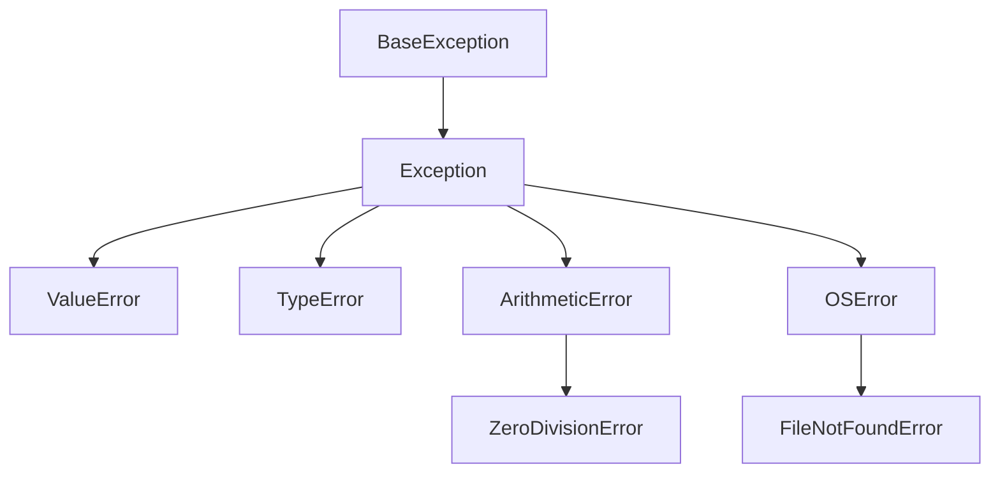

# Os tipos embutidos

O Python já vem com dezenas de tipos de exceção, as **exceções embutidas** (*built-in*). Cada
uma descreve um tipo de problema. O enunciado pede que elas sejam usadas do jeito certo, com
cada erro no tipo que combina com ele. Estas são as que o projeto usa (`open()`, na linha do
`FileNotFoundError`, é a função que abre um arquivo; o
[exercício 2](../05-ex2/02-garden-operations.md) a explica):

| Tipo | Quando o Python o lança | Exemplo |
|---|---|---|
| `ValueError` | um valor do tipo certo, mas com conteúdo inválido | `int("abc")` |
| `ZeroDivisionError` | uma divisão por zero | `1 / 0` |
| `FileNotFoundError` | abrir para leitura um arquivo que não existe | `open("/non/existent/file")` |
| `TypeError` | uma operação entre tipos que não combinam | `"abc" + 5` (texto mais número) |

## Os tipos formam uma árvore

Cada tipo de exceção é uma **classe** (a exceção lançada é um objeto dessa classe), e cada
classe pode **herdar** de outra: herdar quer dizer "ser um
caso particular de". Um `ZeroDivisionError` é um caso particular de `ArithmeticError` (erro de
conta), que é um caso particular de `Exception`. As classes do projeto, com os seus "pais":



A seta vai do pai para o filho. No topo, `BaseException` é a base de todas; `Exception` é a base
de todos os erros comuns de um programa. `OSError` é o erro do sistema operacional (arquivos,
pastas, permissões), e um arquivo que não existe é um caso particular dele. Nas mensagens de
`OSError` e dos seus filhos, como a do experimento abaixo, `[Errno 2]` é o número que o sistema
dá a "arquivo ou pasta não encontrado".

## Um except também captura os filhos

`except X` captura as exceções do tipo `X` **e de todos os tipos abaixo dele** na árvore. Crie
`experimentos/geral.py`:

```python
try:
    1 / 0
except ArithmeticError as error:
    print(f"Caught by ArithmeticError: {error}")
try:
    open("/non/existent/file")
except OSError as error:
    print(f"Caught by OSError: {error}")
try:
    int("abc")
except Exception as error:
    print(f"Caught by Exception: {error}")
```

```bash
python3 experimentos/geral.py
```

```text
Caught by ArithmeticError: division by zero
Caught by OSError: [Errno 2] No such file or directory: '/non/existent/file'
Caught by Exception: invalid literal for int() with base 10: 'abc'
```

Nenhum dos três `except` cita o tipo exato do erro, e mesmo assim todos capturam: o
`ZeroDivisionError` pelo pai, `ArithmeticError`; o `FileNotFoundError` pelo pai, `OSError`; e o
`ValueError` por `Exception`, que fica acima de todos.

`except Exception` captura praticamente qualquer erro. É prático, mas esconde a diferença entre
os problemas: um erro inesperado seria tratado como se fosse o esperado. Por isso os exercícios
capturam o tipo **mais específico** que cobre os erros esperados: em geral o tipo exato, como
`ValueError`. No [exercício 3](../06-ex3/01-o-problema.md), a mesma regra da árvore permite
capturar de uma vez uma família de erros criada justamente para isso.
