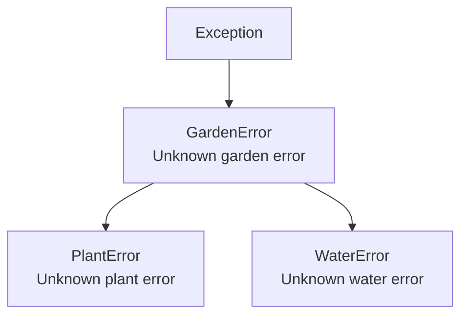

# A família de erros do jardim

O enunciado pede três classes: `GardenError`, a base, e duas filhas dela, `PlantError` e
`WaterError`.



Cada caixa tem o nome da classe e a sua mensagem padrão. O enunciado só dá o exemplo da
mensagem de planta; as outras duas seguem o mesmo modelo.

## A base

`GardenError` herda de `Exception` e tem o `__init__` e o `__str__` da
[página anterior](./04-o-metodo-str.md):

```python
class GardenError(Exception):
    def __init__(self, message: str = "Unknown garden error") -> None:
        self.message = message

    def __str__(self) -> str:
        return self.message
```

## As filhas

```python
class PlantError(GardenError):
    def __init__(self, message: str = "Unknown plant error") -> None:
        self.message = message


class WaterError(GardenError):
    def __init__(self, message: str = "Unknown water error") -> None:
        self.message = message
```

- `class PlantError(GardenError):` faz `PlantError` herdar de `GardenError`. Por tabela, ela
  também é uma `Exception`;
- cada filha escreve o **próprio** `__init__`, só para trocar a mensagem padrão;
- nenhuma filha escreve `__str__`: ela **herda** o da `GardenError`, que devolve `self.message`.
  Uma classe filha recebe todos os métodos da mãe que não reescreve.

O `__init__` de cada filha substitui o da mãe por completo e guarda a mensagem ele mesmo. Daria
para chamar o da mãe pelo nome, com `GardenError.__init__(self, message)`, que faz a mesma
atribuição; repetir a única linha `self.message = message` é mais simples.

## Por que herdar de GardenError

Uma `PlantError` **é** uma `GardenError`, assim como um `ZeroDivisionError` é um
`ArithmeticError`. A consequência prática está na [próxima página](./06-capturar-pela-base.md):
um único `except GardenError` captura as duas filhas.
