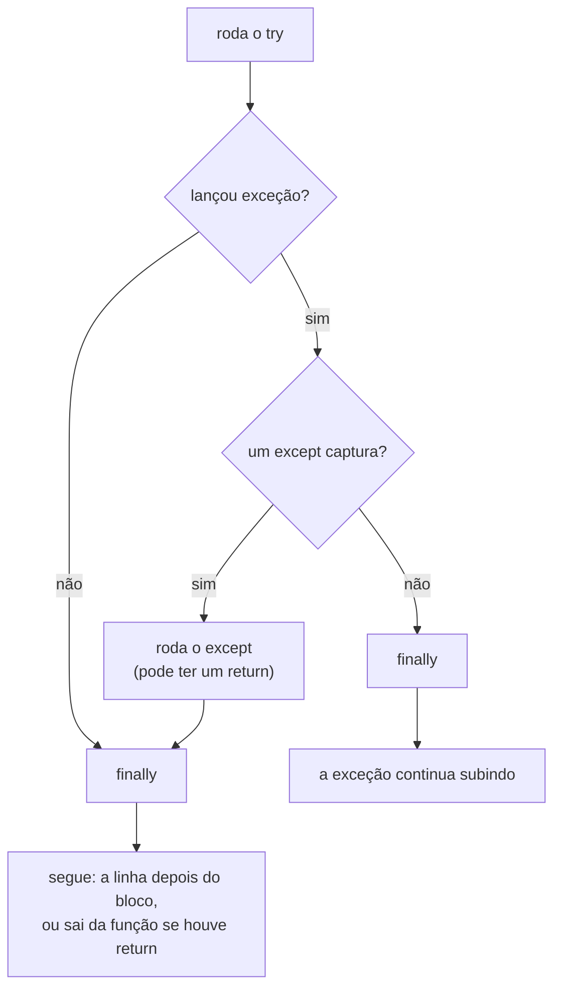

# finally

Um bloco `try` pode terminar com um bloco `finally` ("finalmente"). O que estiver nele roda
**sempre** que o `try` termina, seja qual for o motivo:

| Como o `try` terminou | O `finally` roda? |
|---|---|
| tudo deu certo | sim, depois do `try` |
| uma exceção foi capturada por um `except` | sim, depois do `except` |
| uma exceção não foi capturada | sim, e depois a exceção continua subindo |
| um `return` saiu da função no meio do `try` ou do `except` | sim, antes de a função sair |

O último caso é o que o exercício usa: o enunciado manda **voltar para o main** quando há erro,
e mesmo assim fechar o sistema. Um experimento, `experimentos/finally_demo.py`:

```python
def water() -> None:
    print("Opening")
    try:
        print("Working")
        return
    finally:
        print("Closing")


water()
print("Back in main")
```

```bash
python3 experimentos/finally_demo.py
```

```text
Opening
Working
Closing
Back in main
```

O `return` manda a função sair, mas antes de sair o Python roda o `finally`: `Closing` aparece
antes de `Back in main`.

## O caminho completo



Por isso o lugar do código de limpeza é o `finally`: escrito logo depois do bloco `try`, ele
seria pulado pelo `return` e por qualquer erro não capturado.
