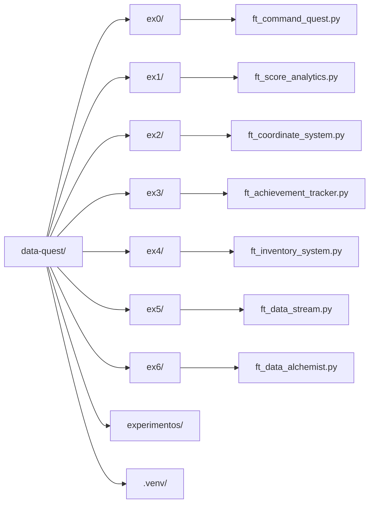

# A pasta do projeto

Cada exercício fica num arquivo próprio, dentro de uma pasta com o número do exercício: `ex0/`,
`ex1/`, até `ex6/`. Crie uma pasta para o projeto, entre nela e crie as sete pastas:

```bash
mkdir data-quest
cd data-quest
mkdir ex0 ex1 ex2 ex3 ex4 ex5 ex6
```

O nome `data-quest` é só uma sugestão; o que o enunciado fixa são as pastas `ex0` a `ex6` e os
nomes dos arquivos. **Todos os comandos daqui em diante são rodados a partir desta pasta**, a
`data-quest`.

Crie também uma pasta `experimentos`, para os programas pequenos que mostram cada ideia antes de
ela entrar num exercício. Eles não fazem parte da entrega:

```bash
mkdir experimentos
```

Ao fim do projeto, a pasta fica assim:



A pasta `.venv/` é criada em [O ambiente virtual](./03-o-ambiente-virtual.md). Só os sete arquivos
`.py` das pastas `ex0` a `ex6` são entregues.
